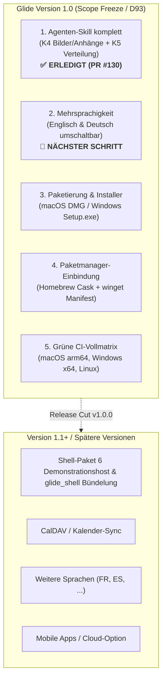

# Meilenstein- und Fahrplan: Glide Version 1.0

Stand 17.11.2026 · Glide 3.69.0 (Ziel: Glide 1.0.0) · Aufgabenformat 26 · Glide-System V1.39

Dieser Plan definiert den verbindlichen **Schnittpunkt (Feature Freeze / D93)** für die offizielle **Version 1.0 von Glide**, die als GitHub-Release veröffentlicht und über **Homebrew** (macOS) und **winget** (Windows) bereitgestellt wird. Er beantwortet die Frage, wo die Grenze gezogen wird, um endlosen Scope Creep zu verhindern.

Tracking-Issue: [GitHub Issue #129](https://github.com/n05a-design/glide-to-do/issues/129)

---

## 1. Strategischer Schnittpunkt: Was gehört in Version 1.0 (und was nicht)?

Um nicht endlos weiterzuentwickeln, wird der Umfang für **Version 1.0** strikt auf die Kernanforderungen für einen erstklassigen ersten öffentlichen Auftritt begrenzt.

### Der verbindliche Leistungsumfang (Must-Haves für v1.0)
1. **Vollständiger Agenten-Skill `glide-to-do` (✅ Abgeschlossen):**
   - K1–K3: Austauschformat 2, Labels, Vorsicherung, Markdown, Ordnerarten, Wiederholungen, Erinnerungen.
   - **K4 (Bilder & Anhänge):** ZIP-Container (`.glideexchange`/`.zip`), Zip-Slip-Schutz, Anhänge für Aufgaben/Listen/Ordner in `ATTACHMENTS_DIR`, Galerielisten, Seiten-Cover, Markdown-Bildauflösung, Export (`write_exchange_package`), Rollback-Bereinigung.
   - **K5 (Ökosystem & Verteilung):** `MANIFEST.json`, `VERTEILUNG.md`, Desktop-Menüaktion `export_agent_skill`, Workflow-Paketierung in GitHub Release-Assets (`glide-to-do-skill-v$VERSION.zip`).
2. **Mehrsprachigkeit (i18n: Deutsch & Englisch) (🎯 Nächster Schritt):**
   - Komplette App-Oberfläche umschaltbar: Automatisch (nach OS), Deutsch, Englisch.
   - Menüs (`desktop_adapter.py`), Werkzeugleiste, Seitenleiste, Kern-Dialoge, Einstellungen, Status- und Fehlermeldungen.
   - Modul `src/glide/i18n.py` (M100) im Glide-System (Standardbibliothek only, Modulbudget-konform).
3. **Plattformpakete & Installer:**
   - **macOS:** `.app`-Bundle, `.dmg` und `.tar.gz` (Ad-hoc signiert, arm64).
   - **Windows:** Inno-Setup-Installer `Glide-setup.exe` (Startmenü-Icon, saubere Deinstallation, AppUserModelID `Shaye.Glide`, unprivilegiert nach `%LOCALAPPDATA%\Programs\Glide`) + portable `.zip`.
4. **Paketmanager:**
   - **Homebrew:** Cask `packaging/homebrew/Casks/glide.rb` im Repository `n05a-design/homebrew-glide`.
   - **winget:** Manifeste `packaging/winget/manifests/s/Shaye/Glide/` für `winget install Shaye.Glide`.
5. **Qualität:**
   - Alle CI-Workflows 100 % grün (Linux-Vollprüfung, Windows x64, macOS arm64).

> [!IMPORTANT]
> **Was bewusst NICHT in Version 1.0 kommt (Post-1.0):**
> Tiefere interne Shell-Umbauten (Shell-Paket 6 Demonstrationshost, Namespace-Bündelung `glide_shell`), zusätzliche Sprachen jenseits DE/EN, externe Kalendersynchronisation (CalDAV) oder Plugin-Systeme werden bis nach Version 1.0 zurückgestellt.

---

## 2. Die vier Etappen bis zum Release v1.0

### Etappe 1: Agenten-Skill komplettieren (Paket K4 & K5) – ✅ ERLEDIGT
- **K4 (Bilder und Dateianhänge im Austausch):**
  - ZIP-Container-Erkennung mit Zip-Slip-Schutz (`inspect_exchange_archive`).
  - Physischer Import von Anhängen für Ordner, Listen, Aufgaben in `ATTACHMENTS_DIR`.
  - Galerielisten (`list_kind: "gallery"`), Cover (`cover`), Markdown-Bildauflösung.
  - Paketausgabe (`write_exchange_package`) und atomare Rollback-Bereinigung.
- **K5 (Verteilung):**
  - `MANIFEST.json` mit Hashes aller 18 Skill-Dateien.
  - `VERTEILUNG.md` für Claude Desktop, Cursor, Gemini CLI, Web-LLMs.
  - App-Menüfunktion `export_agent_skill`.
  - GitHub Actions Workflow packt Skill-ZIP mit Prüfsummen.
- **Nachweis:** Integrationstest T328 (`test_austausch_k4.py`, 9/9 OK), Werkzeugtest T321 (18/18 OK), PR #130 gemergt.

### Etappe 2: Mehrsprachigkeit (i18n: Deutsch / Englisch) – 🎯 NÄCHSTER SCHRITT
- **Architektur:**
  - Neues leichtgewichtiges Modul `src/glide/i18n.py` (M100) im Glide-System (Standardbibliothek only, Thread-sicher, Modulbudget max. 50 Zeilen je Funktion).
  - Strukturierte Übersetzungskataloge: `src/glide/resources/locales/de.json` und `src/glide/resources/locales/en.json`.
  - Robuster Aufruf: `t("menu.file", default="Datei")` mit Formatierungsunterstützung (`**kwargs`).
  - Einstellungsdialog: Dropdown zur Sprachauswahl (`Automatisch / System`, `Deutsch`, `English`), persistiert in `settings.json` als `language`.
- **Übersetzungsumfang für v1.0:**
  - Menüleiste (`desktop_adapter.py`) und Tastaturkürzel.
  - Seitenleiste (Listen, Ordner, Navigation, Systembereiche, Zähler).
  - Aktionsleisten, Knöpfe, Inspektoren und modale Bestätigungsdialoge.
  - Fehler- und Statusmeldungen, Undo-Toasts.
- **Qualitätssicherung:**
  - Neuer Test T329 (`test_i18n.py`): Prüft Schlüsselparität zwischen `de.json` und `en.json`, Platzhaltervalidierung und Umschaltungsverhalten.

### Etappe 3: Paketbau, Installer & Paketmanager-Vorbereitung – GEPLANT
- **macOS:**
  - DMG-Erzeugung in `.github/workflows/macos-paket.yml` verifizieren.
  - Homebrew-Cask `packaging/homebrew/Casks/glide.rb` auf v1.0 vorbereiten.
- **Windows:**
  - Inno-Setup-Skript `packaging/windows/glide_setup.iss` für unprivilegierte Installation nach `%LOCALAPPDATA%\Programs\Glide` und Startmenüeintrag.
  - Build-Schritt in `.github/workflows/windows-paket.yml` verankern.
  - winget-Manifest auf `InstallerType: inno` und v1.0 anpassen.

### Etappe 4: Release Cut, GitHub-Release & Veröffentlichung – GEPLANT
- **Versionierung:**
  - Anheben der Version auf `1.0.0` (über `scripts/pflege/versionswechsel.py 1.0.0 <datum>`).
  - GitHub Actions `release.yml` baut automatisch alle Artefakte und berechnet SHA-256-Hashes.
- **Veröffentlichung:**
  - GitHub Release veröffentlichen.
  - PR an `microsoft/winget-pkgs` einreichen (`wingetcreate`).
  - Homebrew-Tap `n05a-design/homebrew-glide` aktivieren.

---

## 3. GitHub Issue Tracking (#129)

Aktueller Stand in [Issue #129](https://github.com/n05a-design/glide-to-do/issues/129):

- [x] **1. Agenten-Skill `glide-to-do` (WA-61)** (K1–K5 vollständig abgeschlossen via PR #127, PR #128, PR #130)
- [ ] **2. Mehrsprachigkeit (i18n: Deutsch / Englisch)** (M100 `i18n.py`, JSON-Kataloge, Einstellungen, Lokalisierung der UI)
- [ ] **3. Paketierung & Installer** (macOS DMG, Windows Inno-Setup `Glide-setup.exe`)
- [ ] **4. Paketmanager** (Homebrew Cask, winget Manifest)
- [ ] **5. Qualität & Freigabe** (100 % grüne Vollmatrix, Release Cut v1.0.0)
