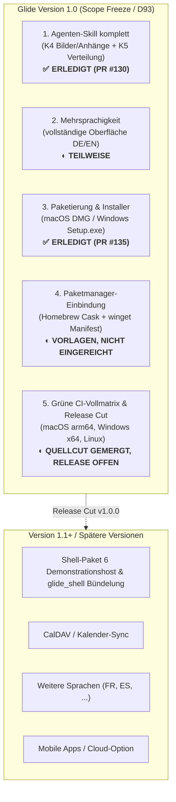

# Meilenstein- und Fahrplan Release 1.0 (Glide 1.0.0)

Stand 21.11.2026 · Glide 1.0.0 · Aufgabenformat 26 · Glide-System V1.68 auf `main` (PRs #168–#171 gemergt, `0ba533af`) · Glide Shell 0.4.0; Selbsttest unter `-O` und Doku-Nachtrag in PR #172 (`claude/v168-integration-doku`); V1.69 Shell-Bausteine D98 (`text_fit`, `action_picker`, `runtime_paths`, Shell 0.5.0) auf `claude/v169-shell-text-menu-paths` über #172

Dieser Plan definiert den verbindlichen **Schnittpunkt (Feature Freeze / D93)** für **Version 1.0 von Glide** und die vorgesehenen Veröffentlichungswege über GitHub, **Homebrew** (macOS) und **winget** (Windows). Er beantwortet die Frage, wo die Grenze gezogen wird, um endlosen Scope Creep zu verhindern. Der Quellstand 1.0.0 ist am 18.11.2026 nach `main` gemergt; ein Tag, GitHub-Release und öffentliche Paketmanager-Einreichungen sind nicht vorhanden. Das Soll ist daher nicht mit einer erfolgten Veröffentlichung gleichzusetzen.

Tracking-Issue: [GitHub Issue #129](https://github.com/n05a-design/glide-to-do/issues/129)

---

## 1. Strategischer Schnittpunkt: Was gehört in Version 1.0 (und was nicht)?

Um nicht endlos weiterzuentwickeln, wird der Umfang für **Version 1.0** strikt auf die Kernanforderungen für einen erstklassigen ersten öffentlichen Auftritt begrenzt.

### Der verbindliche Soll-Umfang (Must-Haves für v1.0)
1. **Vollständiger Agenten-Skill `glide-to-do` (✅ Abgeschlossen):**
   - K1–K3: Austauschformat 2, Labels, Vorsicherung, Markdown, Ordnerarten, Wiederholungen, Erinnerungen.
   - **K4 (Bilder & Anhänge):** ZIP-Container (`.glideexchange`/`.zip`), Zip-Slip-Schutz, Anhänge für Aufgaben/Listen/Ordner in `ATTACHMENTS_DIR`, Galerielisten, Seiten-Cover, Markdown-Bildauflösung, Export (`write_exchange_package`), Rollback-Bereinigung.
   - **K5 (Ökosystem & Verteilung):** `MANIFEST.json`, `VERTEILUNG.md`, Desktop-Menüaktion `export_agent_skill`, Workflow-Paketierung in GitHub Release-Assets (`glide-to-do-skill-v$VERSION.zip`).
2. **Mehrsprachigkeit (i18n: Deutsch & Englisch) (◐ teilweise umgesetzt):**
   - Soll: Komplette App-Oberfläche umschaltbar: Automatisch (nach OS), Deutsch, Englisch.
   - Menüs (`desktop_adapter.py`), Werkzeugleiste, Seitenleiste, Kern-Dialoge, Einstellungen, Status- und Fehlermeldungen.
   - Modul `src/glide/i18n.py` (M100) im Glide-System (Standardbibliothek only, Modulbudget-konform).
   - Ist: Spracheinstellung, Kataloge, Menü-/Tastaturbeschriftungen, ausgewählte Seitenleistenbereiche, Einstellungsdialog, Seiteneditor, Aktionsfeedback und Aufgabeninspektor sind in den geprüften Bereichen zweisprachig. PR #157 ergänzt Statuszeile, Kernmeldungen und zentrale Zeichensteuerungen; Animations-/Mehr-Menüs, weitere Dialoge, Zeichen-/Exportmeldungen, dynamische Undo-Texte und einzelne Status-/Fehlertexte bleiben teilweise deutsch. Vollständige Oberflächenlokalisierung und menschliche Sicht-/Bedienabnahme sind offen.
3. **Plattformpakete & Installer:**
   - **macOS:** `.app`-Bundle, `.dmg` und `.tar.gz` (Ad-hoc signiert, arm64).
   - **Windows:** Inno-Setup-Installer `Glide-setup.exe` (Startmenü-Icon, saubere Deinstallation, AppUserModelID `Shaye.Glide`, unprivilegiert nach `%LOCALAPPDATA%\Programs\Glide`) + portable `.zip`.
4. **Paketmanager (◐ Vorlagen vorbereitet, noch nicht veröffentlicht):**
   - **Homebrew:** Cask `packaging/homebrew/Casks/glide.rb` im Repository `n05a-design/homebrew-glide`.
   - **winget:** Manifeste `packaging/winget/manifests/s/Shaye/Glide/` für `winget install Shaye.Glide`.
   - Ist: Versionierte Vorlagen sind im Repository vorhanden; ohne öffentliches Release wurden sie nicht in den Tap bzw. das winget-Repository eingereicht.
5. **Qualität und Freigabe (◐ Quellstand geprüft, Release offen):**
   - PR #138 wurde am 18.11.2026 nach `main` gemergt; die Grundstufe, CodeQL sowie Linux-/Windows-Vollprüfung und Windows-Paketbau waren auf dem geprüften PR-Head erfolgreich.
   - Der getrennte lokale macOS-Volllauf und native Paketstart sind im [QA-Bericht](../01_Repository/Glide/docs/07_QA_BERICHT.md) belegt. Menschliche Sicht-/Bedienabnahme sowie übersprungene UI-/Barrierefreiheitsjobs bleiben offen.
   - Am 18.11.2026 wurden weder GitHub-Release noch Git-Tags gefunden. Öffentliche Freigabe und Paketmanager-Einreichungen sind nicht erfolgt.

> [!IMPORTANT]
> **Was bewusst NICHT in Version 1.0 kommt (Post-1.0):**
> Tiefere interne Shell-Umbauten (Shell-Paket 6 Demonstrationshost, Namespace-Bündelung `glide_shell`), zusätzliche Sprachen jenseits DE/EN, externe Kalendersynchronisation (CalDAV) oder Plugin-Systeme werden bis nach Version 1.0 zurückgestellt.

---

## 2. Die vier Etappen bis zum Release v1.0

### Etappe 1: Agenten-Skill komplettieren (Paket K4 & K5) – ✅ ERLEDIGT
- **K4 (Bilder und Dateianhänge im Austausch):**
  - ZIP-Container-Erkennung mit Zip-Slip-Schutz (`inspect_exchange_archive`).
  - Physischer Import von Anhängen für Ordner, Listen, Aufgaben in `ATTACHMENTS_DIR`.
  - Galerielisten (`list_kind: "gallery"`), Cover (`cover`), Markdown-Bildauflösung.
  - Paketausgabe (`write_exchange_package`) und atomare Rollback-Bereinigung.
- **K5 (Verteilung):**
  - `MANIFEST.json` mit Hashes aller 18 Skill-Dateien.
  - `VERTEILUNG.md` für Claude Desktop, Cursor, Gemini CLI, Web-LLMs.
  - App-Menüfunktion `export_agent_skill`.
  - GitHub Actions Workflow packt Skill-ZIP mit Prüfsummen.
- **Nachweis:** Integrationstest T328 (`test_austausch_k4.py`, 9/9 OK), Werkzeugtest T321 (18/18 OK), PR #130 gemergt.

### Etappe 2: Mehrsprachigkeit (i18n: Deutsch / Englisch) – ◐ TEILWEISE
- **Architektur:**
  - Neues leichtgewichtiges Modul `src/glide/i18n.py` (M100) im Glide-System (Standardbibliothek only, Modulbudget max. 50 Zeilen je Funktion, WA-50 konform).
  - Strukturierte Übersetzungskataloge: `src/glide/resources/locales/de.json` und `src/glide/resources/locales/en.json`.
  - Robuster Aufruf: `t(key, default, **kwargs)` mit sicherer Formatierung (`safe_format`).
  - Einstellungsdialog: Dropdown zur Sprachauswahl (`Automatisch (System)`, `Deutsch`, `English`), persistiert in `settings.json` als `language`.
- **Tatsächlicher Übersetzungsumfang:**
  - Spracheinstellung, Kataloge und `t()`-Hilfsfunktionen sind implementiert; Menüleiste/Tastaturkürzel und ausgewählte Beschriftungen in Seitenleiste und Einstellungen nutzen die Kataloge.
  - Die vollständige Oberfläche ist nicht lokalisiert: unter anderem bleiben weitere Dialoge, Werkzeugleisten, Inspektoren, Status- und Fehlermeldungen teilweise deutsch.
  - `test_i18n.py` prüft Katalogparität, Platzhalter, direkt verwendete Übersetzungsschlüssel und dynamische Schlüssel aller Hintergrund-Presets.
- **Nachweis:**
  - Test T329 (`test_i18n.py`): Spracherkennung, Auflösung, Fallbacks, Schlüssel- und Platzhalterparität zwischen `de.json` und `en.json`, WA-50-Budget.
  - Werkzeugtest `test_modulbudget.py` um `i18n.py` erweitert.
  - Systemregister auf V1.42 angehoben; `test_i18n.py` besteht mit 13/13 Tests.
  - Die CI-Grundstufe für den aktuellen Lokalisierungsschnitt ist noch auszuführen.

### Etappe 3: Paketbau, Installer & Paketmanager-Vorbereitung – ✅ TECHNISCH VORBEREITET; EINREICHUNG OFFEN
- **macOS:**
  - DMG-Erzeugung in `.github/workflows/macos-paket.yml` verifiziert.
  - Homebrew-Cask `packaging/homebrew/Casks/glide.rb` aktualisiert auf Version 3.70.0.
- **Windows:**
  - Inno-Setup-Skript `packaging/windows/glide_setup.iss` für unprivilegierte Benutzer-Installation nach `%LOCALAPPDATA%\Programs\Glide`, Startmenüeintrag (`AppUserModelID: "Shaye.Glide"`), Sprachunterstützung (DE/EN) und saubere Deinstallation ohne Nutzerdatenverlust.
  - Build-Schritt in `.github/workflows/windows-paket.yml` verankert (Erzeugung von `Glide-$version-windows-x64-setup.exe` samt SHA-256 und Artefakt-Upload).
  - Release-Workflow `.github/workflows/release.yml` um Installer-Einbindung und Download-Tabelleneintrag erweitert.
  - winget-Manifeste unter `packaging/winget/manifests/s/Shaye/Glide/3.70.0/` auf `InstallerType: inno` und zweisprachige Metadaten (de-DE, en-US) umgestellt.

### Etappe 4: Release Cut, GitHub-Release & Veröffentlichung – ◐ QUELLCUT ERLEDIGT, VERÖFFENTLICHUNG OFFEN
- **Versionierung:**
  - Anheben der Version auf `1.0.0` (über `scripts/pflege/versionswechsel.py 1.0.0 17.11.2026 --ohne-ablagekuerzung`).
  - Beim Release-Cut am 18.11.2026 stand das Systemregister auf V1.40 (100 Module M001–M100, 329 Testdateien T001–T329); aktueller Stand V1.42.
  - Standprüfung (86 Dokumente, 0 Befunde) und Lieferabgleich `abgleich_07.py` (0 Abweichungen).
  - GitHub Actions `release.yml` ist für den Bau von Artefakten und SHA-256-Prüfsummen bei einem Tag `v1.0.0` vorbereitet; ein solcher Tag wurde nicht veröffentlicht.
- **Veröffentlichung:**
  - Offen: GitHub Release v1.0.0 mit freigegebenen Artefakten veröffentlichen.
  - Offen: Homebrew-Tap anlegen/bestätigen und Cask einreichen; winget-Manifest einreichen. Die Vorlagen im Hauptrepository sind keine erfolgten Einreichungen.
  - Offen: erforderliche menschliche Sicht-/Bedienabnahme und separate Freigaben aus der Veröffentlichungsvorgabe abschließen.

---

## 3. GitHub Issue Tracking (#129)

Statusabgleich vom 19.11.2026: [Issue #129](https://github.com/n05a-design/glide-to-do/issues/129) bleibt offen. PR #148 hat den zweisprachigen Einstellungsdialog gemergt; übrige App-/Shell-Lokalisierung, öffentliche Veröffentlichung und externe Paketmanager-Einreichung sind weiter offen.

- [x] **1. Agenten-Skill `glide-to-do` (WA-61)** (K1–K5 vollständig abgeschlossen via PR #127, PR #128, PR #130)
- [ ] **2. Mehrsprachigkeit (i18n: Deutsch / Englisch)** (M100 und weitere Bereiche in `main`; PR #157 (gemergt) ergänzt Zeicheneditor-Status und zentrale Steuerungen, PR #158 (gemergt) Animationsleiste, Mehr-Menü, Paletten und Export, vollständige UI-/Status-/Shell-Lokalisierung und menschliche Abnahme offen)
- [x] **3. Paketierung & Installer – technische Vorbereitung** (macOS-/Windows-Bauwege und Inno-Setup via PR #135; öffentliche Artefakte nicht veröffentlicht)
- [ ] **4. Paketmanager** (Homebrew- und winget-Vorlagen vorhanden; externe Einreichung und Installationsprüfung nach öffentlichem Release offen)
- [ ] **5. Qualität & Freigabe** (PR #138 auf dem geprüften Head mit grünen Pflichtchecks gemergt; lokaler macOS-Nachweis vorhanden. Öffentlicher Tag/Release, vollständige menschliche Abnahme und übersprungene UI-/Barrierefreiheitsjobs offen)
