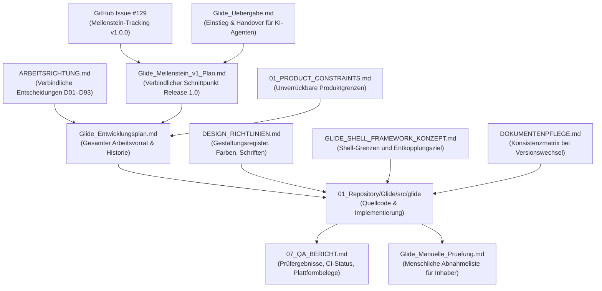
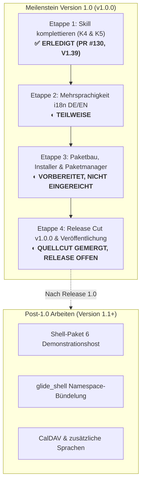

# Glide – Übergabe an eine neue Sitzung

Stand 20.11.2026 · Glide 1.0.0 · Aufgabenformat 26 · Glide-System V1.55 auf `main`; V1.57 lokaler Kandidat

Einstieg für die nächste Sitzung: tatsächlichen Entwicklungsstand, Dokumentenautorität, nächste Arbeit und Arbeitsregeln. Aufgaben und Rest führt der [Entwicklungsplan](Glide_Entwicklungsplan.md), den Soll-Umfang Release 1.0 der [Meilenstein-Plan](Glide_Meilenstein_v1_Plan.md) und das öffentliche Tracking [Issue #129](https://github.com/n05a-design/glide-to-do/issues); Prüfergebnisse stehen im [QA-Bericht](../01_Repository/Glide/docs/07_QA_BERICHT.md), Entscheidungen in der [Arbeitsrichtung](../01_Repository/Glide/docs/ARBEITSRICHTUNG.md). Frühere Übergabestände und historische rote Läufe bleiben in Git erhalten.

**Aktueller Main-Stand:** PR #154 wurde am 19.11.2026 auf `448eee7f`, PR #156 am 20.11.2026 auf `4b6bce08` gemergt; `origin/main` steht auf `4b6bce08`. Auf PR-#156-Head `f1d00bc9` bestanden Dokumentation/YAML/Stand, Linux-Grundstufe, alle drei Analyze-Läufe und die Linux/Tk-9.1-Vollprüfung. Bei letzter Abfrage lief noch die Windows/Tk-9.1-Vollprüfung [Job #136248611305](https://github.com/n05a-design/glide-to-do/actions/runs/44719992687/job/136248611305); UI-Diagnose, NVDA und Orca wurden übersprungen. PR-Head und Merge-Tree stimmen überein; diese Prüfungen enthalten nicht die neuen lokalen Änderungen.

**Git-/Remote-Handoff:** Der aktuelle lokale Arbeitsbranch `copilot/glide-v1-internationalization-qa-governance` steht auf `f1d00bc9`; vor der neuen Runde entsprach sein Baum `origin/main`. Die V1.57-D93-Etappe-2-Fortsetzung und Dokumentnachführung sind lokal und noch nicht committet oder gepusht. Es gab bei letzter Abfrage keine offenen PRs. `.impeccable/critique/2026-11-19T22-32-44Z__readme-md.md` bleibt ein lokaler unversionierter Kritikbericht. Keine Force-Pushes oder Änderungen am separaten Hauptcheckout; OneDrive-Cloudsynchronisierung ist nicht verifiziert.

**Ganzheitsaudit – verifizierter Umfang und Grenzen:** `main` und `origin/main` stehen auf `a53e7790`; der aktive PR-#154-Branch stand vor den neuen Änderungen lokal und remote auf `42fa060f`. Die alten lokalen Branches `claude/macos-nachtraege-main` (`5bcdf8bf`) und `shaye-musik-onedrive-worktree-abgleich` (`84cdd04a`) sind Vorfahren von `main`. Die Stände `f62e7bd8` (`claude/etappe4-release-v1`) und `8fba89a0` (`glide_ci_recovery`) liegen in der Historie des finalen PR-#138-Heads `7d2d5cf`; PR #138 wurde als Squash-Commit `a303e405` gemergt, dessen Baum mit dem finalen PR-Head übereinstimmt. Diese alten Branches sind daher keine eigenen unübertragenen Änderungen; ihre GitHub-Remote-Branches wurden gelöscht. Der detached Prewarm-Stand `1e99bf1d` ist Basis dieses Merges. Es gibt keinen Git-Stash. Der separate Hauptcheckout auf `claude/etappe4-release-v1` wurde nicht geöffnet; sein Dirty-/Untracked-Zustand bleibt unbekannt. Finder bestätigt den Projektpfad in OneDrive und lokale Offlineverfügbarkeit, aber keinen erfolgreichen Cloud-Upload. Eine uneingeschränkte Synchronisationsbestätigung ist daher nicht möglich.

**GitHub-Governance-Folgepaket:** PR #154 mit den zweisprachigen Issue-Formularen, Verhaltensgrundsätzen, Supportleitfaden, Dokumentationsworkflow und verknüpften DE/EN-Einstiegen ist gemergt. Issue #129 bleibt offen; Release/Tags, vollständige Lokalisierung, externe Homebrew-/winget-Einreichungen und menschliche Sicht-/Bedienabnahme bleiben Inhaber- bzw. Folgeaufgaben. About-Beschreibung (live weiter nur deutsch), neue 1.0.0-Aufnahmen und GIF bleiben offen. Wiki-Quellen/Synchronisation sind nach I11 B nicht ausgewählt.

**English-first Korrektur nach Steps (Plan §21.141):** `main/README.md` war beim Live-Abruf noch deutsch, obwohl `README.en.md` existierte. `README.md` ist jetzt die englische Primärseite, Deutsch liegt in `README.de.md`; CONTRIBUTING und SECURITY haben verlinkte deutsche Fassungen, die übrigen öffentlichen Community-Einstiege führen Englisch zuerst. Der geprüfte Commit `38165982` wurde auf PR #154 gepusht; beim damaligen Stand am 19.11. war der PR noch offen, inzwischen ist er auf Merge-Commit `448eee7f` in `main`. Für diesen Head bestand der Dokumentations-/YAML-/Standworkflow; Analyze (Actions/Ruby) bestand, CodeQL wurde übersprungen, Analyze (Python) und Linux-Grundstufe liefen bei damaliger Abfrage noch. `gh repo edit` und REST-PATCH zur About-Beschreibung antworteten mit HTTP 404; die Metadaten bleiben deutsch.

> [!IMPORTANT]
> **Aktueller strategischer Fokus: Soll-Ist-Abschluss Release 1.0 (v1.0.0 / D93)**
> Der Inhaber beschloss am 17.11.2026 den Feature Freeze für Glide 1.0.0. Der Quellstand wurde gemergt, aber nicht öffentlich veröffentlicht. Das Soll – vollständige DE/EN-Oberfläche und bereitgestellte GitHub-/Homebrew-/winget-Releases – ist noch nicht vollständig erfüllt.
> - **Etappe 1: Skill komplettieren (K4 & K5):** ✅ **ABGESCHLOSSEN** (PR #130, PR #133, V1.39, T328)
> - **Etappe 2: Mehrsprachigkeit (i18n DE/EN):** ◐ Spracheinstellung, Einstellungsdialog, ausgewählte Menüs/Seitenleistenbereiche, Seiteneditor, Aktionsfeedback, Aufgabeninspektor, Kalenderfelder und Kernsteuerungen des Zeicheneditors sind in den geprüften Flächen zweisprachig; weitere Dialoge, Animations-/Mehr-Menüs, dynamische Undo-Texte, einzelne Status-/Fehlertexte und Teile der Shell bleiben offen.
> - **Etappe 3: Paketierung & Installer:** ◐ Bauwege, Installer und Paketmanager-Manifeste technisch vorbereitet; Homebrew-/winget-Vorlagen nicht eingereicht.
> - **Etappe 4: Release Cut v1.0.0 & Veröffentlichung:** ◐ Quellstand in `main`, Pflichtchecks auf PR #138 grün; kein Tag/Release, öffentliche Einreichung und menschliche Abnahme offen.
>
> **Erste Handgriffe einer neuen Sitzung:** (1) Entwicklungsplan §21.145 und den Live-Status der noch laufenden Windows/Tk-9.1-Vollprüfung zu PR #156 prüfen. (2) V1.57-Grundstufe und gezielte Zeicheneditorfälle sind bestanden; vor Commit/Push den finalen Dateistand und die Ablage erneut prüfen. (3) Lokale Änderungen bleiben ungepusht. E-P1–E-P5, About-Beschreibung, neue 1.0.0-Aufnahmen/GIF, Tags, Releases und Paketmanageraktionen bleiben ohne separate Auswahl/Freigabe unangetastet. Die OneDrive-Cloud-Synchronisation und der Dirty-/Untracked-Zustand des separaten Hauptcheckouts bleiben offen.
>
> **Nachtrag für die aktuelle Sitzung:** English-first-Nachführung `38165982` ist auf PR #154 gepusht. Bei der letzten Abfrage für diesen Head bestand der Dokumentations-/YAML-/Standworkflow; Analyze (Actions/Ruby) bestand, CodeQL war übersprungen, Analyze (Python) und Linux-Grundstufe liefen noch. Den aktuellen Status erneut live ermitteln; PR #154 nicht ohne ausdrückliche Freigabe mergen.

---

## 0. Sofortübergabe WA-41 – zuerst lesen

> [!IMPORTANT]
> Diese Überschrift bleibt als bestehendes Linkziel im Gesamtsystem unverändert erhalten. Sie betrifft die historische Fehleruntersuchung zur Systemstabilität; aktuelle operative Entwicklungsprioritäten stehen in [Abschnitt 3](#3-nächste-arbeit-und-handlungsanweisungen).

- **WA-41A:** Sporadische Interpreter-/Prozessfehler auf PC-02 Intel, unter anderem `0xC0000005`, `0xC0000409`, „Executing a cache“. WHEA-/Systembefunde sind eine Hardware-Spur, kein abschließend bewiesener CPU-Defekt.
- **WA-41B:** Einmalig abweichender gespeicherter/geladener künstlicher Bestand; konkrete betroffene Felder und Ursache ungeklärt, kein belegter Verlust echter Nutzerdaten. Beide Spuren getrennt erhalten.
- **AMD-Gegenlauf:** Zehn isolierte AMD-Prozesse waren grün; vollständige Suiten erzeugten UUIDs/Zeitstempel selbst. Kein byteidentischer Intel-Replay und kein Ursachenbeweis. Siehe [AMD-Nachweis](https://github.com/n05a-design/glide-to-do/blob/40c20fd62db6ec31b4e3668dfc9e7f1550f67974/01_Repository/Glide/tests/qa-3.48.0/amd_vergleich_2026-10-27/README.md) und [Gerätevergleich](https://github.com/n05a-design/glide-to-do/blob/f1a5b5b6e0f97f2b5eab1ac552999c33c6416e69/01_Repository/Glide/tests/qa-3.49.0/geraetevergleich_2026-10-29/README.md).
- **Stabilitäts-Vorgabe:** BIOS-/CPU-Einstellungen nicht ändern, keine unnötige neue Stressserie am instabilen PC-02. Keine spekulativen Mengenschranken, kein Chunking oder willkürliches `gc.collect()` als angeblicher Fix. Historischen Referenzstand und Originalkriterien bewahren.
- **Dokumentierte Referenzen:** [Ursachenanalyse](https://github.com/n05a-design/glide-to-do/blob/40c20fd62db6ec31b4e3668dfc9e7f1550f67974/01_Repository/Glide/tests/qa-3.48.0/wa41_2026-10-27/README.md), [Python-Vergleich](https://github.com/n05a-design/glide-to-do/blob/40c20fd62db6ec31b4e3668dfc9e7f1550f67974/01_Repository/Glide/tests/qa-3.48.0/python315_vergleich_2026-10-27/README.md), [WHEA-/Lastbefunde und Dumpinventar](https://github.com/n05a-design/glide-to-do/blob/594f4c85eb60370a44282b06fcb8017df8181d70/01_Repository/Glide/tests/qa-3.50.5/abnahme_2026-11-05/aufbewahrung.json), [470-Dateien-Referenz](https://github.com/n05a-design/glide-to-do/blob/594f4c85eb60370a44282b06fcb8017df8181d70/01_Repository/Glide/tests/qa-3.50.5/abnahme_2026-11-05/aufbewahrung.json). Spätere Schutzfunktionen und Lieferungen schließen diese Ursachenfragen nicht.
- **Geschützte lokale Bestände:** `01_Repository/Glide/tests/qa-3.48.0/lokale_belege/eingang/initial.json` und `lokale_belege/minidumps/`; [Sicherungsmanifest](https://github.com/n05a-design/glide-to-do/blob/594f4c85eb60370a44282b06fcb8017df8181d70/01_Repository/Glide/tests/qa-3.50.5/abnahme_2026-11-05/aufbewahrung.json). Anfangsbestand 28.548.872 Bytes, SHA-256 `a3b8c0cac4c72e1820e71730ad78e312f2a30338678fbcfe2a2b6d91dae081f4`. Acht bekannte Minidumps sind keine FullMemory-Aufnahmen. Ein früher genannter externer Exportordner wurde nicht lokal bestätigt; keine Originale löschen.
- **Ablagegrenze:** Dumps, Rohlogs und lokale Eingänge bleiben Git-ausgeschlossen und sind bei Rechnerwechsel ausdrücklich geschützt zu übertragen. Temporärpfade und Runtimeorte aus alten Berichten vor Wiederverwendung prüfen; Version, `sys.executable`, Tk und Binärhashes erfassen. Der Standardbefehl `python` ist kein Laufzeitnachweis.

---

## 1. Tatsächlicher Stand

| Achse | Stand |
|---|---|
| **Version & Schemata** | **Glide 1.0.0** · Aufgabenformat **26** · Einstellungen **2** · Vorlagen **2** · Glide-System **V1.55 auf `main`**, lokaler Arbeitskandidat V1.57 (100 Source-Module M001–M100, 115 Integrationssuiten, 329 Test-/Werkzeugdateien, 5 Analysen). PR #156 ist auf `4b6bce08` gemergt. |
| **Meilenstein Release 1.0** | Verbindlicher Feature Freeze (D93). Etappe 1 Skill K4/K5 ist erledigt. Etappe 2 i18n ist teilweise integriert; vollständige UI-Lokalisierung fehlt. Etappe 3 ist technisch vorbereitet, aber Homebrew-/winget-Vorlagen sind nicht eingereicht. Etappe 4 Quellcut ist in `main`; Tag, GitHub-Release und menschliche Abnahme fehlen. Issue #129 bleibt offen. |
| **Agenten-Skill `glide-to-do` (1.0.0)** | **WA-61 (K1, K2, K3, K4, K5 vollständig):** Zentrierte Skill-Implementierung unter `01_Repository/Glide/skills/glide-to-do/`. Formatkopplung an Format 26 über `abdeckung.json`.<br/>- **K1:** Grundskill auf Austauschformat 2.<br/>- **K2:** Labels an Ordnern und Listen, Labelfarbe, KI-Prompt-Schärfung.<br/>- **K3 (E-K5 Option A):** Automatische dateibasierte Vorsicherung vor Import (`vor_import_*.glidebackup`), Markdown-Listen (`markdown` -> `rich_note` mit Checkbox-Aufgabenextraktion), Ordnerarten (`library`, `journal`, `standard`), Wiederholungsregeln (`repeat` tolerant EN/DE mit `kind`-Rundlauf), Erinnerungen (`reminder` relativ/fest).<br/>- **K4 (Bilder/Anhänge):** ZIP-Container (`.glideexchange`/`.zip`) mit Zip-Slip-Schutz (`inspect_exchange_archive`), physischer Import von Anhängen (`ATTACHMENTS_DIR`) mit Prüfsummen- und Namenskonfliktbereinigung (`store_attachment`), Galerie-Listen (`list_kind: "gallery"`), Seiten-Cover (`cover`), Markdown-Bildauflösung in Notizen, Paketausgabe (`write_exchange_package`), atomares Rollback bei Importfehlern.<br/>- **K5 (Verteilung):** `MANIFEST.json` mit Hashes aller 18 Skill-Dateien, `VERTEILUNG.md` für Claude Desktop, Cursor, Gemini CLI, ChatGPT/Web-LLMs, App-Menüfunktion `export_agent_skill`, Release-Workflow (`glide-to-do-skill-v$VERSION.zip`). T327 (`test_austausch_k3.py`, 6/6 OK), T328 (`test_austausch_k4.py`, 9/9 OK), T321 (18/18 OK). |
| **Shell-Pakete (3a, 3c, 4, 5)** | Vier anwendungsneutrale Shell-Bausteine flach in `src/glide`, Modulbudget WA-50 vollständig eingehalten:<br/>1. `modal_session.py` (M096, 3.62.0, T317): Entkoppelter modaler Warteweg.<br/>2. `window_lifetime.py` (M097, 3.64.0, T318/T320): Zeitgeberbesitz je Fenster/Ansicht (`after_scope`).<br/>3. `custom_controls.py` (M098, 3.67.0, T312): Thementaugliche Canvas-Bedienelemente.<br/>4. `desktop_adapter.py` (M099, 3.68.0, T326): Menüleiste, Tastaturkürzel, OS-Aktionen.<br/>Fokusrückgabe D87 (3.65.0) in modalen Dialogen aktiv. Bündelung zu `glide_shell` und Demonstrationshost (Paket 6) sind Post-1.0. |
| **Prüfstand** | Führend ist der [QA-Bericht](../01_Repository/Glide/docs/07_QA_BERICHT.md). PR-#156-Head und Main-Baum sind gleich. Dokumentation/YAML/Stand, Grundstufe und alle Analyze-Läufe bestanden; Linux/Tk-9.1-Vollprüfung lief bei letzter Abfrage, Accessibility-/UI-Jobs wurden übersprungen. Lokale V1.57-Änderungen sind nicht Bestandteil dieser Remote-Prüfung. Lieferkopie-/SHA-Abgleich und menschliche Abnahme bleiben offen. |
| **Lieferstand** | `07_Python-Versionen` und `src/glide` werden außerhalb einer Produktionsrunde weiterhin getrennt geführt. PR #153 ist in `main`; daraus folgt keine neue freigegebene Lieferfassung oder SHA-256-Aussage. |
| **Ablage-Schutz** | Unberührt und NICHT in Git: `20_Grafik_Master/09_Inspiration/`, `GLIDE_STEPS_GESAMTAUDIT_V2_2026-11-10/`, `glide_master_audit_bericht.md` und `SQLite-Copyright.md`. Diese Pfade dürfen unter keinen Umständen gestaget oder committet werden. |

**Statuskorrektur zu den älteren Laufangaben oben:** PR #150-Workflow #44489695633 ist abgeschlossen und rot; Linux scheiterte am Accelerator-Erwartungswert, Windows-Vollprüfung und Paketbau bestanden. PR #151-Linux #44493977406 prüfte einen älteren Head und scheiterte; sein Windows-Volltest samt Paketbau bestand. PR #152-Workflow #44498011031 auf `f34fb73d` scheiterte in `schriftstile`; der spätere V1.48-Fix ist als `5631333a` gepusht. Der V1.49-Diagnose-/Dokumentationsnachlauf und die 27 Gemini-Dateien wurden mit `042a8d7` auf PR #152 gepusht; `cada01bf` aktualisierte den damaligen Ergebnisstand. Die aktuelle Diagnose und Prüfgrenzen stehen in Plan §21.129–§21.135 und im QA-Bericht.

---

## 2. Zuständige Dokumente und Autoritätsmatrix

In diesem Projekt gilt die Regel **„Ein Thema, ein führendes Dokument“**. Kein Dokument dupliziert die Autorität eines anderen.



| Dokument | Führende Zuständigkeit |
|---|---|
| [`00_Arbeitsvorbereitung/Glide_Meilenstein_v1_Plan.md`](Glide_Meilenstein_v1_Plan.md) | **Verbindlicher Meilenstein- und Fahrplan Version 1.0 (D93):** Definiert den exakten Scope Freeze, die vier Etappen bis zum öffentlichen Release sowie Paketmanager-Ziele (Homebrew, winget). |
| [GitHub Issue #129](https://github.com/n05a-design/glide-to-do/issues/129) | **Öffentliches Meilenstein-Tracking:** Führt den aktuellen Fortschritt der fünf Meilenstein-Kernelemente. |
| [`00_Arbeitsvorbereitung/Glide_Entwicklungsplan.md`](Glide_Entwicklungsplan.md) | **Einziges Planungsdokument:** Führt den gesamten Arbeitsvorrat ([§Aktueller Arbeitsvorrat](Glide_Entwicklungsplan.md#aktueller-arbeitsvorrat)), historische Sprints und chronologische Umsetzungsberichte ([§21.98](Glide_Entwicklungsplan.md#2198-richtungsentscheidungen-zur-shell-trennung-d86d90-15112026)–[§21.110](Glide_Entwicklungsplan.md#21110-agenten-skill-pakete-k4--k5-bilderanhänge-im-austausch--verteilung-17112026)). Es entsteht kein zweiter Backlog! |
| [`01_Repository/Glide/docs/ARBEITSRICHTUNG.md`](../01_Repository/Glide/docs/ARBEITSRICHTUNG.md) | **Verbindliche Architektur- und Prozessentscheidungen:** Register D01 bis D93 (D93: Release 1.0 Meilensteinschnitt). |
| [`01_Repository/Glide/docs/01_PRODUCT_CONSTRAINTS.md`](../01_Repository/Glide/docs/01_PRODUCT_CONSTRAINTS.md) | **Produktgrenzen:** Was Glide bewusst ist und was es strikt ausschließt (kein Cloud-Sync, keine Telemetrie, keine Online-Konten, Offline-First). |
| [`01_Repository/Glide/docs/DESIGN_RICHTLINIEN.md`](../01_Repository/Glide/docs/DESIGN_RICHTLINIEN.md) | **Gestaltungsregister & UI-Verträge:** Typografie (Rubik, DM Mono, DM Serif Display, Charis SIL), Farben, Abstände, Randmaße und verbindliche D83-Regeln. |
| [`01_Repository/Glide/docs/07_QA_BERICHT.md`](../01_Repository/Glide/docs/07_QA_BERICHT.md) | **Prüf- und Lieferstände:** Führt die tatsächlichen Testergebnisse, CI-Status, Plattformnachweise und Grenzwerte geordnet nach Version und Commit. |
| [`00_Arbeitsvorbereitung/Glide_Manuelle_Pruefung.md`](Glide_Manuelle_Pruefung.md) | **Menschliche Abnahmeliste:** Fälle, die ausschließlich vom Inhaber interaktiv am Mac geprüft werden können (DPI, Sicht, Bedienung). |
| [`01_Repository/Glide/docs/DOKUMENTENPFLEGE.md`](../01_Repository/Glide/docs/DOKUMENTENPFLEGE.md) | **Pflegematrix:** Regelt, welche Dateien bei Versionswechsel, Merges oder neuen Modulen zwingend synchron nachgezogen werden müssen. |
| [`01_Repository/Glide/docs/GLIDE_SHELL_FRAMEWORK_KONZEPT.md`](../01_Repository/Glide/docs/GLIDE_SHELL_FRAMEWORK_KONZEPT.md) | **Shell-Grenzen und Entkopplungsziel** (Post-1.0 Zielbild für `glide_shell` und Demonstrationshost). |
| [`01_Repository/Glide/AGENTS.md`](../01_Repository/Glide/AGENTS.md) | **Agenten-Regeln:** Repository-spezifische Richtlinien für autonome Agenten. |

---

## 3. Nächste Arbeit und Handlungsanweisungen

Der Einstellungsdialog samt stabiler Rückspeicherung (§21.121) ist in PR #148 gemergt; Seiteneditor, Aktionsfeedback, Tastenkürzel-Modifier, Aufgabeninspektor, Kalenderfelder, Editorstatus und Mehr-Menü (§§21.122–21.124) sind mit PR #150 in `main`. PR #154 (Governance/English-first) und PR #156 (Ansichtenreparatur) sind ebenfalls gemergt. Die lokale Fortsetzung (§§21.144–21.145) lokalisiert Statusmeldungen, Werkzeugwahl, Anzeigeprofile, Referenz-/Vorschauknöpfe, Zoom und Kontextmenüs des Zeicheneditors. Animationsleiste, Mehr-Menü-Inhalte, weitere Dialoge sowie Zeichen-/Exportmeldungen bleiben offen. Die menschliche DE/EN-Sicht-/Bedienabnahme ist in der [manuellen Prüfliste](Glide_Manuelle_Pruefung.md#offene-sicht-und-bedienabnahme-deen-release-10-etappe-2) ausdrücklich offen. Wiki-Inhalte/Synchronisation sind nach I11 B nicht ausgewählt; E-P1–E-P5 sowie sonstige Funktionsvorschläge werden dadurch nicht ausgewählt. Release-, Konto- und Produktentscheidungen bleiben beim Inhaber.

**Nächster technischer Schnitt:** Windows/Tk-9.1-Vollprüfung #44719992687 nachverfolgen und den PR-#156-Prüfstatus auf dem exakten Head festhalten. Die V1.57-Lokalisierung der Kernsteuerung hat lokal die gezielten Tests und Grundstufe bestanden, ist aber noch nicht gepusht. Weitere Etappe-2-Flächen, Lieferkopie-/SHA-Abgleich und menschliche Sicht-/Bedienabnahme getrennt planen. Keine Tags/Release, Signierung/Notarisierung, Homebrew-/winget-Einreichung oder externe Kontoeinstellungen ohne separate Freigabe. About-Metadaten, neue 1.0.0-Bilder und GIF bleiben offen.

Der verbindliche Soll-Umfang steht im [Meilenstein-Plan Release 1.0](Glide_Meilenstein_v1_Plan.md); der aktuelle Masterprompt-Rest und die README-Nachpflege stehen im Entwicklungsplan [§21.118](Glide_Entwicklungsplan.md#21118-masterprompt-github-internationalisierung-und-verbleibender-soll-ist-umfang-18112026), [§21.119](Glide_Entwicklungsplan.md#21119-github-projektseite-deen-und-windows-prüftakt-18112026) und den i18n-Nachweisen [§21.122](Glide_Entwicklungsplan.md#21122-deen-lokalisierung-des-seiteneditors-aktionsfeedbacks-und-shell-modifier-19112026)–[§21.123](Glide_Entwicklungsplan.md#21123-deen-lokalisierung-des-aufgabeninspektors-und-seiner-kalenderfelder-19112026). Die nachfolgende technische Beschreibung ist Zielumfang, keine Behauptung, dass alle Punkte bereits umgesetzt oder veröffentlicht sind.



---

### Status der Etappen bis Release 1.0

- **Etappe 1 (Skill K4 & K5):** Vollständige Dateianhang-Unterstützung im ZIP-Container, Bildauflösung, Export-Aktion, Manifest-Hashprüfung.
- **Etappe 2 (Mehrsprachigkeit i18n DE/EN) – teilweise:** i18n-Modul, Kataloge, Spracheinstellung sowie ausgewählte Menü- und Seitenleistenbeschriftungen sind vorhanden. Vollständige Lokalisierung aller Bereiche ist nicht erreicht.
- **Etappe 3 (Paketbau & Installer) – technische Vorbereitung erledigt:** Bauwege, Windows-Installer und Homebrew-/winget-Manifeste sind vorbereitet; externe Einreichung und Installationsprüfung fehlen.
- **Etappe 4 (Release Cut v1.0.0) – teilweise:** Quellstand 1.0.0 und Pflichtchecks von PR #138 sind in `main`; Tag, GitHub-Release, menschliche Abnahme sowie öffentliche Paketmanager-Einreichung fehlen.

---

### Offene Soll-Lokalisierung (Etappe 2)

#### Motivation & Ziel
Für die vorgesehene Verteilung über Homebrew und winget verlangt der Meilenstein vollständige Zweisprachigkeit (**Englisch und Deutsch**). Die Spracheinstellung existiert, aber der Integrationsstand deckt die Oberfläche nicht vollständig ab. Die folgenden Bereiche beschreiben den Soll-Umfang; die noch fehlende Arbeit ist im Entwicklungsplan nachgeführt.

#### Architektur & Moduldesign M100 (`src/glide/i18n.py`)
1. **Modulstatus:** Neues Modul M100 im [Glide-System](../01_Repository/Glide/src/glide/README.md), abgelegt unter `01_Repository/Glide/src/glide/i18n.py`.
2. **Technologische Randbedingungen:**
   - **Ausschließlich Python-Standardbibliothek** (`json`, `locale`, `os`, `pathlib`, `typing`). Keine externen Abhängigkeiten!
   - **Modulbudget (WA-50 / T322):** Jede Funktion/Methode höchstens 50 Zeilen Code, maximale Verschachtelungstiefe <= 15.
   - **Thread-sicher:** Sichere globale Zustandsspeicherung der aktiven Sprache.
3. **Katalogstruktur:**
   - JSON-basierte Übersetzungskataloge unter `01_Repository/Glide/src/glide/resources/locales/`:
     - `de.json` (deutsche Begriffe, Referenz- und Standardsprache)
     - `en.json` (englische Übersetzungen)
   - Flache oder hierarchische Punktschreibweise: `t("menu.file", "Datei")`, `t("sidebar.tasks", "Aufgaben")`, `t("dialog.settings.title", "Einstellungen")`.
4. **Kernfunktionen der Schnittstelle:**
   - `t(key: str, default: str | None = None, **kwargs) -> str`: Liefert die Übersetzung für `key`. Fehlt die Übersetzung, wird `default` zurückgegeben (oder der Schlüssel selbst, falls `default is None`). Platzhalter via Python-Formatierung (`t("status.saved_items", count=5)` -> `"5 Elemente gespeichert"`).
   - `set_locale(locale_code: str) -> None`: Setzt die aktive Sprache (`"de"`, `"en"` oder `"system"`).
   - `get_locale() -> str`: Liefert das aktuelle Sprachkürzel (`"de"` oder `"en"`).
   - `detect_system_locale() -> str`: Erkennt die Sprache des Betriebssystems über `locale.getlocale()` bzw. `locale.getdefaultlocale()`. Beginnt der Code mit `"de"`, wird `"de"` gewählt, sonst standardmäßig `"en"`.
5. **Persistenz in Einstellungen:**
   - `settings.json`: Neues Feld `"language": "system"` (Standard: `"system"`, Alternativen: `"de"`, `"en"`).
   - `settings_dialog.py`: Neues Dropdown-Feld *Sprache / Language* mit den Optionen:
     - `System (Automatisch)` / `System (Auto)`
     - `Deutsch`
     - `English`
   - Hinweis bei Sprachwechsel: Dynamische UI-Aktualisierung oder sauberer Hinweis „Sprachänderung wird nach Neustart vollständig wirksam“.
6. **Zu lokalisierende Oberflächenbereiche:**
   - **Menüleiste (`desktop_adapter.py`):** Menütitel (*Datei/File, Bearbeiten/Edit, Ansicht/View, Datenaustausch/Exchange, Hilfe/Help*), alle Menüeinträge und Tastenkürzeltexte.
   - **Seitenleiste:** Systemordner (*Eingang/Inbox, Heute/Today, Erledigt/Completed, Papierkorb/Trash*), Navigationsbereiche (*Aufgaben/Tasks, Listen/Lists, Ordner/Folders, Pinnwand/Pinboard, Zeichnen/Drawing, Notizen/Notes*).
   - **Dialoge:** Einstellungen, Suchdialog, Entlastungsbilanz, Tagesschau, Datenaustausch (Import/Export), Bestätigungsdialoge (*Löschen, Abbrechen, Speichern*).
   - **Status- & Feedbackmeldungen:** Speicherhinweise, Undo-Toasts, Fehleranzeigen.
7. **Qualitätssicherung & Tests:**
   - Neuer Test **T329** `tests/unit/test_i18n.py`:
     - Prüft Schlüsselparität: Jeder Schlüssel in `de.json` muss auch in `en.json` existieren (keine Lücken).
     - Platzhalterkonsistenz: Platzhalter (`{count}`, `{name}`) müssen in beiden Sprachen übereinstimmen.
     - Fallback-Verhalten: Unbekannte Schlüssel geben `default` oder `key` zurück (nie Abbruch).
     - Umschaltung und Locale-Erkennung isoliert getestet.
   - Systemregister: **V1.47 auf `main`** (M100, T329, 329 Test-/Werkzeugdateien); der nachgelagerte Undo-/Redo-Testfix `0a61a08f` ist noch nicht in `main`. Differenz und Prüfstatus in Plan §21.127 und QA-Bericht dokumentiert.

---

### Schritt 2: Etappe 3 – Paketbau, Installer & Paketmanager-Vorbereitung [TECHNISCH VORBEREITET; NICHT VERÖFFENTLICHT]

#### 1. macOS (Homebrew Cask)
- **Paket:** `.dmg` und `.tar.gz` werden über `.github/workflows/macos-paket.yml` gebaut (arm64 Apple Silicon).
- **Homebrew Cask:** `packaging/homebrew/Casks/glide.rb` im Repository `n05a-design/homebrew-glide`:
  ```ruby
  cask "glide" do
    version "1.0.0"
    sha256 "<macos-arm64-dmg-sha256>"
    url "https://github.com/n05a-design/glide-to-do/releases/download/v#{version}/Glide-#{version}-macos-arm64.dmg"
    name "Glide"
    desc "Local-first task, project and visual organization tool"
    homepage "https://github.com/n05a-design/glide-to-do"
    app "Glide.app"
    zap trash: "~/Library/Application Support/Glide"
  end
  ```

#### 2. Windows (Inno Setup & winget)
- **Installer-Skript:** `packaging/windows/glide_setup.iss` für Inno Setup:
  - Unprivilegierte Installation nach `%LOCALAPPDATA%\Programs\Glide` (`PrivilegesRequired=lowest`).
  - Startmenü-Verknüpfung mit sauber gesetzter `AppUserModelID: Shaye.Glide`.
  - Saubere Deinstallation ohne Rückstände.
- **CI-Integration:** In `.github/workflows/windows-paket.yml` Inno Setup (`iscc`) ausführen und `Glide-<version>-windows-x64-setup.exe` erzeugen.
- **winget Manifeste:** `packaging/winget/manifests/s/Shaye/Glide/1.0.0/` für `winget install Shaye.Glide`.

---

### Schritt 3: Etappe 4 – Release Cut, GitHub-Release & Veröffentlichung [QUELLCUT GEMERGT; ÖFFENTLICHE VERÖFFENTLICHUNG OFFEN]

1. **Versionswechsel:** Der Quellstand wurde am 17.11.2026 auf `1.0.0` angehoben und PR #138 am 18.11.2026 nach `main` gemergt.
2. **Release-Artefakte:**
   - `Glide-1.0.0-macos-arm64.dmg` + `.sha256`
   - `Glide-1.0.0-windows-x64-setup.exe` + `.sha256`
   - `Glide-1.0.0-windows-x64.zip` + `.sha256`
   - `glide-to-do-skill-v1.0.0.zip` + `.sha256`
3. **Veröffentlichung:** Noch offen: Release-Draft auf GitHub veröffentlichen, winget PR einreichen (`wingetcreate`), Homebrew-Tap aktivieren. Vorher verbleibende Lokalisierungs- und Abnahmegates abschließen; Kontofreigaben liegen beim Inhaber.

#### Nachprüfung des 906-Zeilen-Masterprompts (19.11.2026)

PR #144 hat drei eng begrenzte Dokumentationspakete umgesetzt. Der gesamte Masterprompt ist nicht vollständig umgesetzt. Verbleibender Soll-Ist-Umfang:

**Nachpflege 19.11.2026:** PR #146 hat die gekürzte deutsche Startseite und die vollständige englische `README.en.md` gemergt; PR #147 hat T299 zur README-Regressionsprüfung gemergt; PR #148 hat die DE/EN-Lokalisierung des Einstellungsdialogs gemergt. Die lokalen i18n-Kandidaten §§21.122–§21.124 erweitern Seiteneditor, Aktionsfeedback, Shell-Modifier, Aufgabeninspektor, Kalenderfelder und Editorstatus; sie sind lokal geprüft, aber nicht Teil von `main`. Wiki-Quellen, weitere App-/Shell-i18n und Governance-Automatisierung bleiben offen. Siehe Plan §§21.119–21.124 und den aktuellen [QA-Bericht](../01_Repository/Glide/docs/07_QA_BERICHT.md).

- Die öffentliche README-Navigation ist mit PR #146 zweisprachig; öffentliche Wiki-Quellen fehlen (nicht ausgewählt, I11 B).
- Weitere Issue-Formulare, Projektansichten, Discussion-Richtlinien und belastbare Governance-Automatisierung fehlen.
- Die App ist nur teilweise zweisprachig; trotz lokalisierter Einstellungen bleiben weitere Dialoge, Inspektoren, Werkzeugleisten, Status-, Fehler-, Platzhalter- und weitere feste UI-Texte teilweise deutsch.
- Die Shell besitzt kein dokumentiertes oder geprüftes Host-/Locale-Übersetzungskonzept.
- Funding ist nicht eingerichtet. Keine externe Sponsoring- oder Zahlungsfreigabe ist erfolgt.
- Tag, GitHub-Release, externe Homebrew-/winget-Einreichung und saubere öffentliche Installationsprüfungen fehlen.
- Menschliche Sicht-/Bedien- und Accessibility-Abnahmen bleiben offen.

Die vollständige Matrix und die Priorisierung stehen in Entwicklungsplan §21.118 und QA-Bericht „Masterprompt-Nachprüfung und verbleibender Umfang“. Diese Punkte sind nicht durch den grünen CI-Lauf oder PR #144 als erledigt anzusehen.

---

### Schritt 4: Post-1.0 Arbeiten (Zurückgestellt bis Version 1.1+)

Folgende Themen sind bewusst bis nach Release 1.0 zurückgestellt, um den Fokus nicht zu verlieren:
1. **Shell-Paket 6 (Demonstrationshost):** Minimaler Demo-Host zur isolierten Wiederverwendbarkeit von `glide_shell`.
2. **Namespace-Bündelung `glide_shell`:** Zusammenfassung der vier Shell-Module unter einem gemeinsamen Paket-Namespace (D86/D88).
3. **Zusätzliche Sprachen:** Französisch, Spanisch, etc.
4. **CalDAV & Cloud-Optionen:** Kalender-Synchronisation.

---

## 4. Verbindliche Arbeitsregeln und Schutzplanken für KI-Agenten

Jeder KI-Agent, der an diesem Projekt arbeitet, hat folgende verbindliche Regeln ausnahmslos zu befolgen:

### 4.1 Sprache & Kommunikation
- **Ausschließlich Deutsch:** Alle Ausgaben, Dokumentationstexte, Git-Commit-Nachrichten, PR-Titel und PR-Beschreibungen werden in deutscher Sprache verfasst.

### 4.2 Git- und Zweig-Workflow
- **Niemals Direkt-Push auf `main`:** `main` ist geschützt. Alle Änderungen entstehen auf Topic-Branches nach dem Muster `claude/<thema>` (z. B. `claude/i18n-mehrsprachigkeit-wa61`).
- **Pull Requests:** Für jeden Schnitt wird ein Pull Request auf GitHub eröffnet. Der Merge nach `main` erfolgt per Squash-Merge erst nach erfolgreicher CI-Prüfung.
- **Atomare, saubere Schnitte:** Jeder Schnitt hat eine klare Aufgabe, eigene Tests, aktualisierte Dokumente und einen sauberen Versionswechsel.

### 4.3 Strenger Schutz untrackter und lokaler Dateien (Safeguard)
- Folgende Ordner und Dateien existieren im Arbeitsverzeichnis, sind lokal geschützt und dürfen **NIEMALS** gestaget, committet oder verändert werden:
  - `20_Grafik_Master/09_Inspiration/`
  - `GLIDE_STEPS_GESAMTAUDIT_V2_2026-11-10/`
  - `glide_master_audit_bericht.md`
  - `01_Repository/Glide/packaging/paket/lizenzen/macos/SQLite-Copyright.md`
- Vor jedem `git add` ist der Status mit `git status` zu prüfen. Niemals blind `git add .` oder `git add -A` ausführen!

### 4.4 Shell-Architekturregeln (D86 / T319)
- Shell-Module (`modal_session.py`, `window_lifetime.py`, `custom_controls.py`, `desktop_adapter.py`) dürfen **ausschließlich die Python-Standardbibliothek und `tkinter` importieren**.
- Sie dürfen **keine** Glide-Fachmodule (`glide.*`, `app.pyw`, `runtime_config`, `brand`, etc.) importieren.
- **Verbotene Bezeichner:** Keine Variablen/Funktionen, die mit `("glide_", "APP_", "ERROR_LOG", "THEMES", "theme")` beginnen.

### 4.5 Modulbudget (WA-50 / T322)
- Für neue und modularisierte Dateien gilt:
  - Jede Funktion / Methode: **höchstens 50 Zeilen Code**.
  - Maximale Verschachtelungstiefe: **höchstens 15**.
  - 0 Tk-Imports in reiner Fachlogik.
- Wird automatisch über `test_modulbudget.py` (T322) und `analyse_statisch.py` geprüft.

### 4.6 Mac-Vertragsprüfpflicht (D90)
- Vor dem Eröffnen eines Pull Requests lokal auf dem Referenz-Mac (macOS arm64) mindestens folgende Tests ausführen (mit isoliertem Temp-Ordner):
  ```bash
  python3 -B 01_Repository/Glide/tests/tools/test_glide_system.py
  python3 -B 01_Repository/Glide/tests/tools/test_agenten_skill.py
  python3 -B 01_Repository/Glide/tests/tools/test_ki_ausgabe.py
  python3 -B 01_Repository/Glide/tests/integration/test_austausch_k4.py
  python3 -B 01_Repository/Glide/tests/integration/test_austausch_k3.py
  python3 -B 01_Repository/Glide/tests/tools/standpruefung.py
  python3 -B 01_Repository/Glide/scripts/pflege/abgleich_07.py
  ```

### 4.7 Test-Isolierung und Datenschutz
- **Datenisolierung:** Automatisierte und manuelle Tests dürfen niemals den echten Nutzer-Datenordner berühren. Vor jedem Start oder Import ist die Umgebungsvariable `GLIDE_DATA_DIR` auf ein temporäres Verzeichnis (z. B. über `tempfile.mkdtemp()`) zu setzen, **bevor** irgendein Modul importiert wird!
- **Datenschutz:** Keine versionierten Dateien dürfen echte Benutzernamen oder benutzerspezifische Pfade (`/Users/<Name>/`, `C:\Users\<Name>`, `/home/<Name>/`) enthalten. Nur erlaubte Platzhalter verwenden.

### 4.8 Versions- und Dokumentenpflege
- Bei jedem Versionswechsel müssen folgende Werkzeuge aus `01_Repository/Glide` ausgeführt werden:
  1. `python3 scripts/pflege/versionswechsel.py <neue_version> <datum>`
  2. `python3 scripts/pflege/abgleich_07.py` (synchronisiert `07_Python-Versionen` bytegleich mit `src/glide`).
  3. `CHANGELOG.md` mit neuem Versionsabschnitt und Datum ergänzen.
  4. `01_Repository/Glide/src/glide/README.md` (Systembestand Mxxx/Txxx) aktualisieren.
  5. `standpruefung.py` und `ci_grundstufe.py` zur Validierung durchlaufen lassen.
