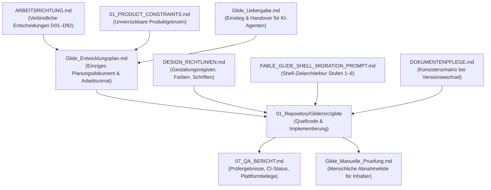
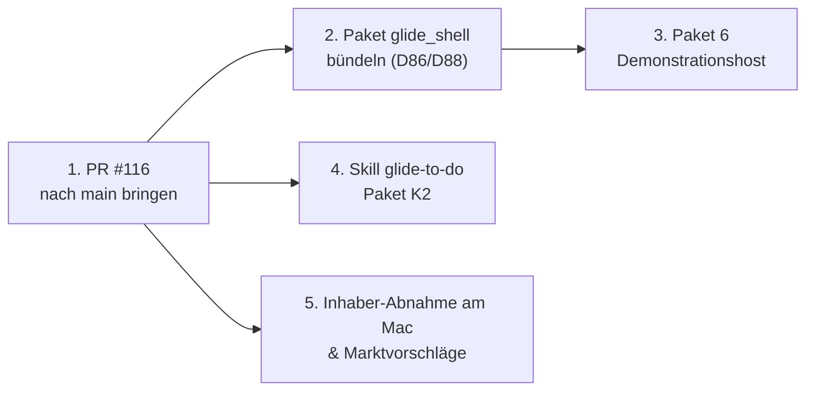

# Glide – Übergabe an eine neue Sitzung

Stand 16.11.2026 · Glide 3.69.0 · Aufgabenformat 26 · Glide-System V1.36

Einstieg für die nächste Sitzung: ganzheitlicher, kontextbasierter Überblick über den tatsächlichen Entwicklungsstand, die verbindliche Dokumentenautorität, die nächsten priorisierten Schritte und die verbindlichen Arbeitsregeln für KI-Agenten. Aufgaben und Rest führt der [Entwicklungsplan](Glide_Entwicklungsplan.md), Prüfergebnisse der [QA-Bericht](../01_Repository/Glide/docs/07_QA_BERICHT.md), Entscheidungen die [Arbeitsrichtung](../01_Repository/Glide/docs/ARBEITSRICHTUNG.md). Stand 16.11.2026 vollständig aktualisiert; frühere Übergabestände trägt Git.

---

## 0. Sofortübergabe WA-41 – zuerst lesen

> [!IMPORTANT]
> Diese Überschrift bleibt als bestehendes Linkziel im Gesamtsystem unverändert erhalten. Sie betrifft die historische Fehleruntersuchung zur Systemstabilität; aktuelle operative Entwicklungsprioritäten stehen in [Abschnitt 3](#3-nächste-arbeit-und-handlungsanweisungen).

- **WA-41A:** Sporadische Interpreter-/Prozessfehler auf PC-02 Intel, unter anderem `0xC0000005`, `0xC0000409`, „Executing a cache“. WHEA-/Systembefunde sind eine Hardware-Spur, kein abschließend bewiesener CPU-Defekt.
- **WA-41B:** Einmalig abweichender gespeicherter/geladener künstlicher Bestand; konkrete betroffene Felder und Ursache ungeklärt, kein belegter Verlust echter Nutzerdaten. Beide Spuren getrennt erhalten.
- **AMD-Gegenlauf:** Zehn isolierte AMD-Prozesse waren grün; vollständige Suiten erzeugten UUIDs/Zeitstempel selbst. Kein byteidentischer Intel-Replay und kein Ursachenbeweis. Siehe [AMD-Nachweis](https://github.com/n05a-design/glide-to-do/blob/40c20fd62db6ec31b4e3668dfc9e7f1550f67974/01_Repository/Glide/tests/qa-3.48.0/amd_vergleich_2026-10-27/README.md) und [Gerätevergleich](https://github.com/n05a-design/glide-to-do/blob/f1a5b5b6e0f97f2b5eab1ac552999c33c6416e69/01_Repository/Glide/tests/qa-3.49.0/geraetevergleich_2026-10-29/README.md).
- **Stabilitäts-Vorgabe:** BIOS-/CPU-Einstellungen nicht ändern, keine unnötige neue Stressserie am instabilen PC-02. Keine spekulativen Mengenschranken, kein Chunking oder willkürliches `gc.collect()` als angeblicher Fix. Historischen Referenzstand und Originalkriterien bewahren.
- **Dokumentierte Referenzen:** [Ursachenanalyse](https://github.com/n05a-design/glide-to-do/blob/40c20fd62db6ec31b4e3668dfc9e7f1550f67974/01_Repository/Glide/tests/qa-3.48.0/wa41_2026-10-27/README.md), [Python-Vergleich](https://github.com/n05a-design/glide-to-do/blob/40c20fd62db6ec31b4e3668dfc9e7f1550f67974/01_Repository/Glide/tests/qa-3.48.0/python315_vergleich_2026-10-27/README.md), [WHEA-/Lastbefunde und Dumpinventar](https://github.com/n05a-design/glide-to-do/blob/594f4c85eb60370a44282b06fcb8017df8181d70/01_Repository/Glide/tests/qa-3.50.5/abnahme_2026-11-05/aufbewahrung.json), [470-Dateien-Referenz](https://github.com/n05a-design/glide-to-do/blob/594f4c85eb60370a44282b06fcb8017df8181d70/01_Repository/Glide/tests/qa-3.50.5/abnahme_2026-11-05/aufbewahrung.json). Spätere Schutzfunktionen und Lieferungen schließen diese Ursachenfragen nicht.
- **Geschützte lokale Bestände:** `01_Repository/Glide/tests/qa-3.48.0/lokale_belege/eingang/initial.json` und `lokale_belege/minidumps/`; [Sicherungsmanifest](https://github.com/n05a-design/glide-to-do/blob/594f4c85eb60370a44282b06fcb8017df8181d70/01_Repository/Glide/tests/qa-3.50.5/abnahme_2026-11-05/aufbewahrung.json). Anfangsbestand 28.548.872 Bytes, SHA-256 `a3b8c0cac4c72e1820e71730ad78e312f2a30338678fbcfe2a2b6d91dae081f4`. Acht bekannte Minidumps sind keine FullMemory-Aufnahmen. Ein früher genannter externer Exportordner wurde nicht lokal bestätigt; keine Originale löschen.
- **Ablagegrenze:** Dumps, Rohlogs und lokale Eingänge bleiben Git-ausgeschlossen und sind bei Rechnerwechsel ausdrücklich geschützt zu übertragen. Temporärpfade und Runtimeorte aus alten Berichten vor Wiederverwendung prüfen; Version, `sys.executable`, Tk und Binärhashes erfassen. Der Standardbefehl `python` ist kein Laufzeitnachweis.

---

## 1. Tatsächlicher Stand

| Achse | Stand |
|---|---|
| **Version & Schemata** | **Glide 3.69.0** · Aufgabenformat **26** · Einstellungen **2** · Vorlagen **2** · Glide-System **V1.36** (99 Source-Module M001–M099, 114 Integrationssuiten, 5 Analysen). Basis auf `main` ist Commit `e2e0590b` (3.67.0, PR #115 Shell-Paket 4 gemergt). Aktiver Arbeitskandidat ist `claude/release-3690`. |
| **Shell-Paket 5 (3.68.0)** | **Vierter Shell-Baustein:** [`desktop_adapter.py`](../01_Repository/Glide/src/glide/desktop_adapter.py) (M099, 170 Zeilen) lagert anwendungsneutrale Menü-, Tastaturkürzel- und Betriebssystemfunktionen aus `app.pyw` aus: `build_menu_tree` (deklarativer rekursiver Menüaufbau mit Trennlinien und dynamischen Menüs), `DesktopMenuBar` (Frame-Erzeugung und sichere Popup-Verwaltung mit Grab-Release und Fokus-Wiederherstellung), OS-Aktionen (`launch_path`, `copy_to_clipboard`, `read_from_clipboard`) sowie Modifikatoren (`primary_modifier`, `format_accelerator`, `format_redo_accelerator`). Modulbudget WA-50 / T322 vollständig eingehalten. T313 [`test_desktop_adapter.py`](../01_Repository/Glide/tests/unit/test_desktop_adapter.py) mit 13 Testfällen. |
| **Shell-Paket 4 (3.67.0)** | **Dritter Shell-Baustein:** [`custom_controls.py`](../01_Repository/Glide/src/glide/custom_controls.py) (M098, ~1.440 Zeilen) lagert thementaugliche Canvas-Bedienelemente aus `app.pyw` aus: `CanvasLabel`, `GlideCheckbutton`, `GlideRadiobutton`, `GlideListbox`, `GlideScale`, `ThemedAutoScrollbar`, `rounded_rect_points`, `bind_resize`, `paint_canvas_backdrop`. `app.pyw` re-exportiert alle Steuerelemente. T312 [`test_custom_controls.py`](../01_Repository/Glide/tests/integration/test_custom_controls.py) mit 11 Testfällen. |
| **Agenten-Skill `glide-to-do` (3.66.0)** | **WA-61 (D91/D92):** Zentrierte Skill-Implementierung unter `01_Repository/Glide/skills/glide-to-do/`. Strikte Datenformatkopplung an Aufgabenformat 26 über `abdeckung.json`. Zentrales 4-Stufen-Prüfwerkzeug `ki_ausgabe.py` (T323), Werkzeugtest `test_ki_ausgabe.py` (T324), Vollprüfungs-Integrationssuite `test_ki_ausgabe_darstellung.py` (T325). Entwickler-Skill `glide-aufbau` und Referenz `glide-aufbau.md`. Datenformat 26 unverändert. |
| **Fokusrückgabe D87 (3.65.0)** | Modale Dialoge geben den Fokus beim Schließen kontrolliert an das aufrufende Fenster bzw. das vorher aktive Widget zurück (auch bei verschachtelten Unterdialogen). Sichtbares Verhalten unverändert, Datenformat 26 unverändert. |
| **Shell-Paket 3c (3.64.0)** | **Zweiter Shell-Baustein:** [`window_lifetime.py`](../01_Repository/Glide/src/glide/window_lifetime.py) (M097) ordnet Zeitgeber (`after`) sauber Fenstern oder Ansichten zu (`_after_bindings`), verhindert Zombie-Callbacks und Memory-Leaks bei Fensterschließung. `ListApp.after_scope` und `_register_after` dienen als Fassaden. T318 [`test_abbauvertrag.py`](../01_Repository/Glide/tests/integration/test_abbauvertrag.py) (5 Fälle) und T320 [`test_fensterlebensdauer.py`](../01_Repository/Glide/tests/integration/test_fensterlebensdauer.py) (9 Fälle). |
| **Shell-Paket 3a (3.62.0)** | **Erster Shell-Baustein:** [`modal_session.py`](../01_Repository/Glide/src/glide/modal_session.py) (M096) entkoppelt den modalen Warteweg aus `app.pyw`. `ListApp.run_modal` und Verwandte bleiben Fassaden. T317 [`test_modalvertrag.py`](../01_Repository/Glide/tests/integration/test_modalvertrag.py) (17 Fälle). |
| **Dreiecke & Details (3.63.x)** | Kleine gefüllte Dreiecke (D84), randlose Zeilenaktionen, „Alle bis morgen 09:00 Uhr“, vier Zeichenprofile (D85); 3.63.1/3.63.2: Anzeigeknopf „Standard ▾“, Kompaktkopf einheitlich 28 px, Linux-Bereichspfeile auf Kappenmitte zentriert. |
| **Prüfstand** | 3.69.0 lokal am Referenz-Mac (macOS arm64, Python 3.14.5, Tk 9.0.3, künstliche Daten): `ci_grundstufe.py` 19/19 grün (Exitcode 0), Standprüfung 0 Befunde, Testkatalog V1.36 5/5, Unit-Tests 1.230/1.230 grün, Desktop-Adapter-Test 13/13 grün, Shell-Importregel 7/7 grün, Modalvertrag 17/17 grün, Abbauvertrag 5/5 grün, Fensterlebensdauer 9/9 grün, Custom-Controls 11/11 grün. Vollprüfung Linux/Windows und CI-Workflows in GitHub Actions. |
| **Lieferstand** | `07_Python-Versionen` ist über `scripts/pflege/abgleich_07.py` vollständig SHA-256-synchron zu `src/glide` (`Glide-Aufgaben-und-Listen_v3.69.0.pyw`). Nativer macOS-Paketbau auf `main` grün. |
| **Ablage-Schutz** | Unberührt und NICHT in Git: `20_Grafik_Master/09_Inspiration/`, `GLIDE_STEPS_GESAMTAUDIT_V2_2026-11-10/` und `glide_master_audit_bericht.md`. Diese Pfade dürfen unter keinen Umständen gestaget oder committet werden. |

---

## 2. Zuständige Dokumente und Autoritätsmatrix

In diesem Projekt gilt die Regel **„Ein Thema, ein führendes Dokument“**. Kein Dokument dupliziert die Autorität eines anderen.



| Dokument | Führende Zuständigkeit |
|---|---|
| [`00_Arbeitsvorbereitung/Glide_Entwicklungsplan.md`](Glide_Entwicklungsplan.md) | **Einziges Planungsdokument:** Führt den gesamten Arbeitsvorrat ([§Aktueller Arbeitsvorrat](Glide_Entwicklungsplan.md#aktueller-arbeitsvorrat)), historische Sprints und chronologische Umsetzungsberichte ([§21.98](Glide_Entwicklungsplan.md#2198-richtungsentscheidungen-zur-shell-trennung-d86d90-15112026)–[§21.106](Glide_Entwicklungsplan.md#21106-glide-3680-shell-paket-5--aktionen-menüs-und-desktop-adapter-desktop_adapterpy-16112026)). Es entsteht kein zweiter Backlog! |
| [`01_Repository/Glide/docs/ARBEITSRICHTUNG.md`](../01_Repository/Glide/docs/ARBEITSRICHTUNG.md) | **Verbindliche Architektur- und Prozessentscheidungen:** Register D01 bis D92. Legt Arbeitsablauf, Modulaufteilung und Richtungsentscheidungen fest. |
| [`01_Repository/Glide/docs/01_PRODUCT_CONSTRAINTS.md`](../01_Repository/Glide/docs/01_PRODUCT_CONSTRAINTS.md) | **Produktgrenzen:** Was Glide bewusst ist und was es strikt ausschließt (kein Cloud-Sync, keine Telemetrie, keine Online-Konten, Offline-First). |
| [`01_Repository/Glide/docs/DESIGN_RICHTLINIEN.md`](../01_Repository/Glide/docs/DESIGN_RICHTLINIEN.md) | **Gestaltungsregister & UI-Verträge:** Typografie (Rubik, DM Mono, DM Serif Display, Charis SIL), Farben, Abstände, Randmaße und verbindliche D83-Regeln. |
| [`01_Repository/Glide/docs/07_QA_BERICHT.md`](../01_Repository/Glide/docs/07_QA_BERICHT.md) | **Prüf- und Lieferstände:** Führt die tatsächlichen Testergebnisse, CI-Status, Plattformnachweise und Grenzwerte geordnet nach Version und Commit. |
| [`00_Arbeitsvorbereitung/Glide_Manuelle_Pruefung.md`](Glide_Manuelle_Pruefung.md) | **Menschliche Abnahmeliste:** Fälle, die ausschließlich vom Inhaber interaktiv am Mac geprüft werden können (DPI, Sicht, Bedienung). |
| [`01_Repository/Glide/docs/DOKUMENTENPFLEGE.md`](../01_Repository/Glide/docs/DOKUMENTENPFLEGE.md) | **Pflegematrix:** Regelt, welche Dateien bei Versionswechsel, Merges oder neuen Modulen zwingend synchron nachgezogen werden müssen. |
| [`01_Repository/Glide/docs/FABLE_GLIDE_SHELL_MIGRATION_PROMPT.md`](../01_Repository/Glide/docs/FABLE_GLIDE_SHELL_MIGRATION_PROMPT.md) | **Shell-Zielarchitektur:** Sechsstufiger Migrationsplan zur vollständigen Herauslösung des Tk-Frameworks `glide_shell` aus der Anwendung. |
| [`00_Arbeitsvorbereitung/Glide_Markt_und_Vorbilder.md`](Glide_Markt_und_Vorbilder.md) | **Marktrecherchen & Konkurrenzanalyse:** Begründungen und Hintergrundrecherchen für künftige Vorschläge (WA-08 bis WA-60). |
| [`01_Repository/Glide/AGENTS.md`](../01_Repository/Glide/AGENTS.md) | **Agenten-Regeln:** Repository-spezifische Richtlinien für autonome Agenten. |

---

## 3. Nächste Arbeit und Handlungsanweisungen

Die nächsten Schritte sind strikt nach Dringlichkeit und logischer Abhängigkeit geordnet:



### Schritt 1: Aktuellen PR abschließen und nach `main` überführen (Priorität 1)
- **Status:** Branch `claude/release-3690` (Glide 3.69.0, System V1.36, Shell-Paket 5 `desktop_adapter.py`, Dokumentations- und Übergabekonsolidierung, Headless-CI-Absicherung).
- **Aktion:** Sicherstellen, dass GitHub Actions CI (Grundstufe und Vollprüfung) grün durchläuft. Nach erfolgreichem Durchlauf bittet der Agent den Inhaber um den Merge nach `main`.

### Schritt 2: Paket `glide_shell` bündeln (Vorstufe vor Paket 6, D86/D88)
- **Kontext:** Gemäß Richtungsentscheidungen D86–D90 ([Plan §21.98](Glide_Entwicklungsplan.md#2198-richtungsentscheidungen-zur-shell-trennung-d86d90-15112026)) wurden die vier Shell-Module flach in `src/glide` abgelegt:
  1. `modal_session.py` (M096)
  2. `window_lifetime.py` (M097)
  3. `custom_controls.py` (M098)
  4. `desktop_adapter.py` (M099)
- **Ziel:** Bündelung dieser vier Module in ein eigenständiges Python-Paket `glide_shell` (oder Namespace-Paket unter `src/glide_shell`), ohne die Anwendung `app.pyw` zu brechen (`app.pyw` importiert dann aus `glide_shell`).
- **Bedingung:** Modulbudget (WA-50 / T322) und Shell-Importregeln (D86 / T319) bleiben gewahrt; keine Rückwärtsabhängigkeit von `glide_shell` auf `glide`.

### Schritt 3: Paket 6 – Demonstrationshost und Wiederverwendungsnachweis
- **Ziel:** Nachweis, dass `glide_shell` eine eigenständige Mini-Anwendung betreiben kann (Wiederverwendbarkeit ohne Glide-Fachlogik).
- **Umfang:** Minimaler Demo-Host mit Menüleiste, modalem Dialog, Canvas-Bedienelementen und sauberem Abbau/Fokusrückgabe.

### Schritt 4: Agenten-Skill `glide-to-do` Paket K2 (WA-61)
- **Kontext:** Paket K1 und zentrierte Struktur D92 sind in 3.66.0 geliefert.
- **Ziel K2:** Gemeinsame Tk-freie Quelle für Datenmodelle und Schema-Validierung (Entkopplung von `app.pyw`-Re-Exports), automatische Generierung von Referenzdateien aus den Glide-Quellkonstanten.
- **Hinweis:** Freigabe durch Inhaber erforderlich; E-K5 vor K3 beachten.

### Schritt 5: Menschliche Abnahme am Mac (Nur durch den Inhaber)
Folgende Punkte aus der [Prüfliste](Glide_Manuelle_Pruefung.md) erfordern die menschliche Sicht- und Bedienprüfung am macOS-Gerät:
1. **Fokusrückgabe (D87, 3.65.0):** Prüfen, ob nach dem Schließen modaler Dialoge (und Unterdialoge) der Fokus verlässlich ins aufrufende Fenster/Element zurückkehrt.
2. **Entlastungsdialog mit Gründen (D81, 3.61.0):** Verständlichkeit der Überlastungsgründe bei Terminkonflikten.
3. **Meldung bei nicht erreichbarem Datenordner (D82, 3.61.0):** Hinweis bei nicht gemountetem Netzlaufwerk/USB-Stick.
4. **Suche nach zerlegten Umlauten (3.61.0):** Auffinden von NFD-normalisiertem Text (z. B. aus macOS-Dateinamen kopiert).
5. **Kompaktkopf & Anzeigeknopf (3.63.1/3.63.2):** Kompaktkopf einheitlich 28 px; Anzeigeknopf im Zeicheneditor „Standard ▾“.

### Schritt 6: Marktvorschläge und Inhaberangaben (Nur durch den Inhaber)
- **Marktreihung:** Inhaberentscheidung zur Priorisierung von WA-08 (Soll-Ist-Schätzfaktor), WA-20 (Wochenabsicht), WA-12-Rest (Puffer nach Terminen, Spätstart-Frage) und WA-53 bis WA-59 (Chancen aus §21.70).
- **Inhaberangaben:** I1 (Impressum/Anbieter), I3 (Developer-ID-Signierung & Notarisierung macOS), I4 (Markenprüfung Glide), I11 (Releasefreigabe).

---

## 4. Verbindliche Arbeitsregeln und Schutzplanken für KI-Agenten

Jeder KI-Agent, der an diesem Projekt arbeitet, hat folgende verbindliche Regeln ausnahmslos zu befolgen:

### 4.1 Sprache & Kommunikation
- **Ausschließlich Deutsch:** Alle Ausgaben, Dokumentationstexte, Git-Commit-Nachrichten, PR-Titel und PR-Beschreibungen werden in deutscher Sprache verfasst.

### 4.2 Git- und Zweig-Workflow
- **Niemals Direkt-Push auf `main`:** `main` ist geschützt. Alle Änderungen entstehen auf Topic-Branches nach dem Muster `claude/<thema>` (z. B. `claude/shell-paket-5-desktop-adapter`).
- **Pull Requests:** Für jeden Schnitt wird ein Pull Request auf GitHub eröffnet. Der Merge nach `main` erfolgt erst nach erfolgreicher CI-Prüfung und durch den Inhaber.
- **Atomare, saubere Schnitte:** Jeder Schnitt hat eine klare Aufgabe, eigene Tests, aktualisierte Dokumente und einen sauberen Versionswechsel.

### 4.3 Strenger Schutz untrackter und lokaler Dateien (Safeguard)
- Folgende Ordner und Dateien existieren im Arbeitsverzeichnis, sind lokal geschützt und dürfen **NIEMALS** gestaget, committet oder verändert werden:
  - `20_Grafik_Master/09_Inspiration/`
  - `GLIDE_STEPS_GESAMTAUDIT_V2_2026-11-10/`
  - `glide_master_audit_bericht.md`
- Vor jedem `git add` ist der Status mit `git status` zu prüfen. Niemals blind `git add .` oder `git add -A` ausführen!

### 4.4 Shell-Architekturregeln (D86 / T319)
- Shell-Module (`modal_session.py`, `window_lifetime.py`, `custom_controls.py`, `desktop_adapter.py`) dürfen **ausschließlich die Python-Standardbibliothek und `tkinter` importieren**.
- Sie dürfen **keine** Glide-Fachmodule (`glide.*`, `app.pyw`, `runtime_config`, `brand`, etc.) importieren.
- **Verbotene Bezeichner:** In Shell-Modulen dürfen keine Variablen, Funktionen oder Parameter verwendet werden, die mit `("glide_", "APP_", "ERROR_LOG", "THEMES", "theme")` beginnen (Safeguard in `test_shell_importregel.py` T319). Für Farbstile Begriffe wie `palette`, `style`, `bg_color` etc. verwenden.
- Jedes neue Shell-Modul muss in `SHELL_MODULE` in `01_Repository/Glide/tests/unit/test_shell_importregel.py` registriert werden.

### 4.5 Modulbudget (WA-50 / T322)
- Für neue und modularisierte Dateien gilt:
  - Jede Funktion / Methode: **höchstens 50 Zeilen Code**.
  - Maximale Verschachtelungstiefe: **höchstens 15**.
  - 0 Tk-Imports in reiner Fachlogik.
- Wird automatisch über `01_Repository/Glide/tests/tools/test_modulbudget.py` (T322) und `analyse_statisch.py` geprüft.

### 4.6 Mac-Vertragsprüfpflicht (D90)
- Vor dem Eröffnen eines Pull Requests für Shell-Schnitte müssen lokal auf dem Referenz-Mac (macOS arm64) mindestens folgende Tests erfolgreich ausgeführt werden:
  ```bash
  python3 01_Repository/Glide/tests/integration/test_modalvertrag.py
  python3 01_Repository/Glide/tests/integration/test_abbauvertrag.py
  python3 01_Repository/Glide/tests/integration/test_fensterlebensdauer.py
  python3 01_Repository/Glide/tests/integration/test_custom_controls.py
  python3 01_Repository/Glide/tests/unit/test_desktop_adapter.py
  python3 01_Repository/Glide/tests/unit/test_shell_importregel.py
  cd 01_Repository/Glide && python3 -B tests/tools/ci_grundstufe.py
  ```

### 4.7 Test-Isolierung und Datenschutz
- **Datenisolierung:** Automatisierte und manuelle Tests dürfen niemals den echten Nutzer-Datenordner berühren. Vor jedem Start oder Import ist die Umgebungsvariable `GLIDE_DATA_DIR` auf ein temporäres Verzeichnis (z. B. über `tempfile.mkdtemp()`) zu setzen, **bevor** irgendein Modul importiert wird!
- **Datenschutz:** Keine versionierten Dateien dürfen echte Benutzernamen oder benutzerspezifische Pfade (`/Users/<Name>/`, `C:\Users\<Name>`, `/home/<Name>/`) enthalten. Nur erlaubte Platzhalter (`shared`, `runner`, etc.) verwenden.

### 4.8 Versions- und Dokumentenpflege
- Bei jedem Versionswechsel müssen folgende Werkzeuge aus `01_Repository/Glide` ausgeführt werden:
  1. `python3 scripts/pflege/versionswechsel.py <neue_version> <datum>` (aktualisiert `VERSION`, `GLIDE_SYSTEM_VERSION`, `app.pyw`, Fixtures und Metadaten).
  2. `python3 scripts/pflege/abgleich_07.py` (synchronisiert `07_Python-Versionen` bytegleich mit `src/glide`).
  3. `CHANGELOG.md` mit neuem Versionsabschnitt und Datum ergänzen.
  4. `01_Repository/Glide/src/glide/README.md` (Systembestand Mxxx/Txxx) aktualisieren.
  5. `standpruefung.py` und `ci_grundstufe.py` zur Validierung durchlaufen lassen.
