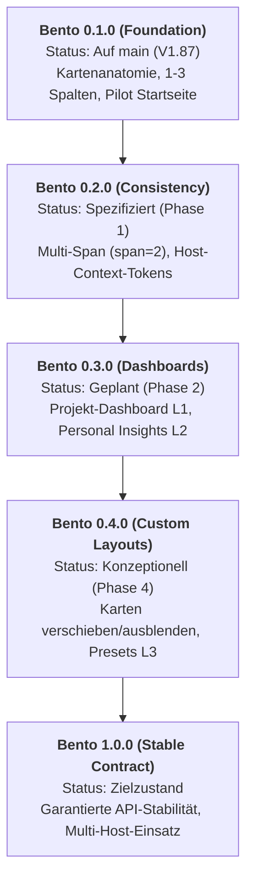

# Glide Bento Box System – Architektur- und UI-Kompositionskonzept

Stand 26.11.2026 · Glide 1.0.3 (Entwicklungsstand 1.1.0) · Glide Bento Version 0.2.0 · Glide-System V1.88 · Glide Shell 0.6.2 · Format 26 · Entscheidung D100

Das **Glide Bento Box System** (Kurzbezeichnung: **Glide Bento**, Paketname: `glide_bento`) ist eine wiederverwendbare, modulare UI-Kompositionsschicht für kartenbasierte Benutzeroberflächen, Bento-Dashboards und adaptive Inhaltsraster in Python/Tkinter. Es bildet die architektonische **Ebene B** im Glide-Gesamtsystem.

---

## 1. Vision und Zielsetzung

Glide besitzt eine eigenständige Aufgaben- und Projektanwendung (Ebene A), ein dokumentarisches Systemregister (Ebene D) und ein wiederverwendbares Desktop-Fundament (Glide Shell, Ebene C).

Glide Bento schließt die Lücke zwischen generischen Shell-Widgets und konkreter Anwendungsfachlogik:
- **Systematisierung statt Redesign:** Bestehende Gestaltungswerte (`ui_design.py`, `RADII`, `SPACING`, `FONT_SIZES`) werden semantisch abstrahiert, ohne die vertraute visuelle Identität von Glide zu verändern.
- **Wiederverwendbarkeit:** Kartenanatomie, Header, Aktionsleisten, Metriken und responsive Raster stehen anwendungsneutral zur Verfügung und können in Folgeprojekten (z. B. STEPS, Chess & Chains) genutzt werden.
- **Freiheit von Fachlogik:** Das Bento-System kennt weder Aufgaben noch Notizen noch Gismo noch Datenbanken. Es rendert generische Inhalts- und Aktionsstrukturen, die vom Host bereitgestellt werden.
- **Deterministische Layout-Engine:** Ein Tk-freier Layout-Planner berechnet Spaltenanzahl, Breiten und Kartenplatzierung rein mathematisch vor der Widget-Erzeugung.
- **Volle Theme- und Provider-Unterstützung:** Farben, Schriften, Icons und Lokalisierung werden strikt über den Host-Kontext bezogen.

---

## 2. Das 4-Ebenen-Architekturmodell

```text
┌────────────────────────────────────────────────────────┐
│               Ebene A – Glide Application              │
│  (Aufgaben, Notizen, Gismo, Lokalisierung, Fachdaten)  │
└───────────┬────────────────────────────────┬───────────┘
            │                                │
            ▼                                ▼
┌───────────────────────────┐   ┌───────────────────────────┐
│ Ebene B – Glide Bento Box │   │ Ebene C – Glide Shell     │
│  (Karten, Grid, Tokens,   ├──►│  (Fenster, Lifetime,      │
│   Layout-Engine, Specs)   │   │   Modal, Custom Controls) │
└───────────────────────────┘   └─────────────┬─────────────┘
                                              │
                                              ▼
                                ┌───────────────────────────┐
                                │   Tkinter / Standard-Bib  │
                                └───────────────────────────┘

┌────────────────────────────────────────────────────────┐
│ Ebene D – Glide-System (Register & Dokumentenrahmen)    │
└────────────────────────────────────────────────────────┘
```

### Verbindliche Abhängigkeitsregeln

1. **Glide Application (Ebene A)** darf `glide_bento` und `glide_shell` importieren.
2. **Glide Bento (Ebene B)** darf die öffentliche Schnittstelle von `glide_shell` nutzen (`custom_controls`, `window_lifetime`, `text_fit`).
3. **Glide Bento darf NIEMALS** Module der Glide Application importieren (weder `app.pyw` noch `home_tiles` noch `home_dashboard`).
4. **Glide Shell (Ebene C)** bleibt vollständig unabhängig von `glide_bento`.
5. **Keine zirkulären Abhängigkeiten**, keine globalen Singleton-Kopplungen, keine festen Produktfarben im neutralen Bento-Kern.

---

## 3. Paketstruktur (`src/glide/glide_bento`)

```text
01_Repository/Glide/src/glide/glide_bento/
├── __init__.py                # Öffentliche API und BENTO_VERSION = "0.1.0"
├── tokens.py                  # Semantische Design-Tokens und Skalen
├── context.py                 # BentoContext & Host-Provider (Theme, Fonts, Icons)
├── specs.py                   # BentoCardSpec, BentoGridSpec & Datenklassen
├── layout.py                  # Tk-freier deterministischer Layout-Planner
├── card.py                    # BentoCard, BentoHeader, BentoBody, BentoFooter
├── grid.py                    # BentoGrid (Multi-Column-Container mit Scrollsupport)
├── components.py              # BentoMetric, BentoActions, BentoEmptyState
├── demo.py                    # Eigenständiger Referenzhost (python -m glide_bento.demo)
├── selftest.py                # Autonomer Bento-Selbsttest
├── README.md                  # Dokumentation für Entwickler (Englisch)
├── README.de.md               # Dokumentation für Entwickler (Deutsch)
└── BENTO_DESIGN_CONTRACT.md   # Portabler Design- und Gestaltungsvertrag
```

---

## 4. Semantische Token-Architektur

Das Token-System übersetzt fundamentale Skalen in nachvollziehbare semantische Rollen:

| Token | Wert / Basis | Semantische Bedeutung |
|---|---|---|
| `layout.gap.default` | 12 px (`SPACING[12]`) | Standard-Abstand zwischen Bento-Karten |
| `layout.margin.default` | 16 px (`SPACING[16]`) | Randabstand des Rasters zum Fenster |
| `card.radius` | 18 px (`RADII["card"]`) | Eckenradius von Bento-Karten |
| `card.padding.x` | 18 px (`SPACING[18]`) | Horizontaler Innenabstand der Karte |
| `card.padding.y` | 15 px (`SPACING[15]`) | Vertikaler Innenabstand der Karte |
| `card.header.gap` | 8 px (`SPACING[8]`) | Abstand zwischen Header und Body |
| `card.min_width` | 300 px | Minimale lesbare Breite einer Kachel |
| `card.row_height.task`| 36 px (`ROW_HEIGHTS["task"]`) | Zeilenhöhe für kompakte Einträge |

Farben und Stile werden zur Laufzeit über den `BentoContext` aufgelöst. Unterstützt werden Standard-, Dark-, Kontrast- und Glass-Themes.

---

## 5. Responsive Layout-Engine

Die Layoutberechnung erfolgt zweistufig:

1. **BentoLayoutPlanner (Tk-frei):**
   - Berechnet anhand der verfügbaren Inhaltsbreite und `card.min_width` (300 px) zzgl. Lücken (16 px) die optimale Spaltenzahl (1 Spalte < 616 px, 2 Spalten ab 616 px, 3 Spalten ab 932 px).
   - Platziert Vollbreitenkarten im oberen Kopfbereich (`span="full"`).
   - Verteilt variable Karten über einen deterministischen Greedy-Algorithmus auf die jeweils vertikal kürzeste Spalte.
2. **BentoGrid (Tk-Renderer):**
   - Überträgt das berechnete Raster verlustfrei auf Tkinter-Frames.
   - Verhindert Resize-Oszillationen durch Entprellung und Schwellenstabilisierung.
   - Unterstützt sanftes vertikales Scrollen ohne verschachtelte Scrollkonflikte.

---

## 6. Pilotmigration: Glide Home

Die Startseite von Glide (`render_home` in `app.pyw`) wird schrittweise auf Bento-Karten umgestellt:
- Bestehende 20 Kacheldefinitionen in `home_tiles.py` bleiben unverändert erhalten.
- Der Adapter `TileUI` in `home_task_tiles.py` nutzt Bento-Kartenkomponenten.
- Die Kacheln „Heute“, „Woche“, „Gismo“, „Zeichnungen“, „Galerie“, „Angeheftet“ usw. behalten 100 % ihrer Funktionen, Interaktionen und Tooltips.
- Keine Datenformatmigration: Datenformat 26 und das Austauschformat 2 bleiben unverändert.

---

## 7. Qualitätssicherung und Nachweise

- **Import-Isolation:** Ein dedizierter Test prüft, dass `glide_bento` keine Glide-Fachmodule importiert und `glide_shell` unabhängig von `glide_bento` bleibt.
- **Tk-freie Unittests:** Layout-Berechnungen werden ohne grafische Anzeige mathematisch auf Determinismus getestet.
- **Echte Tk-Integrationstests:** Karten, Header, Aktionen, Resize und Theme-Wechsel werden unter realem Tk (unter Xvfb im CI-Lauf) getestet.
- **Referenzhost:** `python3 -B -m glide_bento.demo` demonstriert alle Komponenten ohne Glide-Import.

---

## 8. Vollständiger Bento-Komponentenkatalog (0.1.0 und geplanter Ausbau)

Der Komponentenbestand von `glide_bento` gliedert sich in deklarative Datenstrukturen, Layout-Engines, visuelle Kartenkomponenten und interaktive Hilfselemente:

| Komponente | Quelldatei | Zweck & Öffentliche API | Unterstützte Varianten & Zustände | Aktueller Einsatzort | Geplanter Ausbau (0.2.0+) |
|---|---|---|---|---|---|
| **`BentoCard`** | `card.py` | Universeller Karten-Container. API: `BentoCard(parent, spec, context)`. | Varianten: `standard`, `compact`, `featured`. Zustände: Normal, Hover, Focus, Selected. | Startseite `home_task_tiles.py` (Pilot). | Subtile Randverläufe, adaptive Schatten, Tastaturfokus-Ring. |
| **`BentoHeader`** | `card.py` | Kopfleiste für Karten mit Titel, Unterzeile, Symbol und Aktionen. API: `BentoHeader(master, context, title=None, icon=None, subtitle=None, action=None, **kwargs)`. | Varianten: `default`, `compact`, `minimal`. | Startseiten-Kacheln. | Integrierte Status-Badges, Tooltip-Anbindung. |
| **`BentoGrid`** | `grid.py` | Responsiver Raster-Container mit Canvas-Scrollsupport und dynamischem Spaltenumbruch. | Spalten: 1, 2 oder 3 Spalten basierend auf Breite. | Startseite `render_home`. | Multi-Span Rendering (`span=2`), ruckelfreies Resize. |
| **`BentoContext`** | `context.py` | Dependency-Injection-Behälter für Theme, Schriften, Icons und Lokalisierung. | Auflösung über Host-Provider oder neutrale Fallbacks. | Alle Bento-Widgets. | Dynamisches Event-Abonnement bei Theme-Wechsel ohne Neuaufbau. |
| **`BentoTokens`** | `tokens.py` | Semantische Design-Tokens für Abstände, Radien, Höhen und Typografie. | Immutable Dataclass mit Skalen. | `card.py`, `grid.py`, `components.py`. | Vollständiger Abgleich mit Host-Thementokens (Variante C). |
| **`BentoCardSpec`** | `specs.py` | Deklarative Spezifikation einer Karte (`key`, `title`, `span`, `weight`, `order`, `visible`, `variant`, `heading_action`, `extra`). | `span` (`1` oder `"full"` in 0.1.0; `2` in 0.2.0), `weight` (int), `variant`. | Kachel-Definitionen in `app.pyw`. | Deklarative Sichtbarkeitsregeln, erweiterte Layout-Parameter. |
| **`BentoGridSpec`** | `specs.py` | Deklarative Rasterspezifikation (Lücken, Schwellenwerte, Randabstände). | Standard-Gaps: 12 px, Margin: 16 px, Breakpoints: 616/932 px. | `grid.py`. | Benutzerdefinierte Breakpoints je Host. |
| **`BentoLayoutPlan`**| `specs.py` | Unveränderlicher Berechnungsplan für die Kartenplatzierung. | Spaltenanzahl, Spaltenbreiten, Karten-zu-Spalte-Zuordnung. | Ausgabe von `BentoLayoutPlanner`. | Zeilen- und Spaltenkoordinaten für Multi-Span-Karten. |
| **`BentoLayoutPlanner`**| `layout.py` | Deterministischer, Tk-freier Layout-Rechner mit gieriger Spaltenverteilung. | Reine Berechnungslogik ohne Tkinter-Import. | `grid.py`, Unittests T341/T342. | Echter 2-von-3-Spalten-Algorithmus mit Lückenminimierung. |
| **`BentoMetric`** | `components.py` | Darstellung prominenter Kennzahlen (Zahl, Einheit, Trend, Beschriftung). | Varianten: `large`, `medium`, `compact`. | Heute-Zusammenfassung auf Startseite. | Miniatur-Sparklines / Verlaufsbalken. |
| **`BentoActions`** | `components.py` | Einheitliche Aktionsleiste für sekundäre Kartenaktionen. | Anordnung: Horizontal rechtsbündig oder vertikal gestapelt. | Fußleisten komplexer Kacheln. | Dropdown-Menü-Unterstützung für Overflow-Aktionen. |
| **`BentoEmptyState`**| `components.py` | Visueller Leerzustand mit Illustration/Symbol, Titel, Text und Aktion. | Kompakt oder zentriert. | Leere Startseiten-Bereiche. | Universeller Einsatz in Fachmodulen (WA-52). |
| **`BentoDivider`** | `components.py` | Feine Trennlinie nach D83-Gestaltungsregeln. | Horizontal oder vertikal, 1 px Höhe. | Kachel-Gliederung. | Themenangepasste Randüberblendung. |
| **Bento Demo** | `demo.py` | Standalone-Referenzanwendung (`python -m glide_bento.demo`). | Demonstriert alle Komponenten ohne Glide-Import. | Manuelle Sichtprüfung und Verifikation. | Interaktive Regler für Schwellenwerte und DPI-Skalierung. |
| **Bento Selftest** | `selftest.py` | Autonomer 13-Punkte-Selbsttest (`python -m glide_bento.selftest`). | Prüft Importe, Layoutdeterminismus, Tokens und Widgets. | CI-Grundstufe und Paketbau. | Erweiterung auf 15 Checks (Multi-Span- und Tokenverträge). |

---

## 9. Token-Reconciliation: Variantenvergleich und Architekturentscheidung

Zwischen dem Host-Gestaltungsmodul `src/glide/ui_design.py` und dem Bento-Token-Modul `src/glide/glide_bento/tokens.py` existieren derzeit parallele Skalen für Abstände (`SPACING`), Radien (`RADII`), Schriftgrößen und Zeilenhöhen. Um Doppelpflege und Brüche zu vermeiden, wurden drei Architekturvarianten untersucht:

### 9.1 Die drei Varianten im Vergleich

- **Variante A: Foundation-Tokens in die Framework Shell auslagern (`glide_shell.tokens`)**
  - *Konzept:* Die Framework Shell definiert neutrale Basisskalen. Glide und Bento importieren diese.
  - *Bewertung:* Widerspricht dem Shell-Prinzip (D86, D94–D99): Die Shell soll rein funktionale Desktop-Mechanismen (Fenster, Modal, Lifetime) bereitstellen und keine starren Designvorgaben machen. Verschiedene Hosts (z. B. Glide vs. Chess) benötigen unterschiedliche Grundästhetiken.
- **Variante B: Eigenständiges Token-Paket (`glide_tokens`)**
  - *Konzept:* Ein fünftes separates Mini-Paket nur für Design-Tokens.
  - *Bewertung:* Unnötiger administrativer Aufwand; erzeugt Fragmentierung, zusätzliche Importpfade und erhöht den Pflegeaufwand bei jedem Versionswechsel unverhältnismäßig.
- **Variante C: Expliziter Host-Context-Token-Vertrag (Empfohlen für Bento 0.2.0)**
  - *Konzept:* `glide_bento` definiert rein semantische Tokens (`BentoTokens`) mit neutralen Standardwerten für Standalone-Demos und Fremdhosts. Beim Start injiziert der konkrete Host (Glide über `ui_design.py`) seine aktiven Werte in den `BentoContext`.
  - *Vorteile:*
    1. **100 % Entkopplung:** Bento bleibt völlig frei von Glide-Code.
    2. **Keine Doppelpflege:** Glide pflegt seine Master-Skalen zentral in `ui_design.py`.
    3. **Portabilität:** Folgeprojekte (STEPS, Chess) übergeben einfach ihre eigenen Tokens.
    4. **Sicherheit:** Fehlt die Host-Injektion, greifen robuste neutrale Fallbacks.

### 9.2 Entscheidungsmatrix

| Kriterium | Variante A (Shell) | Variante B (Eigenes Paket) | Variante C (Host-Injection) |
|---|---|---|---|
| **Abhängigkeitsrichtung** | ✕ Shell wird mit UI-Design belastet | ◐ Erzeugt neues Modul | ✅ Perfekt: Host → Context → Bento |
| **Portabilität für Fremdhosts** | ◐ Bindet Fremdhosts an Shell-Tokens | ◐ Zusätzliche Abhängigkeit | ✅ Jeder Host liefert eigene Tokens |
| **Migrationsaufwand** | Hoch (Umbau von Shell und Host) | Hoch (Neues Paket) | **Niedrig (Adapter in `BentoContext`)** |
| **Vermeidung von Doppelpflege** | ✅ Zentral in Shell | ✅ Zentral im Paket | ✅ Zentral im jeweiligen Host |
| **Shell-Unabhängigkeit** | ✕ Verletzt D94/D99-Entkopplung | ✅ Shell bleibt frei | ✅ Shell bleibt frei |
| **Wartbarkeit & Testbarkeit** | Moderat | Aufwendig | **Hervorragend (Unit-Tests via Mock-Context)** |

**Architekturempfehlung:** Umsetzung von **Variante C** im Übergabepaket 1 für Bento 0.2.0.

**Umgesetzt (0.2.0, 26.11.2026):** `BentoTokens.from_host(mapping, base=DEFAULT_TOKENS, strict=False)` übernimmt bekannte Namen als nichtnegative ganze Zahlen, legt unbekannte in `custom` ab und leitet fehlende Zwei-/Dreispaltenschwellen aus Mindestbreite und Abstand ab; ohne Mapping bleibt `DEFAULT_TOKENS`. `BentoContext` trägt `theme_provider`, `token_provider` und `button_factory`; `for_host(...)` legt an und befüllt, `refresh_from_host(**felder)` liest nach Design-, Schrift- oder Glaswechsel neu, ohne den Kontext auszutauschen. Glide liefert seine Skalen allein aus `ui_design.bento_token_values()` und den Startseitenmaßen (`ListApp.glide_bento_context`); die Werte entsprechen den neutralen Fallbacks, sichtbar ändert sich nichts. Komponenten erhalten Knöpfe über `context.make_button` (Glide: abgerundete Dialogknöpfe, ohne Host neutrale Tk-Knöpfe).

---

## 10. Multi-Span Layout-Algorithmus (Spezifikation für Bento 0.2.0)

In Bento 0.1.0 unterstützen Karten entweder eine einzelne Spalte (`span=1`) oder die volle Breite über alle verfügbaren Spalten (`span="full"`). Bento 0.2.0 führt echte Mehrspaltenkarten ein (`span=2` im 3-Spalten-Raster).

### 10.1 Trennung von visueller Variante und Spaltenbelegung

Um semantische Klarheit zu gewährleisten, werden Layout-Geometrie und visuelle Darstellung strikt entkoppelt:

1. **`span` (Layout-Geometrie):** Gibt an, wie viele Spalten die Karte im aktuellen Spaltenraster belegt (`1`, `2`, oder `"full"`).
2. **`variant` (Visuelle Stilistik):** Bestimmt Rahmen, Polsterung und Hintergrund (`standard`, `compact`, `featured`).
3. **`weight` (Relatives Inhaltsgewicht):** Steuert die vertikale Gewichtsverteilung ohne synchrone Render-Messung (`1` bis `5`).

### 10.2 Reflow-Regeln bei variabler Fensterbreite

Der `BentoLayoutPlanner` wendet folgende deterministische Reflow-Regeln an:

```text
3-Spalten-Raster (Breite >= 932 px):
┌───────────────────────┬───────────────────────┬───────────────────────┐
│     Karte A (span=2)                          │     Karte B (span=1)  │
├───────────────────────┼───────────────────────┼───────────────────────┤
│     Karte C (span=1)  │     Karte D (span=1)  │     Karte E (span=1)  │
└───────────────────────┴───────────────────────┴───────────────────────┘

2-Spalten-Raster (616 px <= Breite < 932 px):
┌───────────────────────────────────────────────┬───────────────────────┐
│     Karte A (span=2 -> belegt volle 2 Spalten)                        │
├───────────────────────────────────────────────┬───────────────────────┤
│     Karte B (span=1)                          │     Karte C (span=1)  │
├───────────────────────────────────────────────┼───────────────────────┤
│     Karte D (span=1)                          │     Karte E (span=1)  │
└───────────────────────────────────────────────┴───────────────────────┘

1-Spalten-Raster (Breite < 616 px):
┌───────────────────────────────────────────────────────────────────────┐
│     Karte A (span=1, volle Fensterbreite)                             │
├───────────────────────────────────────────────────────────────────────┤
│     Karte B (span=1, volle Fensterbreite)                             │
├───────────────────────────────────────────────────────────────────────┤
│     Karte C (span=1, volle Fensterbreite)                             │
└───────────────────────────────────────────────────────────────────────┘
```

### 10.3 Platzierungs- und Antikollisions-Algorithmus

1. **Zeilen-Tracking:** Der Planner führt ein Belegungs-Array für jede Spalte mit aktuellem Höhenstand (`column_heights = [0, 0, 0]`).
2. **Span-Prüfung:** 
   - `span=1`: Wird in die Spalte mit der minimalen Höhe gesetzt (`min(column_heights)`).
   - `span=2` (im 3-Spalten-Raster): Prüft die beiden möglichen Spaltenpaare (Spalte 0+1 vs. Spalte 1+2). Wählt das Paar, dessen maximale Höhe geringer ist. Beide Spalten werden auf `max(h_a, h_b) + card_height` angeglichen.
   - `span="full"`: Wird über alle Spalten gelegt; alle Spalten werden auf `max(column_heights) + card_height` gesetzt.
3. **Widget-Retention:** Bei Neuberechnung durch Fenster-Resize werden bestehende Tk-Karten-Instanzen wiederverwendet und lediglich per `grid(row=..., column=..., columnspan=...)` neu positioniert. Kein Flackern, kein Zerstören des internen Widget-Zustands.
4. **Fokus-Erhalt:** Der aktive Tastaturfokus bleibt während des Spaltenumbruchs auf dem fokussierten Element erhalten.

### 10.3a Umgesetzter Algorithmus in 0.2.0 (verbindlich, ersetzt die Skyline-Skizze aus 10.3)

Die Skizze in 10.3 rechnet mit Pixelhöhen je Spalte; die tatsächliche Kartenhöhe kennt Tk aber erst nach dem Zeichnen. Umgesetzt ist deshalb das deterministische **Bandmodell** aus 10.4 Punkt 3, erweitert um zweispaltige Bahnen. `BentoLayoutPlanner.plan_bands(cards, column_count, full_width_first)` arbeitet in Lesereihenfolge (stabil nach `order`, dann Eingabefolge):

1. **Vollbreite** (`span="full"`, `"wide"`, `3` oder `variant="full_width"`) bildet ein eigenes Band `full`.
2. **Einspaltige Karten** sammeln sich in einem Band `flow`; jede Karte kommt in die Bahn mit dem kleinsten Gewicht, bei Gleichstand links.
3. **`span=2` im Dreispaltenraster** öffnet ein Band `split`: zweispaltige Bahn links (`extra["align"] == "end"`: rechts), daneben füllen die nächsten einspaltigen Karten die freie Spalte, bis deren Gewicht das der breiten Karte erreicht. Bleibt die freie Spalte leer, wird die Karte zur vollen Breite – **keine unvermeidbare Restfläche**.
4. **Breakpoints:** Im Zweispaltenraster belegt `span=2` beide Spalten (Band `full`), im Einspaltenraster ist jede Karte einspaltig. Spaltenzahl wie bisher: unter `card_min_width·2+gap` eine, unter `·3+2·gap` zwei, darüber drei Spalten (Glide: 616/932 px).
5. **`full_width_first`** (`BentoGridSpec`) stellt alle Vollbreitenkarten wie in 0.1.0 vor das Raster; Glides Startseite nutzt das, damit „Ganze Breite“ weiter „über dem Raster“ bedeutet.
6. **Fehlerhafte Spezifikationen:** unbekannte `span`-Werte gelten als eine Spalte, doppelte Schlüssel werden verworfen; beides steht in `BentoLayoutPlan.issues`.

**Überlappungsfreiheit** folgt aus der Konstruktion: Bahnen eines Bands belegen getrennte Spaltenbereiche, Bänder liegen untereinander. **Höhe** schätzt allein `weight` (keine Messung, kein Doppel-Layout); **Breite** einer Bahn ist `lane_width(span) = column_width·span + gap·(span−1)`. **Kompatibilität:** `header_cards`, `columns` und `column_weights` bleiben als 0.1.0-Projektion (Vollbreite oben, alle übrigen Karten einspaltig), bestehende Hosts laufen unverändert. **Resize:** `BentoGrid` vergleicht die Platzierung (`placements()`) mit dem letzten Lauf und baut nur bei Änderung Band- und Bahnrahmen neu; die Kartenwidgets selbst bleiben erhalten und werden umgehängt. Ausstehende `after_idle`-Aufträge gibt `destroy()` frei.

### 10.4 Architektonischer Vergleich: Grid vs. Column Flow vs. Masonry

Zur Platzierung von Bento-Karten wurden drei grundlegende Algorithmen abgewogen:

1. **Row-based Grid (Starres Zeilenraster):**
   - *Verhalten:* Alle Karten einer Zeile brechen synchron um; die Zeilenhöhe richtet sich nach der höchsten Karte.
   - *Problem:* Bei unterschiedlich hohen Karten entstehen große ungenutzte Leerflächen unter kürzeren Kacheln (Verletzung von Gestaltungsprinzip P4 „Kein Platz verschwenden“).
2. **Dynamische Masonry-Engine (Kachelwand):**
   - *Verhalten:* Karten werden nach tatsächlicher Pixelhöhe erst nach dem Rendern auf dem Bildschirm platziert.
   - *Problem in Tkinter:* Erfordert zweistufiges Messen (`update_idletasks()`), was bei Fenstergrößenänderungen zu Doppel-Layout-Events und sichtbarem Flackern führt.
3. **Deterministischer Column Flow mit Band-Struktur (Glides Wahl):**
   - *Verhalten:* Vollbreitenkarten (`span="full"`) bilden saubere horizontale Bänder. Darunter liegende Karten werden anhand ihres statischen Inhaltsgewichts (`weight`) über einen gierigen Algorithmus auf Spalten verteilt.
   - *Vorteil:* Flackerarmes Resize mit stabiler Entprellung; maximale Raumausnutzung ohne leere Löcher im Raster.

---

## 11. Theme-, Font- und Icon-Fallbacks

`glide_bento` stellt sicher, dass Komponenten sowohl in einer vollwertigen Desktop-App als auch in isolierten Testumgebungen oder fremden Hosts fehlerfrei rendern:

- **Farben:** `BentoContext.colors` löst semantische Rollen (`bg_card`, `fg_primary`, `border_subtle`, `accent`) auf. Ist kein Host-Theme registriert, greift eine barrierefreie, neutrale Palette (WCAG AA konform).
- **Typografie:** Primärfont wird über `context.resolve_font(size, weight)` angefordert. Kann der Host keine Schriften liefern, fällt Bento robust auf Tk-Standardfonts (`TkDefaultFont`, `Helvetica`, `Arial`) zurück.
- **Icons:** Bento verwendet ausschließlich textuelle Unicode-Symbole oder vom Host bereitgestellte Canvas-Zeichenroutinen. Keine externen Bilddateien im Bento-Kern.

---

## 12. Gewichtete Platzierung vs. Masonry-Engine

Der `BentoLayoutPlanner` arbeitet mit einem **deterministischen gewichteten Slot-Modell**:
- Jede Karte deklariert ein relatives Inhaltsgewicht (`weight: int`, z. B. 1 für Einzeiler, 3 für Aufgabenlisten).
- Dies ermöglicht eine rein mathematische Verteilung ohne vorheriges Zeichnen der Widgets.
- **Abgrenzung zu dynamischem Masonry:** Eine echte Masonry-Engine misst die Pixelhöhe erst nach dem Rendern auf dem Bildschirm. Dies führt in Tkinter oft zu zwei aufeinanderfolgenden Geometrie-Events (Flimmern / Flackern beim Resize). Glides deterministisches Vorab-Gewichtsmodell vermeidet Resize-Oszillationen vollständig.

---

## 13. Strategische Bento-Versionsroadmap (0.1.0 bis 1.0.0)



- **Bento 0.1.0 – Foundation (Aktueller Stand auf `main`, V1.87):**
  - Universelle Kartenanatomie (`BentoCard`, `BentoHeader`, `BentoMetric`, `BentoActions`).
  - Responsiver Container `BentoGrid` mit Schwellen bei 616 px und 932 px.
  - Pilotmigration der Glide-Startseite unter Beibehaltung aller 20 Kachelinhalte.
  - Autonomer Selbsttest (13 Checks) und Referenzdemo (`demo.py`).
- **Bento 0.2.0 – Composition & Consistency (Phase 1):**
  - Echtes 2-von-3-Spalten Multi-Span Layout (`span=2`; eine Bezeichnung `col_span` gibt es nicht).
  - Token-Harmonisierung über Host-Context-Injection (Variante C).
  - Dynamische Tastaturfokus-Führung über Kartenränder hinweg.
  - Erweiterte Komponenten-Galerie in der Standalone-Demo.
- **Bento 0.3.0 – Reusable Dashboards (Phase 2):**
  - Einsatz des Bento-Systems für das neue Projekt-Dashboard (Feature L1).
  - Standard-Karten für Meilensteine, Fortschritt und verknüpfte Notizen.
  - Integration von Personal Insights (Feature L2).
  - Übernahme-Test im Schwesterprojekt STEPS.
- **Bento 0.4.0 – Custom Layouts & Personalization (Phase 4):**
  - Nutzer können Kacheln auf dem Dashboard per Drag-and-drop anordnen.
  - Kacheln temporär ausblenden oder minimieren.
  - Persistierung des benutzerdefinierten Layouts in den Einstellungen.
  - Ein-Klick-Rücksetzung auf das empfohlene Standard-Raster.
- **Bento 1.0.0 – Stable Component Contract:**
  - Dauerhaft eingefrorene öffentliche API mit semantischer Versionierung.
  - Vollständige Unabhängigkeit von Tk-Versionen (Tk 8.6 und Tk 9.0+ kompatibel).
  - Voll dokumentierter Übernahmeleitfaden für externe Python/Tk-Anwendungen.

---

## 14. Projektübergreifende Übernahmestrategie (STEPS, Chess & Chains)

Glide Bento ist so konzipiert, dass es wie die Glide Shell als eigenständiges Unterpaket in Schwesterprojekte übernommen werden kann:

1. **Übernahmeprinzip:** Folgeprojekte binden `glide_bento` als isoliertes Unterpaket ein. Das übernehmende Projekt ändert niemals Bento-Dateien von Hand, sondern steuert Darstellung und Inhalte ausschließlich deklarativ über `BentoCardSpec`, `BentoGridSpec` und den `BentoContext`.
2. **Einsatz in STEPS:** STEPS ist ein spezialisiertes musikalisches Werkzeug für Akkordprogressionen, Tonleitern, Skalenstufen und melodische Sequenzen. Bento-Karten in STEPS dienen der flexiblen Darstellung von Akkordblöcken, Skalenstufen, Voicings, Taktmustern und Instrumentenbelegungen.
3. **Einsatz in Chess & Chains:** Nutzt Bento für Spielanalysen, Zugstatistiken, Schachuhr-Metriken und Notationstafeln.

### 14.1 Differenzierung der Werkzeugoptionen für die Bento-Übernahme

Für die Bereitstellung des Bento-Pakets in Folgeprojekten stehen drei Werkzeugwege zur Auswahl:

- **Option A: Eigenständiges Skript `bento_uebernehmen.py`**
  - *Konzept:* Analog zu `shell_uebernehmen.py` existiert ein dediziertes Skript für `glide_bento`.
  - *Vorteile:* Klare funktionale Trennung; Projekte, die nur Bento (ohne Shell) nutzen, bleiben schlank.
  - *Nachteile:* Doppelter Pflegeaufwand für zwei getrennte Übernahmeskripte.
- **Option B: Integriertes Übernahmeskript `shell_uebernehmen.py --mit-bento` (Empfohlen)**
  - *Konzept:* Die bestehende, transaktionssichere Übernahme-Engine von `shell_uebernehmen.py` (T331) wird um einen Schalter `--mit-bento` erweitert.
  - *Vorteile:* Nutzt alle 36 gehärteten Sicherheitsprüfungen (Rollback, Symlink-Schutz, Pfad-Quoting) ohne Codeduplikation; ein einziger Befehl stattet Folgeprojekte vollständig aus.
  - *Nachteile:* Leichte Kopplung der Übernahmewerkzeuge auf Quellskriptebene.
- **Option C: Rein dateibasiertes Kopieren mit Manifest-Prüfung**
  - *Konzept:* Manuelles Kopieren von `src/glide/glide_bento/` mit nachgelagerter Prüfung durch `python -m glide_bento.selftest`.
  - *Vorteile:* Keine zusätzlichen Skripte im Quellbaum.
  - *Nachteile:* Fehleranfällig bei manueller Ausführung; keine automatisierte Snapshot-Historie.
