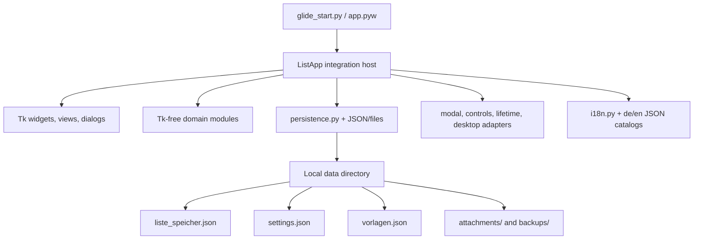

# System architecture

Stand 22.11.2026 · Glide 1.0.1 · Aufgabenformat 26 · Quellstand 4ce3697a

## Runtime shape

Glide is a Python desktop application using Tk/Tcl. `src/glide/app.pyw` owns the `ListApp` integration class and composes windows, event bindings, views, dialogs, domain modules, persistence, and platform adapters. The smaller modules are generally standard-library-only and many are Tk-free, but the system register explicitly warns that “no Tk import” does not prove that a module is product-neutral.

## Main layers

1. **Entry/runtime:** `glide_start.py`, `runtime_check.py`, `runtime_config.py`, `runtime_diagnostics.py`.
2. **Host/application integration:** `app.pyw`, the central coordinator and legacy-compatible UI/mutation entry points.
3. **Domain services/projections:** planning, task editing, search, repeat rules, calendar, drawing, references, pages, side view, and save coordination.
4. **UI infrastructure:** custom controls, modal session, window lifetime, appearance, symbols, accessibility, desktop menu adapter.
5. **Persistence and interchange:** local JSON files, attachment/backup directories, exchange parser, markdown, ICS, CSV, Notion and drawing import/export paths.
6. **Resources and packaging:** locale catalogs, fonts, templates, logos, packaging/runtime scripts, native workflows.

The full current inventory is [`src/glide/README.md`](../../../src/glide/README.md); it is the sole complete module/feature/test register.

## State and event flow

The host reads persisted data on startup, normalizes/migrates it subject to schema protection, creates UI projections, and routes user intent through existing mutation/save guards. New domain calculations should be pure or Tk-free, with IDs rather than stale mutable model objects crossing UI boundaries. UI callbacks must respect current object identity, data ownership, modal lifetime, and window callback cleanup.

Tk is single-threaded in normal UI operation; do not infer worker threads from “background” image or timer features. See architecture rules on callback lifecycle, `after`, `update_idletasks`, focus, modals, and view rebuilding.

## Persistence and failure boundaries

Writes use same-directory temporary files and atomic replacement; a local lock protects recognized simultaneous writers. Imports and repairs require pre-save protection. Restore and schema migration preserve originals and reject newer formats. See [data model and persistence](./06_DATA_MODEL_AND_PERSISTENCE.md).

## Runtime dependencies and packaging

The app's runtime is based on the Python standard library plus optional `tkinterdnd2` for drag-and-drop. Native distribution builds bundle a tested Python/Tk runtime and use PyInstaller 6.22.3 as documented in packaging sources. Platform-specific code and resources are checked by native build/start workflows. A repository manifest is not proof that an external package-manager submission happened.

## Architecture boundaries and risks

- `ListApp` remains large; extraction is incremental, not a mandate for a rewrite.
- The reusable shell is the subpackage `glide_shell` 0.6.0 (modal session, window lifetime, custom controls, desktop adapter, motion, window geometry, system appearance, redo history, text fit, action picker, runtime paths), with demo host and self-test. It is copied into follow-up projects, not published separately. D99 closes the shell work; `ListApp` stays the host with facades.
- Existing UI/API facades and mutation boundaries must remain compatible.
- Tk event order and geometry are platform-sensitive; full current platform runs on PR #152 are red in `test_ui39.py`.
- Future architecture proposals belong in the plan as proposals until the owner selects them.

## Primary sources

[`02_ARCHITECTURE.md`](../../02_ARCHITECTURE.md), [`GLIDE_SHELL_FRAMEWORK_KONZEPT.md`](../../GLIDE_SHELL_FRAMEWORK_KONZEPT.md), [`src/glide/README.md`](../../../src/glide/README.md), [`AGENTS.md`](../../../AGENTS.md), and [testing and quality](./12_TESTING_AND_QUALITY.md).
