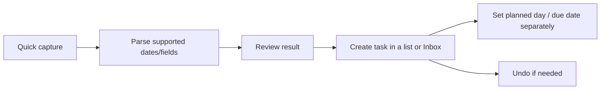

# User workflows

Stand 22.11.2026 · Glide 1.0.1 · Aufgabenformat 26 · Quellstand 5631333a

These are documented product flows, not a usability study. Exact labels can vary by language and platform; consult the active UI catalog and current feature contract.

## Capture and organize

Quick capture accepts supported structured field terms; unsupported recurrence language remains text rather than being guessed. A full edit form is distinct and does not use the quick-capture parser.

## Plan a day

The user reviews Today, upcoming work, due items, and Inbox; may inspect available capacity and choose a planning proposal; then accepts an explicit change. Glide does not automatically allocate work based on a person's worth or silently change dates to resolve calendar overlaps. A chosen local ICS busy-time file is read as schedule input, not subscribed to.

## Work with a task

Open a task in its current view or inspector; edit fields, checklist, subtasks, labels, recurrence, reminders, attachment, or links; save through the host's mutation/guard path; undo a completed action if appropriate. Checklist steps are not tasks and do not by themselves mark the parent complete. A “waiting on” relationship can add a confirmation before completion.

## Maintain reference material

Create a page, note, notebook, gallery, drawing, or pinboard in its existing workspace. Pages can contain supported blocks, references, and live task-list projections. Attachments are copied into Glide's local data area. Cross-project or external URLs are not converted into local object references.

## Import, export, backup

1. Select the relevant file-based import or exchange route.
2. Let Glide validate and preview supported content.
3. Use a proposed change/import path with conflict checks and pre-write backup where required.
4. Confirm changes; if the workflow fails before the protected write, preserve the original state.
5. Export to a supported file format, noting documented loss boundaries. Use a full Glide backup for complete restoration rather than relying on a lossy interchange format.

## Common edge cases

- Older app versions opening a newer schema must remain read-only.
- If an external data drive or configured data path is unavailable, Glide reports it and does not silently switch to another data directory.
- A detected lock or invalid/corrupt state can leave the app read-only.
- Reminders are delivered only while the app is running; missed notices may be summarized later.
- Some image preview types depend on operating-system support/tools.

## Input and accessibility

The product contracts specify keyboard interaction, focus, menu shortcuts, visible focus, and modal return behavior. Exact support varies by native platform and Tk runtime; automated tests do not replace manual platform review. See [`05_QA_TESTPLAN.md`](../../05_QA_TESTPLAN.md), [design system](./09_UX_UI_DESIGN_SYSTEM.md), and [QA status](../../07_QA_BERICHT.md).
