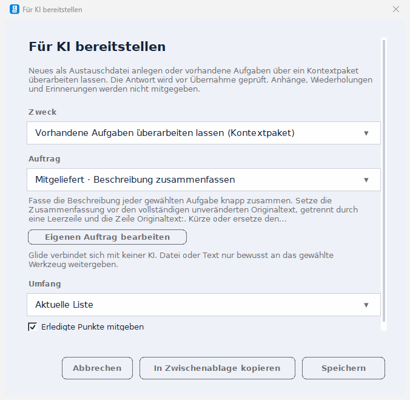

# FP-06 – Wiederverwendbare lokale KI-Aufträge, 18.10.2026

Lokaler Prüfkandidat auf `1042727`, zusammen mit WA-26 und FP-05; uncommittet im bestehenden Zweig. Glide 3.43.1, Aufgabenformat 25, Einstellungen 2. Keine neue Lieferung oder Releasefreigabe.

Fünf mitgelieferte Aufträge im Dialog „Für KI bereitstellen“: Notiz zerlegen, Projekt mit Aufwand planen, Beschreibung zusammenfassen, Priorisierung begründen und Labels vorschlagen. Passende Create-/Patch-Stufe, Datei oder Kopierweg, eigene Aufträge mit Bearbeiten/Löschen. Die Anweisungen verwenden vorhandene Felder `notes`/`instructions`; Antworten gehen durch die bestehenden Importer. Eigene Vorlagen liegen in den Einstellungen und reisen mit dem Einstellungsteil einer App-Sicherung. Verhalten und Grenzen: [Funktionen §11](../../../docs/20_FUNKTIONEN.md#11-import-ausgabe-und-austausch); Datenvertrag: [Daten und Migration](../../../docs/06_DATA_BACKUP_MIGRATION.md).

## Tatsächlich geprüft

- [Endgültige Pflichtsuite](pflichtsuite_abschluss.json): fünf Fälle grün. Fünf Dateipakete mit passender Stufe und gewähltem Umfang; Kopieradapter und unveränderter Paketinhalt ohne Auftragswahl; eigene Vorlage über echten Dialog, Neustart, App-Sicherung, Wiederherstellen und Löschen; fünf Musterantworten über die vorhandenen Importer mit einem Undo; Auswahl/Erledigt-Filter, Schreibschutz, atomarer Einstellungsfehler und Abbruch bei fehlender Editorübernahme.
- [Fach-/Werkzeugprüfung](fachpruefung.json): alle **781 Unit-Tests** und **152 Werkzeugtests** grün. Acht neue Fachtests decken Grenzen/Typen, doppelte Kennungen/Titel, unveränderten Ausgangsstand und Prüfsummen, bestehendes Create-Wurzelfeld, falsche Stufe und statisch fehlende Tk-/Netz-/Prozessimporte ab.
- [Bestehende Bereichssuiten](regression.json): `test_austausch3350.py` und `test_features316.py` grün; bestehende Auswahl, Feldvergleich, Konflikte, Vorsicherung, Undo und App-Sicherungsabschnitte bleiben erhalten.
- [Gegenprobe](gegenprobe.json): fünf neue App-Einstiege gegen den bytegenauen FP-05-Ausgangsstand `6fdeb763e042ba029d7cd8efbd76b8f549a8a7b60f946128a185fc7e25c43858` erwartungsgemäß rot. Aktuelle Hilfsmodule bleiben verfügbar. Dies ist eine App-Adapter-Gegenprobe, kein vollständiger alter Quellbaum und kein Defektbeleg für eine früher vorhandene Funktion.
- [Abschlussmanifest nach Stichprobe](quellstand_nachpruefung.json): 81 Quell-/Prüf-/Ressourcen-/Lieferwerkzeugdateien. Aktuelle App-SHA-256 `b2f0b75415470ead0e33b25762f2e578552d38471685e13817fe10faccd5d2a8`. [Formaler Abschluss und Bestandsabgleich](abschluss_nachpruefung.json).

Die [abschließende Musterprüfung](muster_nachpruefung.json) präzisiert die Label-Fixture: Der vorgeschlagene Name kommt nachweislich bereits im mitgegebenen Kontext vor. Ausschließlich die Testfixture wurde angepasst; alle fünf Musterantworten wurden erneut über die vorhandenen Importer samt Undo geprüft. Der vollständige vorangegangene Funktionslauf und dessen Manifest bleiben unverändert erhalten.

Die fünf Musterantworten stehen lesbar in `tests/integration/test_auftraege.py`: zwei Create-Antworten für neue Aufgaben/Projekt mit Minuten und drei Patch-Antworten für Zusammenfassung mit Originaltext, Wichtigkeit/Begründung und Labels. Die Übernahme verwendet die vorhandene Validierung und Mutation; keine zweite Patch-Engine.

## Vorläufe und Grenzen

Die roten Vorläufe bleiben erhalten. Der erste Bytevergleich berücksichtigte den bereits bestehenden Exportverlauf nicht; der korrigierte Test verlangt unveränderte Listen/Punkte. Der weitere Vorlauf belegte einen Hostfehler: Im Mehrfenster-Prüflauf erzeugte eine Textvariable im falschen Tk-Interpreter einen scheinbar ausgefüllten Titel mit leerem Speicherwert. Die neuen Dialogvariablen sind jetzt ausdrücklich an Root/Dialog gebunden; der vollständige serielle Lauf mit Neustart und Sicherung ist grün. Die endgültige Layoutprüfung schützt Dropdownpfeile innerhalb des Scrollbereichs und hält die Aktionen im festen Fuß.

Der Kopiertest fängt `clipboard_clear`/`clipboard_append` ab und prüft den vollständigen JSON-Inhalt; die echte Zwischenablage wird nicht überschrieben. Die Auftragsanweisungen sind keine Zusicherung fremder KI-Antwortqualität. Die im Auftrag genannten Felder begrenzen die Anweisung; die bestehende Importprüfung der neun Austauschfelder bleibt maßgeblich. Kein Netz, keine KI-API, kein Schlüssel und keine automatische Antwortübernahme.

Keine eingefrorene Vollmatrix der Produktionsphase oder native Mac-/Linux-/Readerabnahme. 07, Showcase und Pakete bleiben auf ihrem bisherigen Lieferstand. Neue Module und Ressource sind lediglich in den Lieferwerkzeugen vorgemerkt.

## Bild und Wiederholung

Die Aufnahme wurde per PrintWindow ausschließlich vom künstlichen Testdialog unter Windows/Tk 9.0.4 erstellt und angesehen. Der Dialog wurde auf 660 × 620 Pixel gesetzt; Dropdownpfeile und Aktionen bleiben innerhalb ihrer sichtbaren Flächen, längerer Inhalt hat einen eigenen Bildlauf. Physische DPI-/Mehrmonitorabnahme bleibt gesondert.



Aus `01_Repository/Glide`, Windows mit `PYTHONUTF8=1`:

```text
python -B -m unittest discover -s tests/unit -p test_exchange_recipes.py
python -B tests/integration/test_auftraege.py --report <neue Ergebnisdatei>
```

`--fall` wählt einen der fünf Fälle, `--capture` die Windows-Testfensteraufnahme, `--app` die App für eine Adapter-Gegenprobe. Alle App-Importe erfolgen nach temporärem `GLIDE_DATA_DIR`; GUI-Suiten laufen seriell. Rohprotokolle und die lokale Ausgangs-App werden nicht versioniert.
