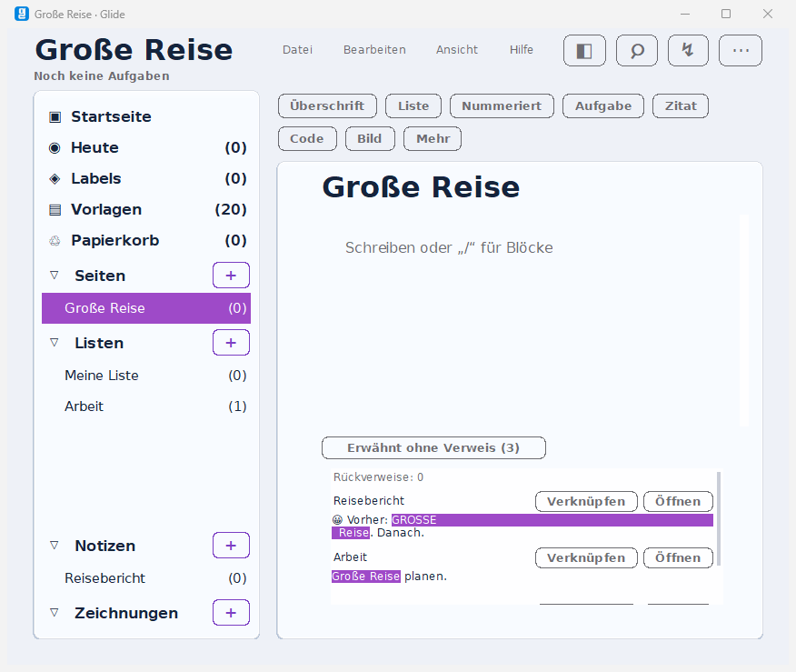

# FP-05 – Unverknüpfte Erwähnungen, 18.10.2026

Lokaler Prüfkandidat auf dem integrierten Schutzstand `1042727`, gemeinsam mit dem uncommitteten WA-26-Kandidaten. Version 3.43.1, Aufgabenformat 25. Keine neue Lieferung oder Releasefreigabe.

Die Funktion findet ganze Titel ab vier Zeichen in anderen aktiven Seiten, Notizen und Beschreibungen. Erst beim Aufklappen wird gesucht. Markierter Originalausschnitt, Öffnen und gezieltes Verknüpfen; bestehende Linkspannen, Code, URLs, eigene und archivierte/gelöschte Quellen werden ausgelassen. Formatierter Text verwendet die vorhandenen lokalen Linkspannen; reine Beschreibungen den vorhandenen ausdrücklichen Objektverweis. Quelle, Ziel und Text werden vor dem Schreiben erneut geprüft. Ein Undo, sofort ableitbarer Rückverweis, Rollback bei Schreibfehler auch mit vollem Undo-Stapel. Vollständiger Funktionsvertrag: [Funktionen §8](../../../docs/20_FUNKTIONEN.md).

## Gezielte Prüfung

- [Pflichtsuite](pflichtsuite.json): sechs Fälle grün, echte Tk-/Mutationseinstiege. Aufklappen ohne Suche beim normalen Aufbau; lesender Schreibschutz; Verknüpfen, ein globales Undo und Neustart; Beschreibungen/Verweismenü; veralteter Text, Umbenennung, Archiv und Schreibfehler einschließlich vollem Stapel; Öffnen mit Nicht-BMP-Zeichen und eingebettetem Fenster; gleiche Titel bleiben verschiedene Ziel-IDs.
- Tk-freie Fixture: 20 erwartete Treffer, zehn Fehltrefferfallen. Fünf neue Unit-Tests; alle 773 Fachlogiktests und 152 Werkzeugtests erneut grün. [Ausführung und Bereichsregressionen](regression.json).
- Fünf Aufklappmessungen mit zusätzlich 500 Seiten und 10.000 Punkten: 79,65 / 194,40 / 135,25 / 128,28 / 149,56 ms, Median **135,25 ms**, Kriterium ≤150 ms bestanden. Gemessen wird der synchrone Aufklapppfad einschließlich Fundstellen-Widgets. Ein Spitzenwert überschreitet 150 ms; keine Garantie für jeden Einzelaufruf oder andere Rechner. Der erste [Vorlauf](vorlauf.json) mit unnötiger Editorübernahme war langsamer und bleibt erhalten. Die Suche selbst speichert nichts und benötigt keine Editorübernahme; der verändernde Weg übernimmt weiterhin offene Änderungen.
- [Gegenprobe](gegenprobe.json): sechs neue App-Einstiege auf dem exakt per SHA-256 bestätigten WA-26-Ausgangsstand erwartungsgemäß rot. Ausgangs-App `83d4d5773fc322873e9654184174b7052284699bf7a16f6c2110b98362a739aa`, aktuelle Hilfsmodule beibehalten. Das ist eine App-Adapter-Gegenprobe und kein Lauf eines vollständigen alten Quellbaums. Die fehlenden Einstiege führen zu den roten Ergebnissen; die reine Trefferlogik wird durch Fixture und Units geprüft.
- Bereichsregressionen: `test_bildkonversion` neun Fälle grün; `test_wissen3340` grün (Linux-`djpeg`-Teil unter Windows bezeichnet übersprungen); `test_woche33317` elf Prüfabschnitte grün. Seriell ausgeführt.
- [Quell-/Prüfmanifest](quellstand.json), [Abschlussabgleich und formale Prüfungen](abschluss_nachpruefung.json). Aktuelle App `6fdeb763e042ba029d7cd8efbd76b8f549a8a7b60f946128a185fc7e25c43858`. Historische WA-26-Ergebnisse werden nicht auf diesen neuen App-Hash umgeschrieben.

Der formale [Vorlauf](abschluss.json) meldete einen 313 Zeichen langen Grafikpfad als fehlend und den erst am Ende desselben Laufs geschriebenen Bericht als fehlendes Linkziel. Die Nachprüfung verwendet für die Grafik den erweiterten Windows-Pfad: Original-SHA-256 unverändert. Alle 783 geschützten Dateien sind damit bestätigt; der Berichtlink existiert. Die roten Vorlaufwerte bleiben erhalten.

## Bildnachweis

PrintWindow erfasste ausschließlich das künstliche Testfenster unter Windows/Tk 9.0.4 bei 860 × 700 Pixeln. Die Aufnahme wurde angesehen: Fundstellen, Markierung, Verknüpfen/Öffnen und eigener Bildlauf sind sichtbar; der Texteditor bleibt bedienbar. Dies ersetzt keine physische DPI-/Mehrmonitor- oder Readerabnahme.



## Wiederholen

Aus `01_Repository/Glide`, unter Windows mit `PYTHONUTF8=1`, immer `python -B`:

```text
python -B -m unittest discover -s tests/unit -p test_unlinked_mentions.py
python -B tests/integration/test_erwaehnungen.py --report <neue Ergebnisdatei>
```

`--fall` grenzt einen der sechs Fälle ein; `--capture` erstellt unter Windows die Testfensteraufnahme. `--app` erlaubt eine App-Adapter-Gegenprobe. Alle GUI-Tests laufen seriell, mit temporärem `GLIDE_DATA_DIR` vor dem Import. Rohprotokolle bleiben lokal und werden nicht versioniert.

Keine eingefrorene Vollmatrix der Produktionsphase, native Mac-/Linux-Prüfung, tatsächliche Readerabnahme oder neue 07-/Bundle-/Paketlieferung. Anzeige der ersten 100 Fundstellen und bis zu 20 ergänzenden Rückverweisen, vollständiger Trefferzähler; das bestehende Rückverweismenü bleibt vollständig. Vorhandene Originalreferenzen, Migrationsfixtures, Grafik und Lieferungen bleiben erhalten.
