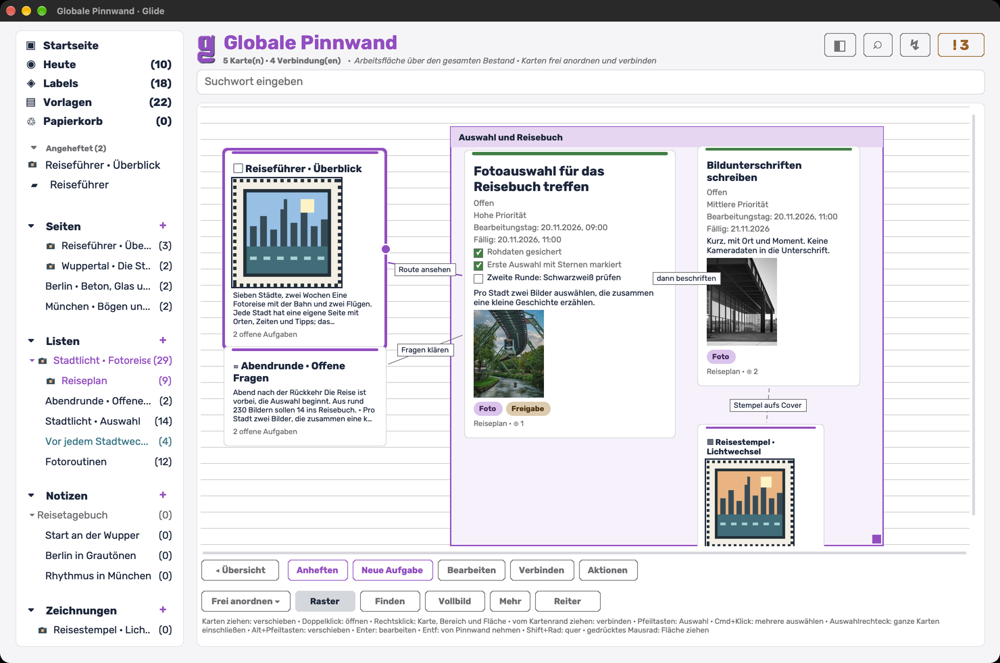
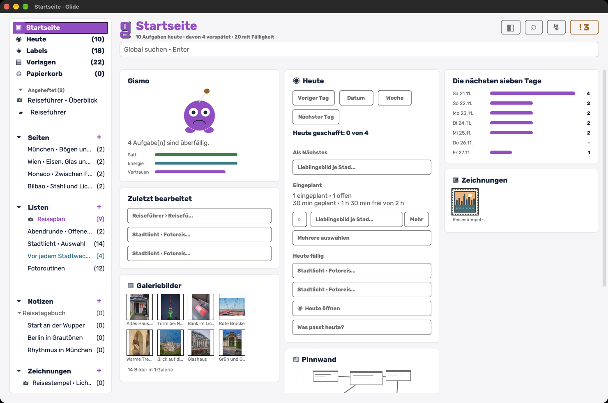
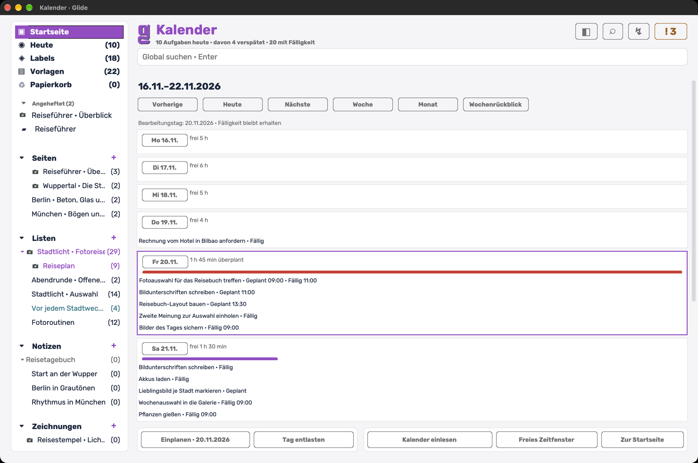
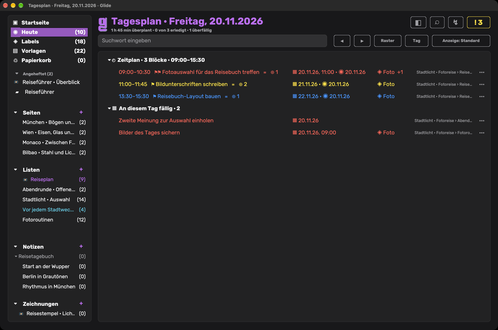
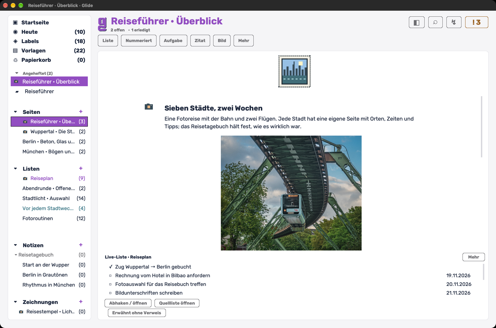
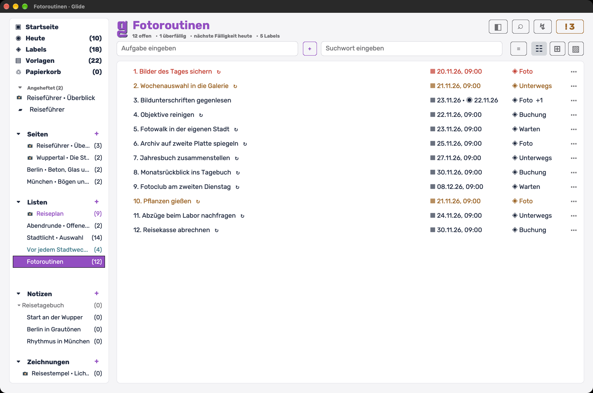
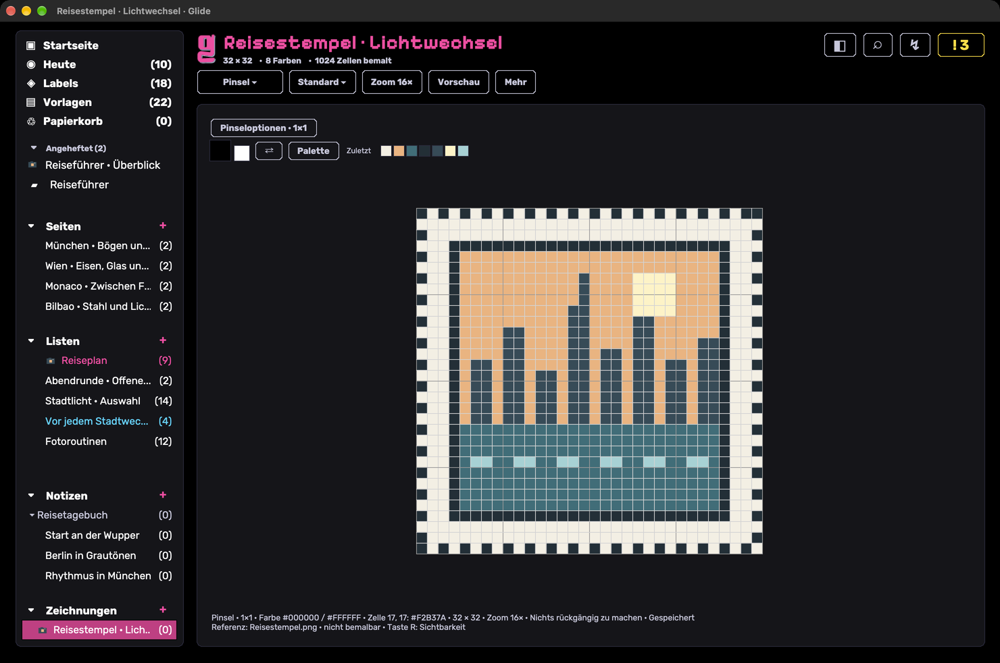

<p align="right"><a href="README.md">English</a></p>

<p align="center">
  
</p>

<h1 align="center">Glide</h1>

<p align="center">
  <strong>Aufgaben planen. Ideen verbinden.</strong><br>
  Glide ist ein quelloffener Desktop-Arbeitsplatz, der Aufgaben, Tagesplanung, Notizen und visuelle Projektorganisation miteinander verbindet. Arbeite lokal, verknüpfe deine Ideen und behalte die Kontrolle über deine Daten.
</p>

<p align="center">
  
  
  <a href="https://github.com/n05a-design/glide-to-do/releases/tag/v1.0.2"></a>
  <a href="LICENSE"></a>
</p>

<p align="center">
  <a href="#herunterladen"><strong>Glide 1.0.2 herunterladen</strong></a> ·
  <a href="#schnellstart-und-systemanforderungen">Quellstart</a> ·
  <a href="05_Probelisten_Testdaten/Showcase/README.md">Showcase ansehen</a> ·
  <a href="#was-glide-kann">Funktionen</a> ·
  <a href="#ein-blick-in-glide">Bilder</a> ·
  <a href="CONTRIBUTING.de.md">Mitwirken</a>
</p>



<p align="center"><sub>Glide gibt es auf Deutsch und Englisch. Die Aufnahmen zeigen Glide 1.0.2 unter macOS mit dem Showcase „Stadtlicht“, einer fiktiven Fotoreise; die Fotos stammen von Tim von Trostorff. Sie sind kein Prüf- oder Paketnachweis.</sub></p>

## Warum Glide?

Glide verbindet Aufgaben und Projektnotizen an einem lokalen Arbeitsplatz. Dieselbe Aufgabe bleibt erhalten, wenn du zwischen Listen, Seiten, Kalendern und Pinnwänden wechselst.

- **Plane deinen Tag:** Bearbeitungstage, Fristen, Zeitaufwand und freie Kapazität getrennt betrachten.
- **Arbeite mit deinen eigenen Inhalten:** Aufgaben, Seiten, Notizen und Pinnwände lassen sich miteinander verbinden.
- **Behalte die Kontrolle:** Deine Daten bleiben in einem Ordner deiner Wahl; Sicherungen und lesbare Exporte unterstützen den Umzug.

## Ein Blick in Glide

Alle Aufnahmen zeigen den Showcase „Stadtlicht“: fiktive Daten, echte Fotos des Autors.

<table>
  <tr>
    <td><strong>Startseite</strong><br></td>
    <td><strong>Kalender</strong><br></td>
  </tr>
  <tr>
    <td><strong>Heute</strong><br></td>
    <td><strong>Seiten</strong><br></td>
  </tr>
  <tr>
    <td><strong>Aufgabenliste</strong><br></td>
    <td><strong>Pixel-Werkstatt</strong><br></td>
  </tr>
</table>

[Das vollständige Showcase öffnen](05_Probelisten_Testdaten/Showcase/README.md) · [Weitere Screenshots und Funktionen](01_Repository/Glide/docs/20_FUNKTIONEN.md)

## Was Glide kann

Glides Leistungsvermögen gliedert sich in sechs tragende Produktsäulen:

1. **Task Management:** Hierarchische Listen, Ordner, Unteraufgaben, Checklisten, Labels, Farbakzente, Fälligkeiten, Wiederholungen, Abhängigkeiten und gespeicherte Ansichten.
2. **Day Planning:** Bearbeitungstage, Fristen, Zeitaufwand, Termine, Routinen, Fokusblöcke und Puffer getrennt verwalten; Tagesvorschläge vor der Übernahme prüfen.
3. **Personal Knowledge:** Formatierte Seiten und Blöcke, Notizbücher, lokale Dateianhänge, Rückverweise und explizite Verwendungsorte.
4. **Visual Workspace:** Listen, Tabellen, Boards, Pinnwände mit Verbindungslinien, Kalender und ein konfigurierbares Startseiten-Dashboard. *(Hinweis: Das responsive Glide Bento Box System 0.1.0 mit dynamischem 1–3-Spalten-Umbruch befindet sich auf `main` in aktiver Entwicklung nach 1.0.2).*
5. **Creative Tools:** Integrierte Pixel-Werkstatt für animierte Stempel, eigene Farbpaletten und visuelle Reisemotive als Seiten- oder Projektsymbol.
6. **Open Data & AI Exchange:** Lokale Dateispeicherung, Import und Export für Markdown, CSV, iCalendar, JSON Canvas und `.glideexchange`; KI-Anbindung über den offenen [Agent-Skill](01_Repository/Glide/skills/glide-to-do/README.md) ohne Cloud-Zwang.

## Was Glide bewusst nicht ist

- **Keine Handy- oder Tablet-App.** Glide ist für die Arbeit am Desktop gemacht. Für mobile Erinnerungen und unterwegs geplante Aufgaben eignet sich eine mobile Aufgaben-App besser.
- **Kein Cloud-Teamdienst.** Es gibt kein Glide-Konto und keine Echtzeit-Zusammenarbeit. Ein freigegebener Cloudordner führt Änderungen mehrerer Geräte nicht zusammen; für gemeinsam bearbeitete Projekte ist ein dafür gebauter Teamdienst die passendere Wahl.
- **Kein eingebauter KI-Dienst.** Glide sendet keine Inhalte an ein KI-Angebot. Du kannst Dateien selbst mit einem Werkzeug deiner Wahl austauschen; der [Agenten-Skill `glide-to-do`](01_Repository/Glide/skills/glide-to-do/README.md) kann Glide-Importdokumente vorbereiten.

## Herunterladen

Glide 1.0.2 ist als offizieller **öffentlicher Prerelease** unter [GitHub Releases (v1.0.2)](https://github.com/n05a-design/glide-to-do/releases/tag/v1.0.2) verfügbar. Die eigenständigen Pakete bündeln Python, Tk, Schriften und Abhängigkeiten; eine separate Python-Installation ist für die Binärpakete nicht erforderlich.

| Plattform | Download-Asset | Größe | Hinweise |
|---|---|---|---|
| **Windows 10/11 (x64)** | [Glide-1.0.2-windows-x64-setup.exe](https://github.com/n05a-design/glide-to-do/releases/download/v1.0.2/Glide-1.0.2-windows-x64-setup.exe) | ~17,0 MB | Setup-Assistent (installiert unprivilegiert nach `%LOCALAPPDATA%\Programs\Glide`) |
| **Windows 10/11 (x64)** | [Glide-1.0.2-windows-x64.zip](https://github.com/n05a-design/glide-to-do/releases/download/v1.0.2/Glide-1.0.2-windows-x64.zip) | ~19,5 MB | Portables Archiv (entpacken und `Glide.exe` direkt starten) |
| **macOS (Apple Silicon, arm64)** | [Glide-1.0.2-macos-arm64.dmg](https://github.com/n05a-design/glide-to-do/releases/download/v1.0.2/Glide-1.0.2-macos-arm64.dmg) | ~20,7 MB | Festplattenabbild (`Glide.app` in `/Applications` ziehen) |
| **macOS (Apple Silicon, arm64)** | [Glide-1.0.2-macos-arm64.tar.gz](https://github.com/n05a-design/glide-to-do/releases/download/v1.0.2/Glide-1.0.2-macos-arm64.tar.gz) | ~18,2 MB | Portables Tarball-Archiv |
| **Agent-Skill** | [glide-to-do-skill-v1.0.2.zip](https://github.com/n05a-design/glide-to-do/releases/download/v1.0.2/glide-to-do-skill-v1.0.2.zip) | ~39 KB | Dokumentbasierter Austausch-Skill für KI-Entwicklungsagenten |
| **Linux (x64 / arm64)** | [Quellstart](#schnellstart-und-systemanforderungen) | — | Python 3.14 + Tk 9 empfohlen; derzeit kein Standalone-Paket |

> [!NOTE]
> **Prerelease- und Signaturhinweise:** Kommerzielle EV- und Apple-Developer-ID-Zertifikate sind bis zum Aufbau eines breiteren Softwarekatalogs zurückgestellt (Entscheidung I3 / D43). Unter macOS erfordert Gatekeeper beim Erststart das Öffnen über **Systemeinstellungen › Datenschutz & Sicherheit › Dennoch öffnen** oder den gezielten Terminalbefehl `xattr -d com.apple.quarantine /Applications/Glide.app`. Unter Windows im SmartScreen-Dialog auf **Weitere Informationen › Trotzdem ausführen** klicken.
> Alle Downloads können über die offiziellen SHA-256-Prüfsummen kryptographisch verifiziert werden; siehe [Installationsanleitung](01_Repository/Glide/docs/user-guide/02-installation.md).

## Schnellstart und Systemanforderungen

Für den Quellstart wird Python 3.14 mit Tk 9 empfohlen; Tk 8.6 startet mit bekannten Einschränkungen. Zusätzliche Laufzeitpakete sind nicht erforderlich. Aus dem Repository-Hauptordner:

```text
cd 01_Repository/Glide
python3 src/glide/app.pyw
```

Unter Windows lautet der zweite Befehl `python src\glide\app.pyw`. Das Hauptfenster benötigt mindestens **860 × 700 px**; im Kompaktmodus sind **480 × 560 px** möglich. Weitere Startwege und Voraussetzungen stehen im [technischen Schnellstart](01_Repository/Glide/README.md#schnellstart-aus-dem-quellstand). Zum Ausprobieren mit künstlichen Daten dient der [Showcase](05_Probelisten_Testdaten/Showcase/README.md).

Die vollständige Bedienbeschreibung und Funktionsgrenzen stehen im [Handbuch](01_Repository/Glide/docs/20_FUNKTIONEN.md). Eine kontrollierte englische Übersetzung ist der [English user guide](01_Repository/Glide/docs/user-guide/README.md).

## Deine Daten

Glide speichert Inhalte und Anhänge in einem Datenordner außerhalb des Programmordners. Du bestimmst, wo er liegt. Automatische Sicherungen, Papierkorb und Rückgängig schützen die Arbeit; Markdown- und JSON-Canvas-Exporte helfen, Inhalte mitzunehmen. Glide lädt deine Daten nicht zu einem eigenen Cloud-Dienst hoch.

| Bereich | Ablage und Zweck |
|---|---|
| Eigene Inhalte und Einstellungen | Im gewählten lokalen Datenordner; Details und Plattformpfade stehen unter [Daten und Migration](01_Repository/Glide/docs/06_DATA_BACKUP_MIGRATION.md#ablage). |
| Anhänge und Sicherungen | Werden mit dem Datenordner verwaltet; ein freigegebener Cloudordner führt gleichzeitige Änderungen mehrerer Geräte nicht zusammen. |
| Beispieldaten | Der [Showcase](05_Probelisten_Testdaten/Showcase/README.md) nutzt künstliche Inhalte und einen eigenen Datenordner. |

## Projektstruktur

| Pfad | Inhalt |
|---|---|
| [`01_Repository/Glide/`](01_Repository/Glide/README.md) | Anwendung, Bento-System (`glide_bento`), Framework Shell (`glide_shell`), Tests, technische Dokumentation und Paketierung |
| [`07_Python-Versionen/`](07_Python-Versionen/) | Separater Python-Lieferstand; Prüfstatus und Quellabgleich im [QA-Bericht](01_Repository/Glide/docs/07_QA_BERICHT.md) |
| [`05_Probelisten_Testdaten/Showcase/`](05_Probelisten_Testdaten/Showcase/README.md) | Künstlicher Showcase-Datensatz zum Ausprobieren |
| [`00_Arbeitsvorbereitung/`](00_Arbeitsvorbereitung/Glide_Entwicklungsplan.md) | Entwicklungsplan und Übergabe |
| [`20_Grafik_Master/`](20_Grafik_Master/README.md) | Quelldateien der Projektgrafik |

## Häufige Fragen

<details>
<summary><strong>Kann ich Glide auf zwei Rechnern verwenden?</strong></summary>

Du kannst den Datenordner in einer Cloudablage deiner Wahl speichern. Glide führt jedoch keine gleichzeitigen Änderungen mehrerer Geräte zusammen.
</details>

<details>
<summary><strong>Verbindet sich Glide mit einem KI-Anbieter?</strong></summary>

Nein. Der Datei-Austausch bleibt unter deiner Kontrolle; Glide sendet nichts automatisch an einen KI-Dienst.
</details>

<details>
<summary><strong>Ist Glide barrierefrei geprüft?</strong></summary>

Glide bietet Tastaturwege, anpassbare Schriftgrößen und Kontrastdesigns. Eine vollständige native Tastatur- und Screenreader-Abnahme ist noch offen; der [QA-Bericht](01_Repository/Glide/docs/07_QA_BERICHT.md) nennt den geprüften Umfang.
</details>

## Rückmeldung und Mitwirkung

Nutze die [zweisprachigen Formulare für Fehler und Ideen](https://github.com/n05a-design/glide-to-do/issues/new/choose). Gezielt melden:
[Dokumentation](.github/ISSUE_TEMPLATE/dokumentation.yml) ·
[Lokalisierung](.github/ISSUE_TEMPLATE/lokalisierung.yml) ·
[Barrierefreiheit](.github/ISSUE_TEMPLATE/accessibility.yml).
Bitte verwende nur künstliche Beispieldaten. Sicherheitslücken meldest du vertraulich nach der [Sicherheitsrichtlinie](SECURITY.de.md). Unterstützung findest du in [SUPPORT.md](SUPPORT.md), gemeinschaftliche Regeln in [CODE_OF_CONDUCT.md](CODE_OF_CONDUCT.md).

## Entwicklung und Qualität

Stand 24.11.2026 · Glide 1.0.2

<a href="https://github.com/n05a-design/glide-to-do/actions/workflows/python-app.yml"></a>

Mehr zum Quellcode, Entwicklungsablauf und Prüfstand:
[An Glide arbeiten](CONTRIBUTING.de.md) ·
[Roadmap](00_Arbeitsvorbereitung/Glide_Entwicklungsplan.md) ·
[Qualität und Prüfungen](01_Repository/Glide/docs/07_QA_BERICHT.md)

Glide 1.0.2 wurde am 23.11.2026 offiziell als öffentlicher Prerelease auf GitHub veröffentlicht (Tag `v1.0.2`, Commit `7dcd8dc0`). Die Weiterentwicklung auf `main` führt das System Richtung Folgeversionen (Glide-System V1.87, Glide Bento 0.1.0). Das Prüf-Badge oben bezieht sich auf `main`, nicht auf diesen README-Branch oder einen anderen Pull Request. Der [QA-Bericht](01_Repository/Glide/docs/07_QA_BERICHT.md) ordnet Ergebnisse konkreten Commits zu und trennt CI, verfügbare Entwicklungsbauten und offene menschliche Abnahmen.

## Lizenz

Der Projektcode steht unter der [Mozilla Public License 2.0](LICENSE). Für Drittkomponenten, Schriften und fremde Ressourcen können eigene Lizenzbedingungen gelten.
