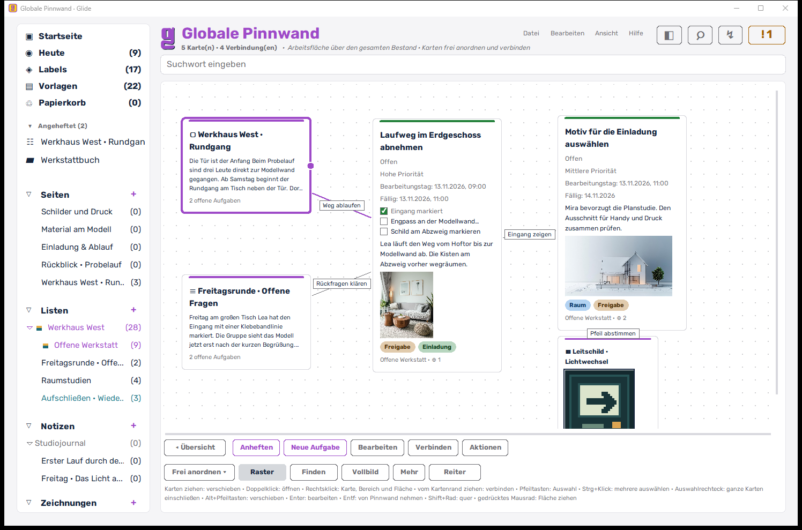
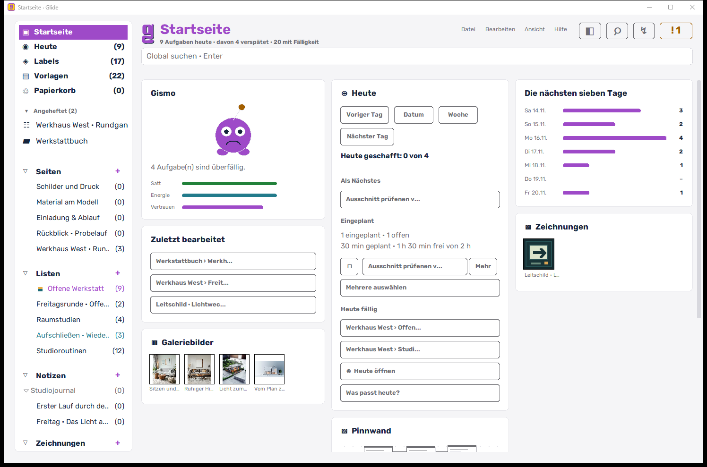
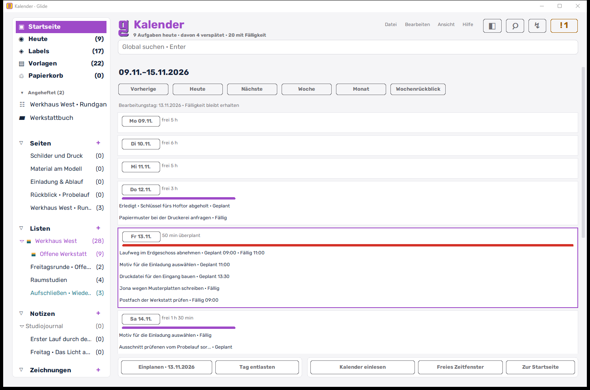
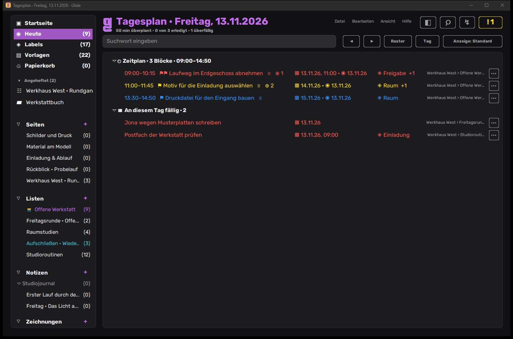
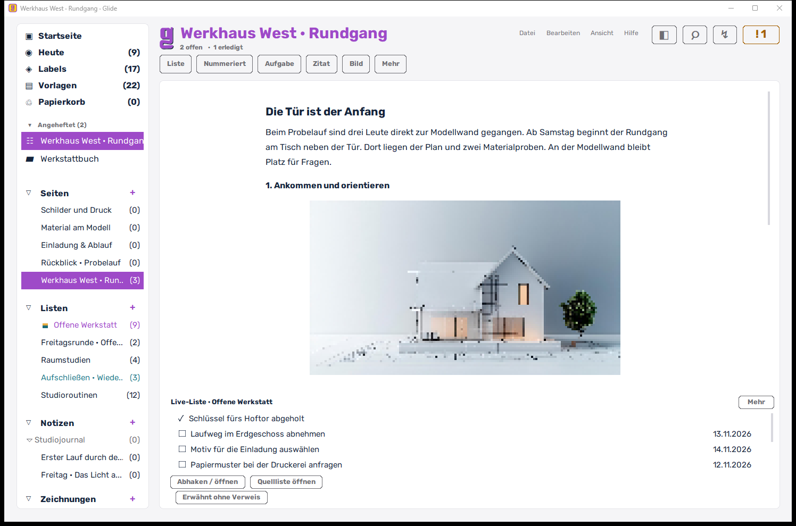
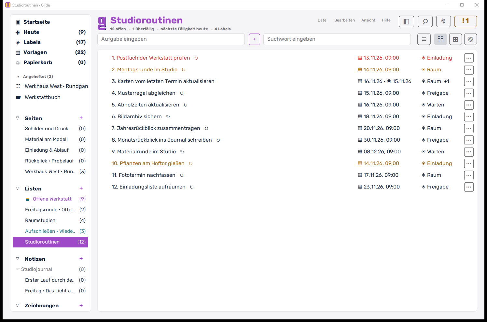
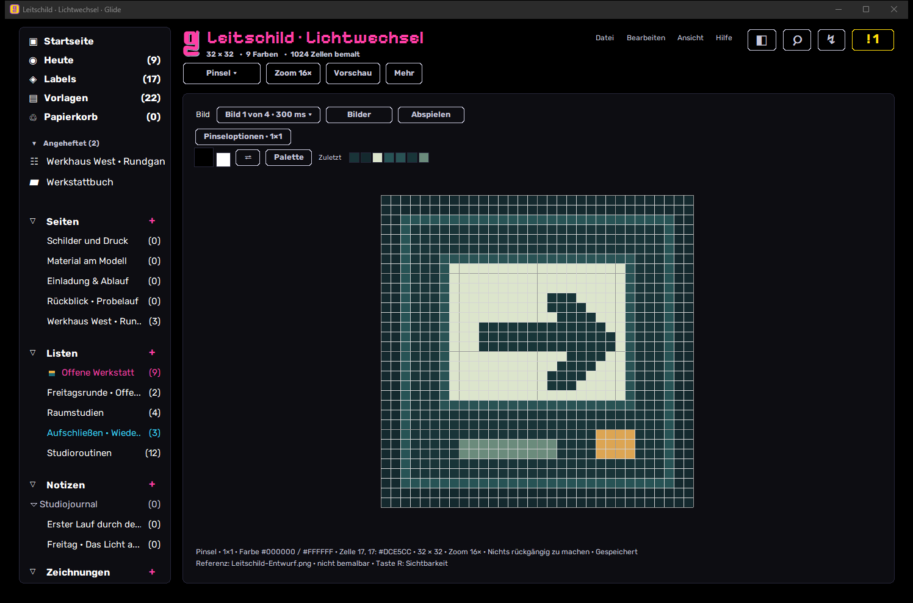

<a href="README.md">Deutsch</a> · <a href="README.en.md">English</a>

  

<h1 align="center">Glide</h1>

  <strong>Plan tasks. Connect ideas.</strong> 
  A local desktop planner for projects, tasks, notes, and visual ideas.

  
  
  
  
  

  <a href="#download"><strong>Download</strong></a> ·
  <a href="#what-glide-does">Features</a> ·
  <a href="#a-look-at-glide">Screenshots</a> ·
  <a href="05_Probelisten_Testdaten/Showcase/README.md">Showcase (DE)</a> ·
  <a href="01_Repository/Glide/docs/20_FUNKTIONEN.md">User guide (DE)</a> ·
  <a href="CONTRIBUTING.md">Contributing</a>

<picture>
  <source media="(prefers-color-scheme: dark)" srcset="01_Repository/Glide/assets/marketing/github-social-preview.png">
  
</picture>

Screenshots were captured with Glide 3.60.0 using synthetic showcase data. They are not test or package evidence for 1.0.0.

## Why Glide?

Glide brings planning and project knowledge together on a local desktop. A task stays the same whether you open it in a list, on a page, or elsewhere. Notes and images add context; pinboards and pixel drawings make relationships visible.

- **Plan your day:** See work dates, due dates, effort, and available time separately.
- **Work with your own material:** Connect tasks, pages, notes, and pinboards.
- **Stay in control:** Keep your data in a folder you choose, with backups and readable exports to support a move.

## A look at Glide

All images show a synthetic showcase dataset.

<table>
  <tr>
    <td><strong>Home</strong> </td>
    <td><strong>Calendar</strong> </td>
  </tr>
  <tr>
    <td><strong>Today</strong> </td>
    <td><strong>Pages</strong> </td>
  </tr>
  <tr>
    <td><strong>Task list</strong> </td>
    <td><strong>Pixel workshop</strong> </td>
  </tr>
</table>

[Open the complete showcase](05_Probelisten_Testdaten/Showcase/README.md) · [More screenshots and features](01_Repository/Glide/docs/20_FUNKTIONEN.md)

## What Glide does

- **Organize tasks:** Lists, folders, subtasks, checklists, labels, due dates, recurrence, and saved views.
- **Plan days and weeks:** Schedule work, see capacity, track focus time, and review changes before easing an overloaded day.
- **Connect knowledge:** Pages with formatted blocks, notes, journals, attachments, local references, and pinboards.
- **Shape your workspace:** Calendar, table, boards, multiple themes and fonts, and pixel drawings.
- **Take your data with you:** Import and export Markdown, CSV, calendar files, JSON Canvas, and Glide exchange files.

The [user guide (in German)](01_Repository/Glide/docs/20_FUNKTIONEN.md) explains the complete feature set and its limits.

## What Glide is not

- **Not a phone or tablet app.** Glide is made for desktop work. A mobile task app is a better fit for mobile-first reminders and planning on the go.
- **Not a cloud team service.** There is no Glide account or real-time collaboration. A shared cloud folder does not merge simultaneous changes from multiple devices; choose a team service built for shared projects when that is your main need.
- **Not an AI service.** Glide does not send content to an AI provider. You can exchange files manually with a tool of your choice; the [`glide-to-do` agent skill](01_Repository/Glide/skills/glide-to-do/README.md) can prepare Glide import documents.

## Download

**A public release download has not been approved yet.** GitHub Actions artifacts are development builds, require a GitHub sign-in, and are not a substitute for a published installer.

| Platform | Available now | Notes |
|---|---|---|
| Windows x64 | Test and package artifacts in [GitHub Actions](https://github.com/n05a-design/glide-to-do/actions/workflows/python-app.yml) | Sign-in required; no public installer |
| macOS Apple Silicon | [Test and package status](01_Repository/Glide/docs/07_QA_BERICHT.md) | No publicly approved package |
| Linux | [Python source](01_Repository/Glide/README.md#schnellstart-aus-dem-quellstand) | Python 3.14 and Tk required; no standalone package |

Once a public download is approved, it will appear under [Releases](https://github.com/n05a-design/glide-to-do/releases). Check the version, platform, checksum, and signing notes there.

## Your data

Glide stores content and attachments in a data folder outside the program directory. You choose where it lives. Automatic backups, a trash folder, and undo help protect your work; Markdown and JSON Canvas exports make it easier to take content elsewhere. Glide does not upload your data to its own cloud service.

## Frequently asked questions

<strong>Can I use Glide on two computers?</strong>

You can keep the data folder in a cloud storage service of your choice. Glide does not merge simultaneous changes from multiple devices.

<strong>Does Glide connect to an AI provider?</strong>

No. File exchange stays under your control; Glide does not automatically send anything to an AI service.

<strong>Has Glide been accessibility-tested?</strong>

Glide offers keyboard access, adjustable text sizes, and contrast themes. A complete native keyboard and screen-reader acceptance test remains open; the [QA report](01_Repository/Glide/docs/07_QA_BERICHT.md) lists what has been tested.

## Feedback and contributions

Use the [bilingual issue forms for bugs and ideas](https://github.com/n05a-design/glide-to-do/issues/new/choose). Please use synthetic example data only. Report security vulnerabilities confidentially through the [security policy](SECURITY.md).

## Development and quality

Stand 18.11.2026 · Glide 1.0.0

The source is merged but has not been publicly released. The [contributing guide](CONTRIBUTING.md), [roadmap](00_Arbeitsvorbereitung/Glide_Entwicklungsplan.md), and [quality and testing report](01_Repository/Glide/docs/07_QA_BERICHT.md) describe the development process and current evidence.

## License

The project code is licensed under the [Mozilla Public License 2.0](LICENSE). Third-party components, fonts, and other resources may have separate license terms.
