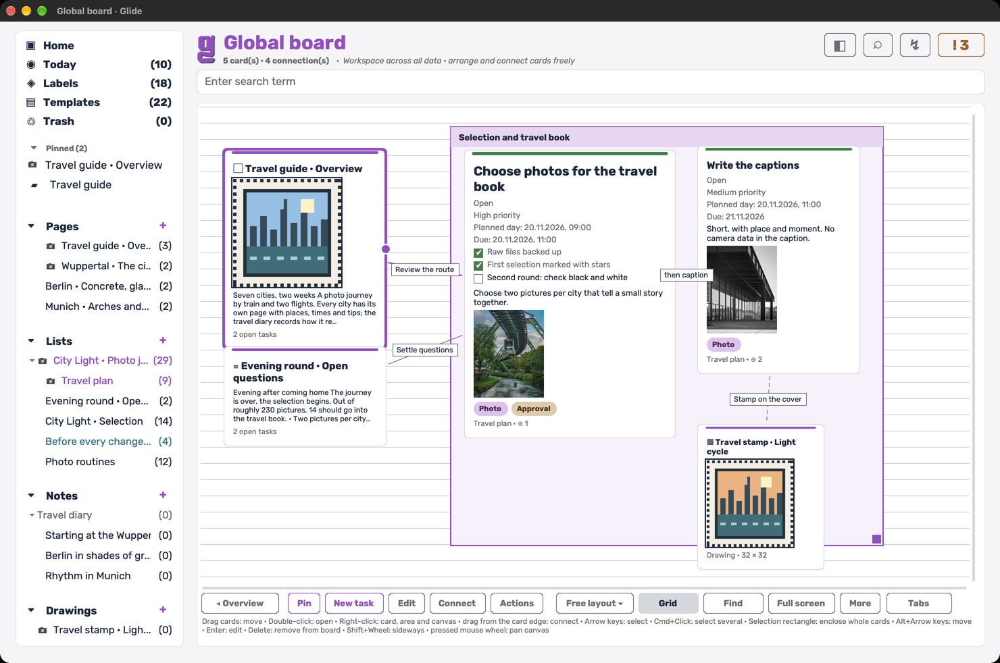
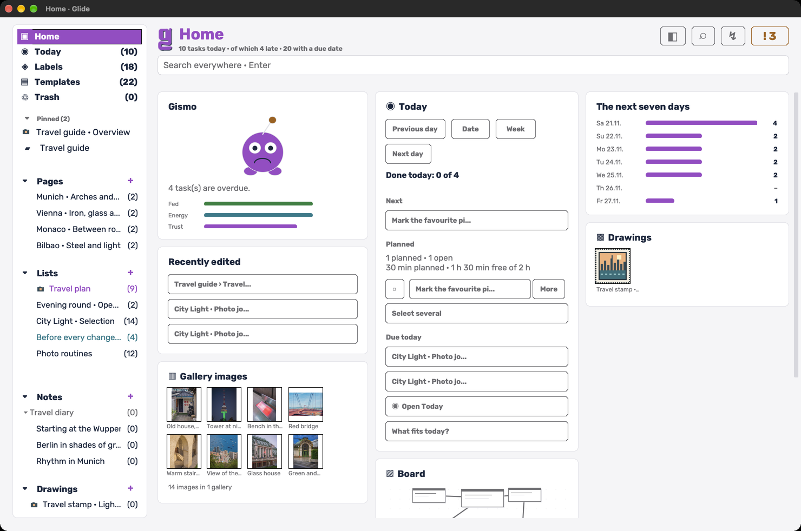
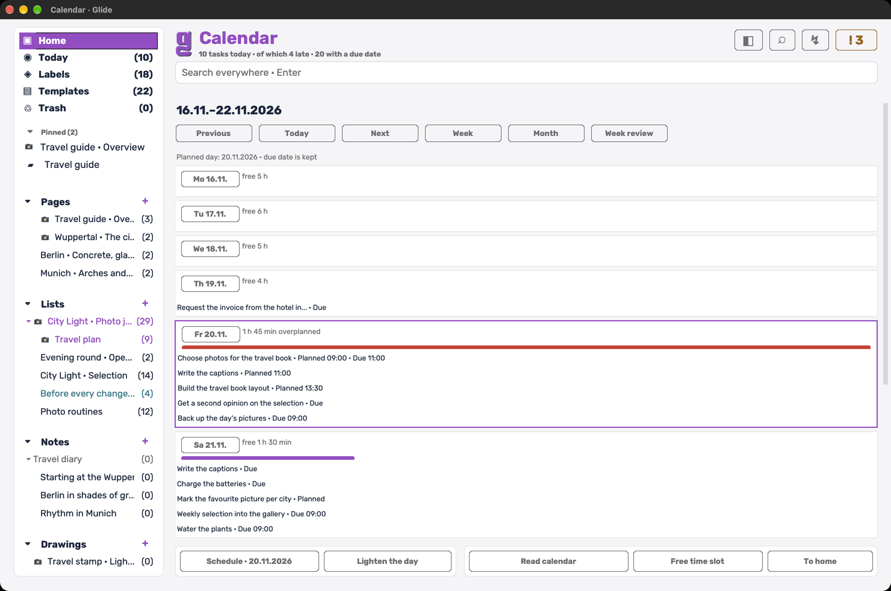
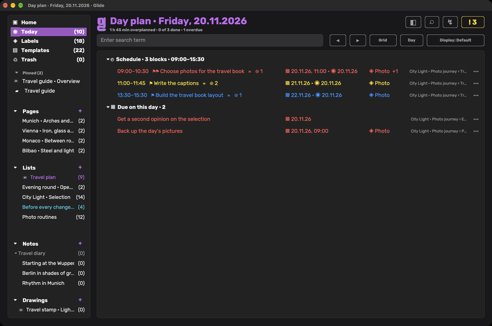
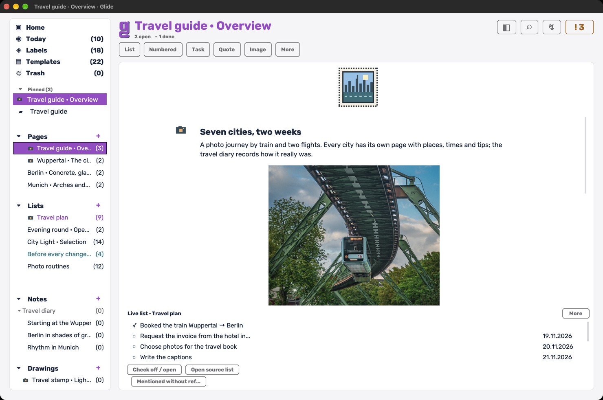
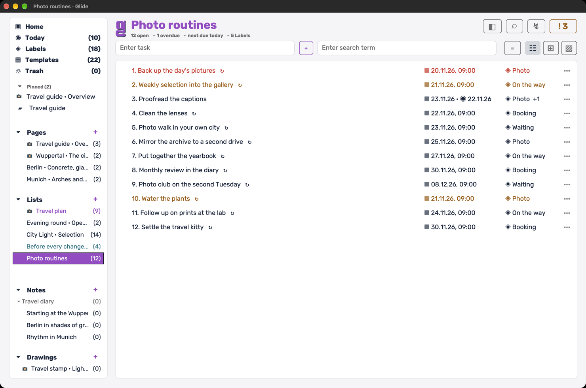
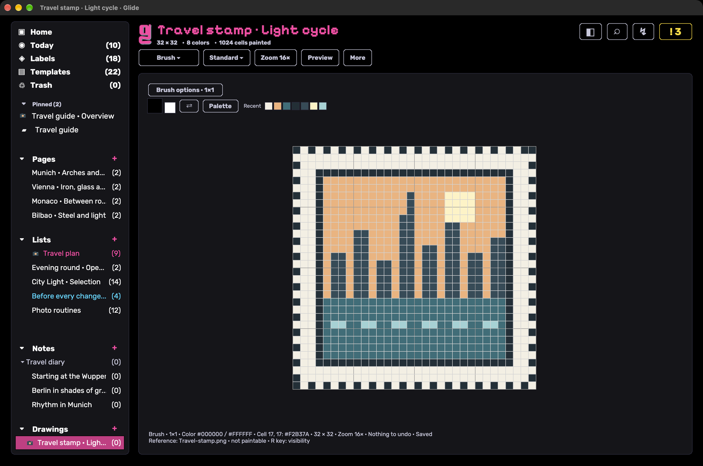

<p align="right"><a href="README.de.md">Deutsch</a></p>

<p align="center">
  
</p>

<h1 align="center">Glide</h1>

<p align="center">
  <strong>Plan tasks. Connect ideas.</strong><br>
  A local desktop planner for projects, tasks, day planning, pinboards, and pixel drawings.
</p>

<p align="center">
  
  
  
  <a href="LICENSE"></a>
</p>

<p align="center">
  <a href="#quickstart-and-system-requirements"><strong>Run from source</strong></a> ·
  <a href="05_Probelisten_Testdaten/Showcase/README.md">Explore the showcase</a> ·
  <a href="#what-glide-does">Features</a> ·
  <a href="#a-look-at-glide">Screenshots</a> ·
  <a href="CONTRIBUTING.md">Contribute</a>
</p>

<picture>
  <source media="(prefers-color-scheme: dark)" srcset="01_Repository/Glide/assets/marketing/github-social-preview.png">
  
</picture>

<p align="center"><sub>Glide is available in English and German. Screenshots show Glide 1.0.1 on macOS with the showcase “City Light”, a fictional photo journey; the photos are by Tim von Trostorff. They are not test or package evidence.</sub></p>

## Why Glide?

Glide brings tasks and project notes into one local workspace. The same task stays connected as you move between lists, pages, calendars, and pinboards.

- **Plan your day:** See work dates, due dates, effort, and available time separately.
- **Work with your own material:** Connect tasks, pages, notes, and pinboards.
- **Stay in control:** Keep your data in a folder you choose, with backups and readable exports to support a move.

## A look at Glide

All images show the showcase “City Light”: fictional data, real photos by the author.

<table>
  <tr>
    <td><strong>Home</strong><br></td>
    <td><strong>Calendar</strong><br></td>
  </tr>
  <tr>
    <td><strong>Today</strong><br></td>
    <td><strong>Pages</strong><br></td>
  </tr>
  <tr>
    <td><strong>Task list</strong><br></td>
    <td><strong>Pixel workshop</strong><br></td>
  </tr>
</table>

[Open the complete showcase](05_Probelisten_Testdaten/Showcase/README.md) · [More screenshots and features](01_Repository/Glide/docs/20_FUNKTIONEN.md)

## What Glide does

- **Manage tasks:** Lists, folders, subtasks, checklists, labels, custom colors, due dates, recurrence, dependencies, and saved views.
- **Plan days and weeks:** See work dates, due dates, effort, calendar events, routines, focus sessions, and available time separately; compare planning suggestions before applying them.
- **Connect knowledge:** Formatted pages and blocks, notes, journals, attachments, local references, backlinks, and usage locations.
- **Shape your workspace:** Lists, tables, boards, pinboards, weekly and monthly calendars, and a configurable home screen; multiple themes, font styles, and a pixel workshop.
- **Take your data with you:** Import and export Markdown, CSV, calendar files, JSON Canvas, and Glide exchange files; automatic backups and recovery support a way back.

The [English user guide](01_Repository/Glide/docs/user-guide/README.md) explains the features of Glide 1.0.1, from getting started to troubleshooting. It is a controlled translation of the authoritative [German function reference](01_Repository/Glide/docs/20_FUNKTIONEN.md), which also covers every limit in detail.

## What Glide is not

- **Not a phone or tablet app.** Glide is made for desktop work. A mobile task app is a better fit for mobile-first reminders and planning on the go.
- **Not a cloud team service.** There is no Glide account or real-time collaboration. A shared cloud folder does not merge simultaneous changes from multiple devices; choose a team service built for shared projects when that is your main need.
- **Not an AI service.** Glide does not send content to an AI provider. You can exchange files manually with a tool of your choice; the [`glide-to-do` agent skill](01_Repository/Glide/skills/glide-to-do/README.md) can prepare Glide import documents.

## Download

**No public installer is available yet.** Use the quickstart to run Glide from source. GitHub Actions artifacts are development builds, require a GitHub sign-in, and are not a substitute for a published installer.

| Platform | Available now | Notes |
|---|---|---|
| Windows x64 | Test and package artifacts in [GitHub Actions](https://github.com/n05a-design/glide-to-do/actions/workflows/python-app.yml) | Sign-in required; no public installer |
| macOS Apple Silicon | [Test and package status](01_Repository/Glide/docs/07_QA_BERICHT.md) | No publicly approved package |
| Linux | [Python source](01_Repository/Glide/README.md#schnellstart-aus-dem-quellstand) | Python 3.14 and Tk required; no standalone package |

Once a public download is approved, it will appear under [Releases](https://github.com/n05a-design/glide-to-do/releases). Check the version, platform, checksum, and signing notes there.

## Quickstart and system requirements

Python 3.14 with Tk 9 is recommended for running from source; Tk 8.6 starts with known limitations. No additional runtime packages are required. From the repository root:

```text
cd 01_Repository/Glide
python3 src/glide/app.pyw
```

On Windows, use `python src\glide\app.pyw` for the second command. The main window requires at least **860 × 700 px**; compact mode can use **480 × 560 px**. See the [technical quickstart (German)](01_Repository/Glide/README.md#schnellstart-aus-dem-quellstand) for other start options and prerequisites. Try the [showcase (German)](05_Probelisten_Testdaten/Showcase/README.md) with synthetic data.

## Your data

Glide stores content and attachments in a data folder outside the program directory. You choose where it lives. Automatic backups, a trash folder, and undo help protect your work; Markdown and JSON Canvas exports make it easier to take content elsewhere. Glide does not upload your data to its own cloud service.

| Area | Storage and purpose |
|---|---|
| Your content and settings | In the local data folder you choose; see [data and migration (German)](01_Repository/Glide/docs/06_DATA_BACKUP_MIGRATION.md#ablage) for details and platform paths. |
| Attachments and backups | Managed with the data folder; a shared cloud folder does not merge simultaneous changes from multiple devices. |
| Sample data | The [showcase (German)](05_Probelisten_Testdaten/Showcase/README.md) uses synthetic content and its own data folder. |

## Project structure

| Path | Contents |
|---|---|
| [`01_Repository/Glide/`](01_Repository/Glide/README.md) | Application, tests, technical documentation, and packaging |
| [`07_Python-Versionen/`](07_Python-Versionen/) | Separate Python delivery; see the [QA report (German)](01_Repository/Glide/docs/07_QA_BERICHT.md) for validation and source alignment |
| [`05_Probelisten_Testdaten/Showcase/`](05_Probelisten_Testdaten/Showcase/README.md) | Synthetic showcase dataset |
| [`00_Arbeitsvorbereitung/`](00_Arbeitsvorbereitung/Glide_Entwicklungsplan.md) | Development plan and handover |
| [`20_Grafik_Master/`](20_Grafik_Master/README.md) | Source files for project artwork |
## Frequently asked questions

<details>
<summary><strong>Can I use Glide on two computers?</strong></summary>

You can keep the data folder in a cloud storage service of your choice. Glide does not merge simultaneous changes from multiple devices.
</details>

<details>
<summary><strong>Does Glide connect to an AI provider?</strong></summary>

No. File exchange stays under your control; Glide does not automatically send anything to an AI service.
</details>

<details>
<summary><strong>Has Glide been accessibility-tested?</strong></summary>

Glide offers keyboard access, adjustable text sizes, and contrast themes. A complete native keyboard and screen-reader acceptance test remains open; the [QA report](01_Repository/Glide/docs/07_QA_BERICHT.md) lists what has been tested.
</details>

## Feedback and contributions

Use the [bilingual issue forms for bugs and ideas](https://github.com/n05a-design/glide-to-do/issues/new/choose). Target a specific area:
[Documentation](.github/ISSUE_TEMPLATE/dokumentation.yml) ·
[Localization](.github/ISSUE_TEMPLATE/lokalisierung.yml) ·
[Accessibility](.github/ISSUE_TEMPLATE/accessibility.yml).
Please use synthetic example data only. Report security vulnerabilities confidentially through the [security policy](SECURITY.md). Find help in [SUPPORT.md](SUPPORT.md) and community rules in [CODE_OF_CONDUCT.md](CODE_OF_CONDUCT.md).

## Development and quality

Status as of 19.11.2026 · Glide 1.0.1

<a href="https://github.com/n05a-design/glide-to-do/actions/workflows/python-app.yml"></a>

The Glide 1.0.1 source baseline is prepared for release; no public release has been approved yet. The badge above tracks checks on `main`, not this README's branch or another pull request. The [quality and testing report](01_Repository/Glide/docs/07_QA_BERICHT.md) ties results to specific commits and distinguishes CI, available development builds, and outstanding human acceptance. See the [contributing guide](CONTRIBUTING.md) and [roadmap](00_Arbeitsvorbereitung/Glide_Entwicklungsplan.md) for the development process and open work.

## License

The project code is licensed under the [Mozilla Public License 2.0](LICENSE). Third-party components, fonts, and other resources may have separate license terms.
