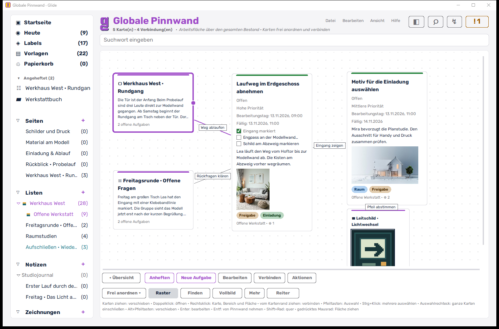
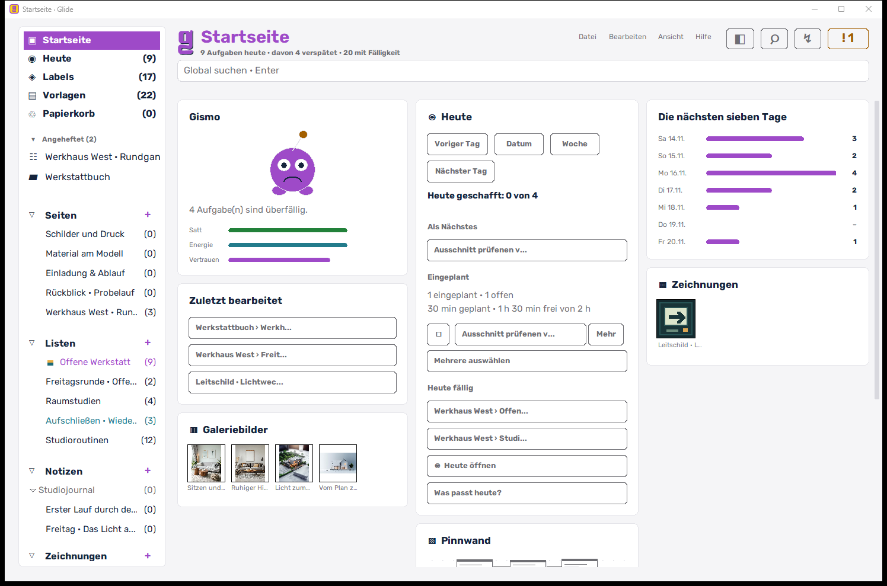
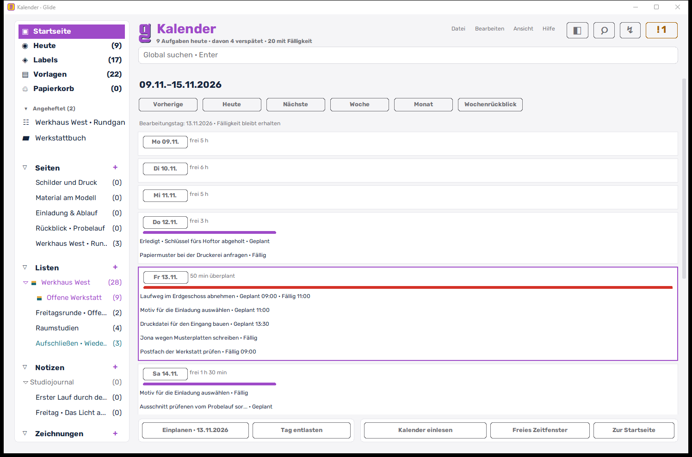
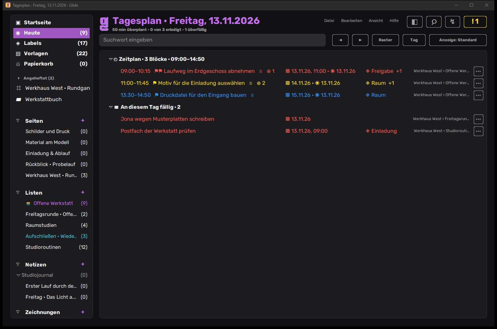
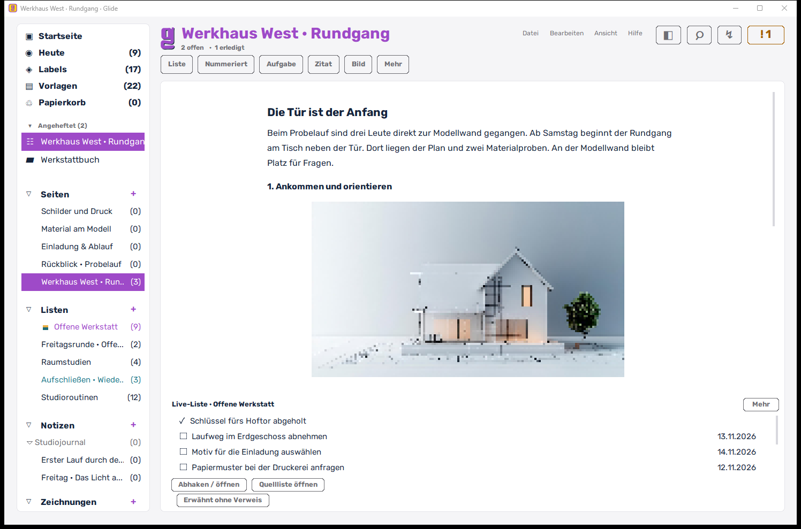
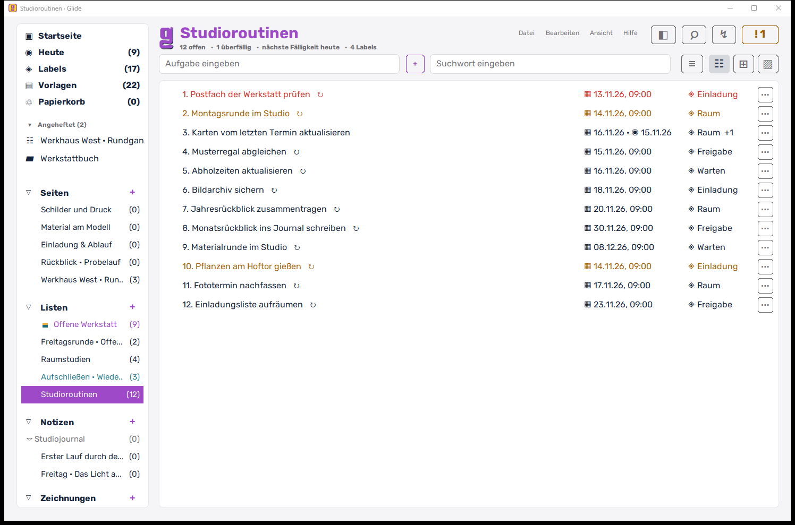
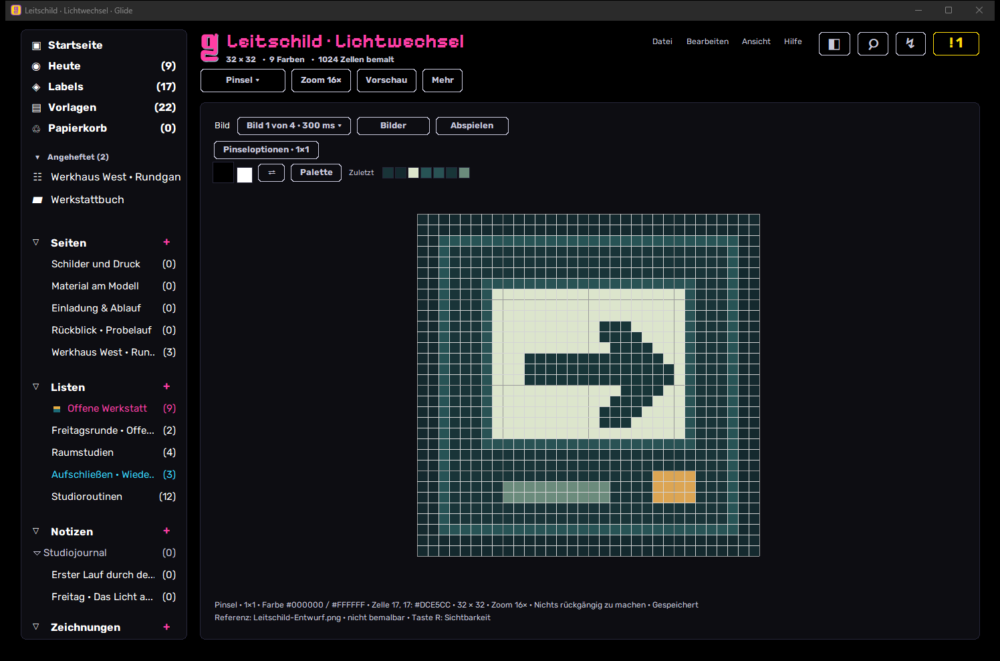

<a href="README.md">Deutsch</a> · <a href="README.en.md">English</a>

  

<h1 align="center">Glide</h1>

  <strong>Aufgaben planen. Ideen verbinden.</strong> 
  Ein lokaler Desktop-Planer für Projekte, Aufgaben, Notizen und visuelle Ideen.

  
  
  
  
  

  <a href="#herunterladen"><strong>Herunterladen</strong></a> ·
  <a href="#was-glide-kann">Funktionen</a> ·
  <a href="#ein-blick-in-glide">Bilder</a> ·
  <a href="05_Probelisten_Testdaten/Showcase/README.md">Showcase</a> ·
  <a href="01_Repository/Glide/docs/20_FUNKTIONEN.md">Handbuch</a> ·
  <a href="CONTRIBUTING.md">Mitwirken</a>

<picture>
  <source media="(prefers-color-scheme: dark)" srcset="01_Repository/Glide/assets/marketing/github-social-preview.png">
  
</picture>

Die Aufnahmen wurden mit Glide 3.60.0 am fiktiven Showcase erstellt. Sie sind kein Prüf- oder Paketnachweis für 1.0.0.

## Warum Glide?

Glide bringt Planung und Projektwissen an einem lokalen Desktop-Arbeitsplatz zusammen. Aufgaben bleiben dieselben, egal ob du sie in einer Liste, auf einer Seite oder an anderer Stelle öffnest. Notizen und Bilder geben ihnen Kontext; Pinnwand und Pixel-Werkstatt machen Zusammenhänge sichtbar.

- **Plane deinen Tag:** Bearbeitungstage, Fristen, Zeitaufwand und freie Kapazität getrennt betrachten.
- **Arbeite mit deinen eigenen Inhalten:** Aufgaben, Seiten, Notizen und Pinnwände lassen sich miteinander verbinden.
- **Behalte die Kontrolle:** Deine Daten bleiben in einem Ordner deiner Wahl; Sicherungen und lesbare Exporte unterstützen den Umzug.

## Ein Blick in Glide

Alle Aufnahmen stammen aus einem künstlichen Showcase-Datensatz.

<table>
  <tr>
    <td><strong>Startseite</strong> </td>
    <td><strong>Kalender</strong> </td>
  </tr>
  <tr>
    <td><strong>Heute</strong> </td>
    <td><strong>Seiten</strong> </td>
  </tr>
  <tr>
    <td><strong>Aufgabenliste</strong> </td>
    <td><strong>Pixel-Werkstatt</strong> </td>
  </tr>
</table>

[Das vollständige Showcase öffnen](05_Probelisten_Testdaten/Showcase/README.md) · [Weitere Screenshots und Funktionen](01_Repository/Glide/docs/20_FUNKTIONEN.md)

## Was Glide kann

- **Aufgaben organisieren:** Listen, Ordner, Unteraufgaben, Checklisten, Labels, Fristen, Wiederholungen und gespeicherte Ansichten.
- **Tages- und Wochenplanung:** Aufgaben einplanen, Kapazität sehen, Fokuszeiten erfassen und Überlastung mit einer Vorschau entschärfen.
- **Wissen verbinden:** Seiten mit formatierten Blöcken, Notizen, Notizbücher, Anhänge, lokale Verweise und Pinnwände.
- **Eigene Perspektiven gestalten:** Kalender, Tabelle, Board, mehrere Designs, Schriftstile und Pixel-Zeichnungen.
- **Daten mitnehmen:** Markdown, CSV, Kalenderdateien, JSON Canvas und Glide-Austauschdateien importieren oder exportieren.

Die vollständige Bedienbeschreibung und Funktionsgrenzen stehen im [Handbuch](01_Repository/Glide/docs/20_FUNKTIONEN.md).

## Was Glide bewusst nicht ist

- **Keine Handy- oder Tablet-App.** Glide ist für die Arbeit am Desktop gemacht. Für mobile Erinnerungen und unterwegs geplante Aufgaben eignet sich eine mobile Aufgaben-App besser.
- **Kein Cloud-Teamdienst.** Es gibt kein Glide-Konto und keine Echtzeit-Zusammenarbeit. Ein freigegebener Cloudordner führt Änderungen mehrerer Geräte nicht zusammen; für gemeinsam bearbeitete Projekte ist ein dafür gebauter Teamdienst die passendere Wahl.
- **Kein eingebauter KI-Dienst.** Glide sendet keine Inhalte an ein KI-Angebot. Du kannst Dateien selbst mit einem Werkzeug deiner Wahl austauschen; der [Agenten-Skill `glide-to-do`](01_Repository/Glide/skills/glide-to-do/README.md) kann Glide-Importdokumente vorbereiten.

## Herunterladen

**Ein öffentlicher Release-Download ist noch nicht freigegeben.** Die geprüften Actions-Artefakte sind Entwicklungsbauten, erfordern eine GitHub-Anmeldung und sind kein Ersatz für ein veröffentlichtes Installationspaket.

| Plattform | Derzeit verfügbar | Hinweise |
|---|---|---|
| Windows x64 | Prüf- und Paket-Artefakte in [GitHub Actions](https://github.com/n05a-design/glide-to-do/actions/workflows/python-app.yml) | Anmeldung erforderlich; kein öffentlicher Installer |
| macOS Apple Silicon | [Prüf- und Paketstand](01_Repository/Glide/docs/07_QA_BERICHT.md) | Kein öffentlich freigegebenes Paket |
| Linux | [Python-Quellstand](01_Repository/Glide/README.md#schnellstart-aus-dem-quellstand) | Python 3.14 und Tk erforderlich; kein eigenständiges Paket |

Wenn ein öffentlicher Download freigegeben ist, erscheint er unter [Releases](https://github.com/n05a-design/glide-to-do/releases). Prüfe dort Version, Plattform, Prüfsumme und Signaturhinweise.

## Deine Daten

Glide speichert Inhalte und Anhänge in einem Datenordner außerhalb des Programmordners. Du bestimmst, wo er liegt. Automatische Sicherungen, Papierkorb und Rückgängig schützen die Arbeit; Markdown- und JSON-Canvas-Exporte helfen, Inhalte mitzunehmen. Glide lädt deine Daten nicht zu einem eigenen Cloud-Dienst hoch.

## Häufige Fragen

<strong>Kann ich Glide auf zwei Rechnern verwenden?</strong>

Du kannst den Datenordner in einer Cloudablage deiner Wahl speichern. Glide führt jedoch keine gleichzeitigen Änderungen mehrerer Geräte zusammen.

<strong>Verbindet sich Glide mit einem KI-Anbieter?</strong>

Nein. Der Datei-Austausch bleibt unter deiner Kontrolle; Glide sendet nichts automatisch an einen KI-Dienst.

<strong>Ist Glide barrierefrei geprüft?</strong>

Glide bietet Tastaturwege, anpassbare Schriftgrößen und Kontrastdesigns. Eine vollständige native Tastatur- und Screenreader-Abnahme ist noch offen; der [QA-Bericht](01_Repository/Glide/docs/07_QA_BERICHT.md) nennt den geprüften Umfang.

## Rückmeldung und Mitwirkung

Nutze die [zweisprachigen Formulare für Fehler und Ideen](https://github.com/n05a-design/glide-to-do/issues/new/choose). Bitte verwende nur künstliche Beispieldaten. Sicherheitslücken meldest du vertraulich nach der [Sicherheitsrichtlinie](SECURITY.md).

## Entwicklung und Qualität

Stand 18.11.2026 · Glide 1.0.0

Mehr zum Quellcode, Entwicklungsablauf und Prüfstand:
[An Glide arbeiten](CONTRIBUTING.md) ·
[Roadmap](00_Arbeitsvorbereitung/Glide_Entwicklungsplan.md) ·
[Qualität und Prüfungen](01_Repository/Glide/docs/07_QA_BERICHT.md)

Der Quellstand ist gemergt, aber noch nicht öffentlich veröffentlicht. CI-Ergebnisse, verfügbare Entwicklungsbauten und offene menschliche Abnahmen sind im [QA-Bericht](01_Repository/Glide/docs/07_QA_BERICHT.md) getrennt ausgewiesen.

## Lizenz

Der Projektcode steht unter der [Mozilla Public License 2.0](LICENSE). Für Drittkomponenten, Schriften und fremde Ressourcen können eigene Lizenzbedingungen gelten.
