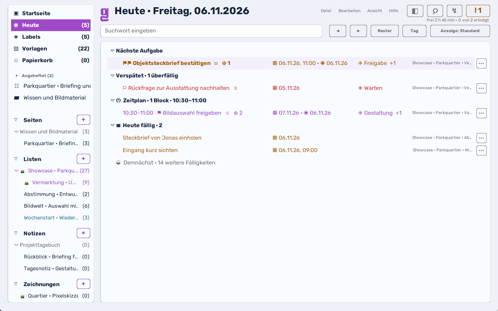
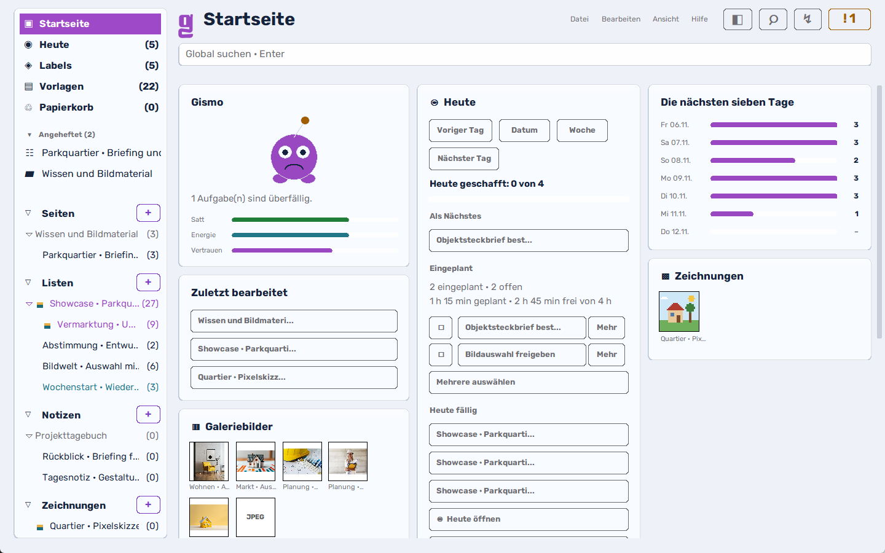
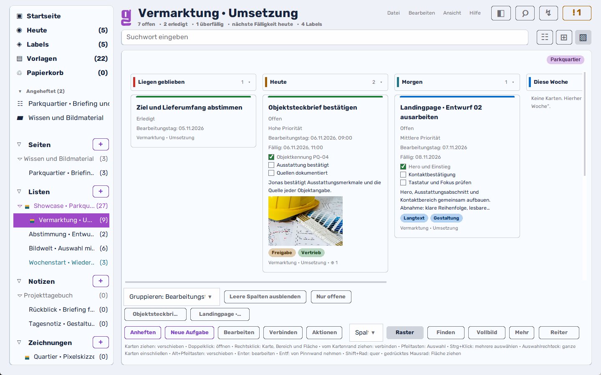
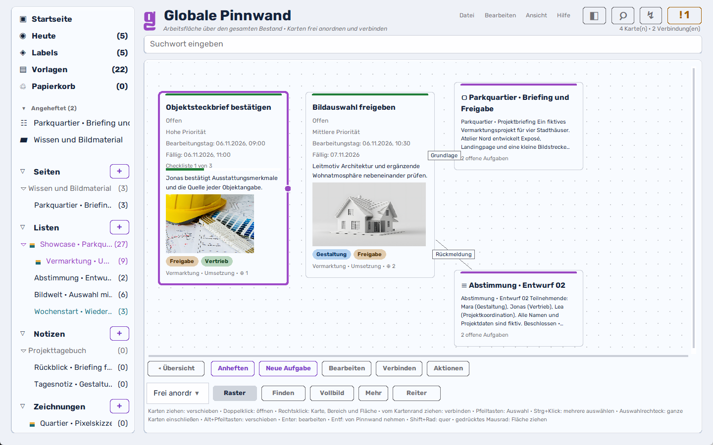
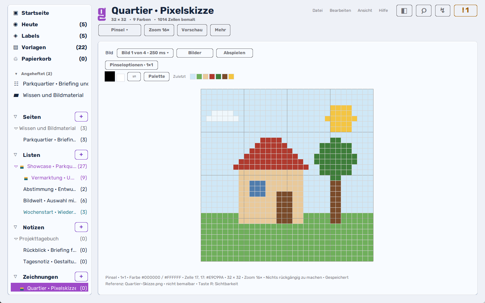
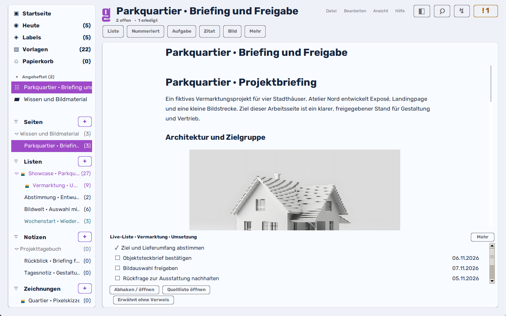
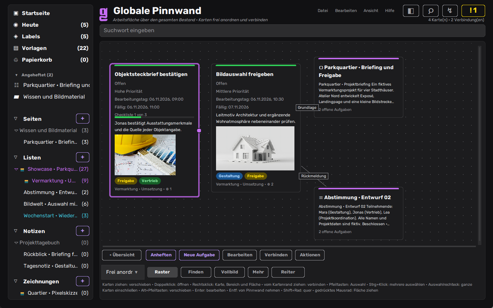

  

<h1 align="center">Glide</h1>

  <strong>Aufgaben planen. Ideen verbinden. Selbst gestalten.</strong> 
  Desktop-Planer für Projekte, Aufgaben, Tagesplanung, Pinnwände und Pixel-Zeichnungen. Verbinde deine Aufgaben mit Seiten und Notizen, plane deinen Tag und gestalte deine Ideen.

  
  
  

  <a href="#loslegen"><strong>Herunterladen</strong></a> ·
  <a href="#was-glide-kann">Was Glide kann</a> ·
  <a href="#ein-blick-hinein">Bilder</a> ·
  <a href="05_Probelisten_Testdaten/Showcase/README.md">Showcase</a> ·
  <a href="01_Repository/Glide/docs/20_FUNKTIONEN.md">Handbuch</a> ·
  <a href="01_Repository/Glide/CHANGELOG.md">Änderungen</a> ·
  <a href="#in-english">English</a>

<picture>
  <source media="(prefers-color-scheme: dark)" srcset="01_Repository/Glide/assets/marketing/glide-3.50.5-heute-dunkel.png">
  
</picture>

Windows-Aufnahmen mit dem künstlichen <a href="05_Probelisten_Testdaten/Showcase/README.md">Showcase</a> vom 06.11.2026; <a href="01_Repository/Glide/docs/07_QA_BERICHT.md">Quellstand und Prüfgrenzen</a>. Hell oder dunkel folgt deiner GitHub-Darstellung.

## Warum Glide?

- **Aufgaben im Zusammenhang bearbeiten.** Eine Aufgabe auf einer Seite, in Heute und auf der Pinnwand bearbeiten: Änderungen gelten überall für dasselbe Original.
- **Den Tag passend planen.** Bearbeitungstag, Fälligkeit, Aufwand und verfügbare Zeit getrennt sehen. „Tag entlasten“ zeigt die vorgeschlagene Änderung vor dem Übernehmen.
- **Ideen mit der Arbeit verbinden.** Seiten, Notizen und Pinnwandkarten geben Aufgaben ihren Zusammenhang. Pixel-Zeichnungen werden eigene Symbole und Bilder für deine Inhalte.
- **Die eigene Arbeit aufbewahren.** Inhalte werden in deinem gewählten Datenordner gespeichert. Automatische Sicherungen, Rückgängig und lesbare Exporte unterstützen die Weiterarbeit.
- **Vorschläge selbst auswählen.** Der Dateiaustausch mit einem von dir gewählten KI-Werkzeug bietet Kontextvorschau und einen Vergleich, bevor du Änderungen übernimmst.

## Ein Blick hinein

<table>
  <tr>
    <td width="50%"> <strong>Startseite</strong> · Tag, Woche, zuletzt Bearbeitetes und Suche auf einen Blick</td>
    <td width="50%"> <strong>Spaltenboard</strong> · Ziehen ändert den Bearbeitungstag, Checklisten und Bilder bleiben an der Karte</td>
  </tr>
  <tr>
    <td width="50%"> <strong>Pinnwand</strong> · Seiten, Notizen und echte Aufgaben auf einer Fläche verbinden</td>
    <td width="50%"> <strong>Pixel-Werkstatt</strong> · Symbole, Skizzen und Bildfolgen für die eigene Arbeit</td>
  </tr>
  <tr>
    <td width="50%"> <strong>Seiten</strong> · Blöcke, Bilder, Live-Listen und echte Aufgaben im Text</td>
    <td width="50%"> <strong>Zehn Designs</strong> · hell, dunkel, Glas, Minimal, Kontrast und mehr</td>
  </tr>
</table>

## Was Glide kann

### Den Tag planen und Aufgaben erledigen

- **Schnell erfassen:** Aufgaben in Alltagssprache eingeben, erkannte Termine und Eigenschaften vor dem Anlegen als Feldchips prüfen; die Schnellerfassung öffnet sich in jeder Glide-Ansicht über das Menü oder per Strg+Alt+N (macOS auch Cmd+Alt+N). Mehrere eingefügte Zeilen werden auf Wunsch zu einzelnen Aufgaben.
- **Aufgaben strukturieren:** Listen, Ordner, Gruppen, Zwischenüberschriften, Unteraufgaben und Checklisten; Wichtigkeit, Labels, eigene Farben, Fälligkeit und Bearbeitungstag getrennt verwalten, Aufwand schätzen und Zeit erfassen. Beziehungen und Abhängigkeiten zeigen, welche Aufgabe eine andere blockiert.
- **Eigene Rhythmen:** täglich, wöchentlich, mehrere Wochentage, Monatsende, n-ter oder letzter Wochentag sowie Monats- und Jahresintervalle; Wiederholung ab Erledigung, Pause, begrenzte Anzahl, Vorschau und Termin überspringen.
- **Heute und Demnächst:** Tagesvorschlag, nächste Aufgabe, Routinen, Tagesziel, Fortschritt, Stundenraster, Wochen- und Monatsplanung sowie Kapazität je Wochentag. Tagesbeginn, Tagesabschluss und Wochenrückblick helfen beim Einordnen; „Tag entlasten“ verschiebt ausgewählte Aufgaben mit Vorher-/Nachher-Bilanz, ohne Fälligkeiten zu ändern, und Tageshinweise erinnern auf Wunsch an Beginn und Abschluss.
- **Fokus halten:** Fokusintervalle mit 15, 25 oder 50 Minuten und eigenem Aufwand; pausieren, fortsetzen, um fünf Minuten verlängern, zur nächsten Aufgabe wechseln und erfasste Zeit buchen.
- **Belegte Zeiten berücksichtigen:** Eine bewusst gewählte lokale Kalenderdatei zeigt Termine einschließlich Serien, Ausnahmen und Zeitzonen in der Planung; Überschneidungen werden sichtbar, ohne Termine automatisch zu verschieben.
- **Mehrere Aufgaben bearbeiten:** Auswahl planen, verschieben, einordnen, mit Labels versehen, Fälligkeit und Aufwand ändern; zusammenhängende Aktionen wieder rückgängig machen.
- **Erinnerungen:** Hinweise in Glide, auf Wunsch Systemmitteilungen und Hervorhebung von Taskleiste bzw. Dock. Die App muss dafür laufen; [Zustellverhalten](01_Repository/Glide/docs/decisions/SYSTEMBENACHRICHTIGUNGEN.md).

### Aufgaben aus der passenden Perspektive sehen

- **Liste, Tabelle, Pinnwand und Spaltenboard** arbeiten mit denselben Inhalten, dazu ein Wochen- und Monatskalender. Gruppieren, sortieren, Spalten anpassen und Wichtigkeit mit der Eisenhower-Darstellung einordnen; bis zu zwölf Aufgaben lassen sich als Reiter offen halten.
- **Eigene Ansichten speichern:** Filter mit Alle-/Oder-Bedingungen, Gruppierung, Sortierung, Darstellung und Spaltenbreiten. Glide erklärt, warum eine Aufgabe im Filter erscheint.
- **Startseite einrichten:** Begrüßung, Uhr, Tagesübersicht, nächste sieben Tage, zuletzt bearbeitete Inhalte, angeheftete Einträge, Zeichnungen, Galeriebilder und Pinnwand; ein Suchfeld übergibt mit Enter an die globale Suche. Kacheln nach Bedarf zusammenstellen, Mondphase und Bestandsstatistik einblenden sowie den lokalen Begleiter Gismo nutzen.
- **Nebenansicht und Kompaktmodus:** Inhalte parallel nachschlagen oder mit einer kleinen Arbeitsansicht fokussieren. Suchtreffer, Abschnitte, Zurück/Vorwärts, Sitzungsverlauf und letzte Suchen erleichtern die Navigation.

### Gedanken, Wissen und Erinnerungen festhalten

- **Seiten mit Blöcken:** Überschriften, Listen, nummerierte Listen, Zitate, Code, Tabellen, Hinweise, Trennlinien und aufklappbare Bereiche; Formatierung, Links, Bilder, Titelbilder und Pixelsymbole. Blöcke am Sechspunktgriff ziehen; Rechtsklick öffnet die Blockaktionen.
- **Aufgaben direkt auf Seiten:** echte Aufgaben und Verknüpfungen statt isolierter Kästchen; Live-Listen zeigen den aktuellen Inhalt ihrer Quelle.
- **Notizen, Notizbücher und Bücher:** kurze Gedanken und längere Texte sammeln, gliedern und durchsuchen. Notizbücher führen datierte Einträge wie ein Tagebuch, mit Zeitraumfilter sowie Stimmung und Ort im Mehr-Menü; Galerien sammeln Bilder mit Großansicht.
- **Wissen vernetzen:** lokale Verweise auf Seiten, Listen und Aufgaben, Rückverweise, unverknüpfte Erwähnungen und vollständige Fundortübersicht („Fundorte anzeigen …“) über alle Verwendungsarten samt Sprung in Haupt- oder Nebenansicht. Markierten Text direkt in der Nebenansicht nachschlagen.
- **Finden und Befehle:** Inhalte und Aktionen über die Suche und die Befehlspalette erreichen, Fundstellen markieren und zu Abschnitten springen; Vorlagen lassen sich nach Titel, Beschreibung und Inhalt filtern.

### Ideen sichtbar machen

- **Pinnwände:** Karten frei anordnen, Bereiche und Verbindungen anlegen, zoomen, präsentieren und als offenes JSON Canvas 1.0 (`.canvas`) mit Verlustbericht ausgeben. Aufgaben, Seiten und Notizen lassen sich miteinander verbinden; Karten zeigen ihre Originalinhalte.
- **Pixel-Werkstatt:** Zeichnungen mit 16 bis 128 Zellen, Formen, Symmetrie, Muster, Farbpaletten und Umfärben; Referenzbild zum Nachzeichnen und benannte Zwischenstände. Export als PNG, ICO mit Symbolvorschau, SVG oder JSON. Bildfolgen erstellen, abspielen und als Einzelbilder bzw. Sprite-Sheet ausgeben.
- **Persönliche Oberfläche:** zehn Designs, automatische Hell-/Dunkelumschaltung, Akzentfarben, Hintergrundverläufe und getrennte Hintergrundfarben. „Wie die Fensterfläche“ verbindet den Hintergrund mit den Arbeitsflächen und deaktiviert deren Materialschatten.
- **Dein Arbeitsstil:** Schriftstil (Modern: Rubik, Technisch: DM Mono, Kreativ: DM Serif Display, Klassisch: Charis SIL) und Größe wählen, Seitenleiste vollständig, schmal oder ausgeblendet nutzen, Bereiche einblenden, Lesebreite ändern und zusätzliche Bedienhinweise oder Animationen abschalten.
- **Tastatur und gute Lesbarkeit:** Tastenkürzel für Navigation, Seitenleiste, Pinnwand und Zeitraster, eine Übersicht aller Kürzel und ein eingebautes Handbuch (F1); berechneter Textkontrast in allen Designs und zwei Kontrastdesigns.

### Inhalte mitnehmen und sicher aufbewahren

- **Anhänge und Zwischenablage:** Dateien über die Dateiauswahl oder per Ziehen hinzufügen, Bilder in der lokalen Vorschau ansehen und Inhalte aus der Zwischenablage übernehmen; eigene Daten und Anhänge bleiben unter deiner Kontrolle.
- **Importieren und ausgeben:** TXT, CSV mit Spaltenzuordnung, Markdown, Kalenderdateien (ICS), Notion-Archive mit Quellenvergleich und Glide-Seiten; Ausgabe auch als CSV, als vollständiger Markdown-Ordner und für Pinnwände als JSON Canvas 1.0 (`.canvas`). Druck und PDF über eine lokale Druckansicht.
- **Vorlagen:** mitgelieferte und eigene Vorlagen, Vorschau vor dem Übernehmen, Aufgaben- und Ordnerstrukturen sowie passende Datumsverschiebung.
- **KI-Austausch über Dateien:** fünf vorbereitete sowie eigene Textaufträge, vollständige Vorschau des Kontextpakets und geprüfte Änderungsvorschläge. Die Weitergabe erfolgt bewusst durch dich; Glide verbindet sich dabei mit keinem KI-Dienst.
- **Sichern und wiederherstellen:** atomare Speicherung, automatische Sicherungen bei Änderungen, Tagesstände, Voll-, Teil- und App-Backups. Sicherungen durchsuchen, Inhalte prüfen, vergleichen und einzelne Seiten wiederherstellen.
- **Kontrolle behalten:** Papierkorb, Archiv, Rückgängig und Wiederholen, Änderungsverlauf, Speicherstatus, Schutz vor gleichzeitigem Schreiben zweier lokaler Instanzen und ein einsehbares Fehlerprotokoll. Nutzerdaten liegen außerhalb des Programmordners.

Die [Funktionsübersicht](01_Repository/Glide/docs/20_FUNKTIONEN.md) beschreibt Bedienung und Grenzen. Diese Featureliste wird bei jeder Funktionsänderung mit dem Handbuch und den Neuerungen abgeglichen.

## Für deine Arbeit am Rechner

Glide richtet sich an Menschen, die eigene Projekte und ihren Tag zusammen mit Notizen und visuellem Material organisieren. Du kannst Aufgaben erfassen, auf Seiten weiterdenken und Ideen auf Pinnwänden anordnen. Die Pixel-Werkstatt ergänzt diese Arbeit mit eigenen Zeichnungen und Symbolen.

Der Schwerpunkt liegt auf persönlicher Desktop-Arbeit. Voraussetzungen und Grenzen, etwa Erinnerungen bei laufender App und die Nutzung eines Datenordners auf mehreren Geräten, stehen im [Handbuch](01_Repository/Glide/docs/20_FUNKTIONEN.md).

## Loslegen

Die Python-Fassung ist für **Windows, macOS und Linux** vorgesehen. Der konkrete Prüf- und Paketstand ist je Plattform getrennt dokumentiert.

| Startweg | Verfügbarkeit | Nächster Schritt |
|---|---|---|
| **Python-Fassung** | Im Repository enthalten, Python 3.14 mit Tk erforderlich | `python3 07_Python-Versionen/Schnellstart.pyw` ausführen |
| **Windows x64** | Native Entwicklungsbauten; Zuordnung zum aktuellen Quellstand im Liefernachweis | [Prüfläufe und Artefakte](https://github.com/n05a-design/glide-to-do/actions/workflows/python-app.yml) und [Liefernachweis](01_Repository/Glide/docs/07_QA_BERICHT.md) prüfen |
| **macOS Apple Silicon** | Nativer Entwicklungsbau und isolierter Start belegt; aktuelle Paket-/Prüfzuordnung im Liefernachweis | [Mac-Paketworkflow](https://github.com/n05a-design/glide-to-do/actions/workflows/macos-paket.yml) und Liefernachweis prüfen |
| **Linux** | Python-Startweg; eigenständige Pakete separat nachzuweisen | Repository mit Python und Tk starten |

Der aktuelle Quell- und Python-Lieferstand ist Glide 3.55.1 mit Datenformat 26 und Glide-System V1.17.2. Die Tagesplanung zeigt geplanten Aufgabenaufwand, belegte Kalenderzeit, verbleibende Kapazität, fehlende Schätzungen und Gründe für Überlastung. Prüfergebnisse, verfügbare Entwicklungsbauten und offene Abnahmen stehen mit ihrem jeweiligen Commit im [QA-Bericht](01_Repository/Glide/docs/07_QA_BERICHT.md). Actions-Artefakte erfordern eine GitHub-Anmeldung. Der öffentliche Downloadkanal unter [Releases](https://github.com/n05a-design/glide-to-do/releases) setzt die Inhaberfreigabe voraus.

Unter Windows startet die Python-Fassung mit `python 07_Python-Versionen\Schnellstart.pyw`. Erst einmal ausprobieren? Der [Showcase](05_Probelisten_Testdaten/Showcase/README.md) öffnet ein fiktives Projekt mit Briefing, Aufgaben, Pinnwänden, Bildfolge und Wiedervorlagen in einem eigenen Datenordner – deine echten Daten bleiben unberührt. Weitere [Startwege und Voraussetzungen](01_Repository/Glide/README.md#schnellstart-aus-dem-quellstand).

## Deine Daten

- Alles liegt in einem Datenordner außerhalb des Programmordners; Datei › „Wo liegen meine Daten?“ zeigt ihn, und du kannst ihn wechseln.
- Glide speichert atomar, legt bei Änderungen automatische Sicherungen und Tagesstände an und schützt den Bestand vor zwei gleichzeitig schreibenden Glide-Fenstern.
- Der gewählte Datenordner enthält deine gespeicherten Inhalte und Anhänge. Links kannst du gezielt im Browser öffnen; eine selbst gewählte Cloudablage verwaltet deren Anbieter.
- Ausstieg jederzeit: Der ganze Bestand lässt sich als lesbarer Markdown-Ordner und jede Pinnwand als JSON Canvas 1.0 (`.canvas`) ausgeben; Teil- und App-Sicherungen stellen Glide-Bestände wieder her.

<strong>Häufige Fragen</strong>

**Gibt es Glide für Handy oder Tablet?** Nein. Glide ist eine Desktop-App für Windows, macOS und Linux; der Kompaktmodus hält ein kleines Fenster neben der Arbeit offen.

**Kann ich Glide auf zwei Rechnern nutzen?** Der Datenordner darf in einem Cloudordner deiner Wahl liegen. Glide verhindert erkannte gleichzeitige Nutzung, führt aber keine Änderungen von zwei Geräten zusammen.

**Wie bekomme ich meine Notion-Inhalte hinein?** Datei › Importieren › Notion-Export (ZIP). Glide zeigt vorher, was übernommen wird und was verloren ginge, und hält das Originalarchiv als Anhang fest.

**Welche Bedienhilfen gibt es?** Glide bietet Tastaturwege, eine Befehlspalette, anpassbare Schriftgrößen und Kontrastdesigns. Eine vollständige native Tastatur- und Screenreader-Abnahme ist noch offen beziehungsweise zurückgestellt; der [QA-Bericht](01_Repository/Glide/docs/07_QA_BERICHT.md) nennt die geprüften Umfänge.

**Unter welcher Lizenz kann ich Glide nutzen?** Der Projektcode steht unter MPL-2.0, einschließlich kommerzieller Nutzung nach deren Bedingungen. Entscheidungen über spätere Vertriebs- und Serviceangebote stehen noch aus; siehe [Lizenz](#lizenz).

## Rückmeldung

Fehler und Wünsche nimmt der [Issue-Bereich](https://github.com/n05a-design/glide-to-do/issues/new/choose) mit kurzen Formularen entgegen. Bitte nur künstliche Beispieldaten anhängen, keine echten Inhalte. Sicherheitslücken meldest du vertraulich nach der [Sicherheitsrichtlinie](SECURITY.md).

## Entwicklung und Qualität

Stand 12.11.2026 · Glide 3.55.1

<!-- Am 02.11.2026 für Erstbesucher gekürzt und zusammengeführt, am 06.11.2026 als Projektseite nach dem Vorbild erfolgreicher Repositorys neu gegliedert. Technische Stände stehen im QA-Bericht. -->

Quellstand, automatisierte Prüfungen und native Pakete sind im [QA-Bericht](01_Repository/Glide/docs/07_QA_BERICHT.md) getrennt nachvollziehbar. Die abschließende menschliche Prüfung erfolgt durch den Inhaber. Eine Screenreader-Abnahme ist bis zu einem konkreten Bedarf zurückgestellt.

- [Quellcode und Entwicklung](01_Repository/Glide/README.md) · [Entwicklungsplan](00_Arbeitsvorbereitung/Glide_Entwicklungsplan.md) · [Übergabe](00_Arbeitsvorbereitung/Glide_Uebergabe.md) · [Markt und Vorbilder](00_Arbeitsvorbereitung/Glide_Markt_und_Vorbilder.md)
- [Technischer Quellstand](01_Repository/Glide/VERSION)
- [Architektur](01_Repository/Glide/docs/02_ARCHITECTURE.md) · [Daten und Backups](01_Repository/Glide/docs/06_DATA_BACKUP_MIGRATION.md) · [Design Richtlinien](01_Repository/Glide/docs/DESIGN_RICHTLINIEN.md)
- [Glide-System und wiederverwendbare Bestandteile](01_Repository/Glide/src/glide/README.md) · [Übernahmegrundlage für Steps und weitere Projekte](01_Repository/Glide/src/glide/README.md#9-grundlage-für-steps-und-weitere-projekte)
- [Sicherheitsrichtlinie](SECURITY.md) · [Technische Sicherheitsgrenzen](01_Repository/Glide/SECURITY.md) · [Prüfplan](01_Repository/Glide/docs/05_QA_TESTPLAN.md)

## Lizenz

Glides Projektcode steht unter der **Mozilla Public License 2.0 (`MPL-2.0`)**. Maßgeblich ist der vollständige [Lizenztext](LICENSE), ergänzt durch die [Hinweise zu Geltungsbereich und Weitergabe](01_Repository/Glide/LICENSE.md). Die Lizenz erlaubt auch kommerzielle Nutzung, Änderung und Weitergabe nach ihren Bedingungen. Drittkomponenten, Schriften und fremde Ressourcen behalten ihre jeweiligen Lizenzen. Markenrechte und spätere Vertriebsangebote werden gesondert behandelt.

## In English

**Glide is a desktop planner for projects, tasks, day planning, pinboards and pixel drawings.** Connect tasks with pages and notes, plan your day and create your own visual material. The same task can appear in several views while keeping one original. Your work is saved in your chosen data folder, with automatic backups and readable exports.

The project code is available under [MPL-2.0](LICENSE). Source, Python delivery, native packages and platform acceptance have separate evidence in the [QA report](01_Repository/Glide/docs/07_QA_BERICHT.md). Public release downloads await owner approval.
